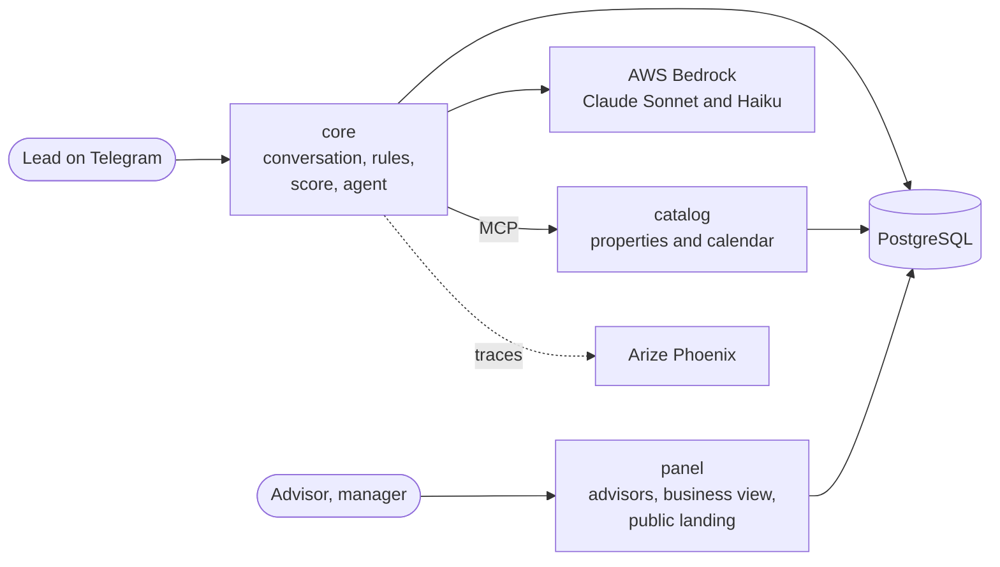
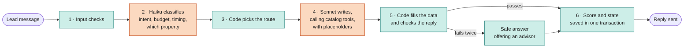

# Real Estate Lead Agent

**Turns Telegram messages into qualified leads and booked visits.**

[](https://github.com/softserve-leads-inmobiliaria/SoftServe-Agente-Lead-Inmobiliaro/actions/workflows/ci.yml)


A Telegram assistant for a real estate agency. It answers people interested in a property using only the
agency's catalog, qualifies them, books a visit and hands them over to a human advisor with a summary. Advisors
work from a web panel that ranks their leads and shows each conversation.

> **The AI understands and writes. Code supplies the facts and decides.**

Built by Team #2 of the SoftServe Project Lab: Santiago Martínez, David Barreto, Miguelangel Vélez.

| 99.6% | 0 | ~8¢ | 6.3 s | 54 / 54 |
| :---: | :---: | :---: | :---: | :---: |
| replies that met every check (285 replies, real model) | invented facts in 37 turns the agent had never seen | per full conversation, at Bedrock list prices | median reply time | fair-housing pairs that score identically |

[What it does](#what-it-does) · [How it works](#how-it-works) · [Design decisions](#design-decisions) ·
[Results](#results) · [Quick start](#quick-start) · [Tests](#tests) · [Repository layout](#repository-layout)

## Documentation

This README is self-contained: it covers what the system does, how it works, how to run it and how it was
evaluated. The design, a diagram per component, the architecture decisions and the test guide (in Spanish) are
indexed in [`docs/README.md`](docs/README.md). The team's working notes live in `docs/internal/` and superseded
documents in `docs/archive/`; they may not be part of every copy of this repository.

## A real exchange

From the live evaluation run of 8 October 2026, with Claude Sonnet 4.5 and Haiku 4.5 on AWS Bedrock:

> 🏠 **Agent:** Hi! I see you came from the listing for the 2-bedroom apartment in El Poblado. What would you
> like to know?\
> 🙋 **Lead:** Is it still available?\
> 🏠 **Agent:** Yes, it's available! It's priced at $185,000, with 2 bedrooms, 2 bathrooms and 78.5 m². Would you
> like to visit it?

The price, size and status in that reply were not written by the model. It wrote `{prop_00231.price}` and code
filled it in from the catalog. When the catalog doesn't know something, the agent says so:

> 🙋 **Lead:** Does it come with a parking spot? I have a car\
> 🏠 **Agent:** I don't have that detail in the listing, but an agent can confirm whether it includes parking.
>
> 🙋 **Lead:** I'm Colombian but I live in Miami, is that a problem?\
> 🏠 **Agent:** That doesn't affect how we help you or the requirements to buy or rent: we treat every client
> the same way.

## What it does

✅ seen working with the real model (8 October evaluation, 9 October live demo) · 🧪 built and covered by
automated tests, not yet used live

| Feature | Status |
| :--- | :---: |
| **Conversation on Telegram**, starting from a property listing link or from scratch | ✅ |
| **Answers from the catalog**: price, size, bedrooms, availability, amenities, purchase or rental requirements, promotions | ✅ |
| **Search** by area, operation (sale, rent, pre-sale), property type and budget; when nothing matches, it offers the closest alternatives | ✅ |
| **Coverage**: says which areas it serves, without naming areas it doesn't have | ✅ |
| **Qualification** with a BANT-E score (Budget, Authority, Need, Timing, Eligibility) and a HOT / WARM / COLD band; checks the lead against the property's requirements | ✅ |
| **Visit booking**: offers three slots from the advisor's calendar (Monday to Saturday, 9:00 to 18:00), filtered by the day or time the lead asked for, and books the one they pick | ✅ |
| **Hand-over to an advisor** when the lead asks for a person or after booking a visit | ✅ |
| **Safety checks** on every message (see [How it works](#how-it-works)) | ✅ |
| **Advisor panel**: queue ordered by score (HOT first); an advisor takes a lead from it | ✅ |
| **Advisor notification** by Telegram when a lead qualifies | ✅ |
| **Conversion funnel** dashboard | ✅ |
| Lead profile in the panel with score, transcript, booked visits and in-panel notifications | 🧪 |
| Hand-over summary for the advisor, written by the model and checked for invented data, promises, exact address and protected mentions (discarded if it fails) | 🧪 |
| Hand-over when the lead is clearly frustrated after several unresolved turns | 🧪 |
| Visit reminder the day before; follow-ups after 24 hours of silence | 🧪 |
| Recording a closed deal from the lead profile | 🧪 |
| Business view: properties placed, days on the market, stale inventory, unmet demand, deals attributed to the bot | 🧪 shown with six months of synthetic history |
| Weekly report to the manager by Telegram (optional) | 🧪 |
| Public landing page (`/properties`) with a Telegram link per available property | 🧪 checked on the running stack |

**What it doesn't do:**

- **Only English.** A message in Spanish gets a fixed request to write in English. The check tells Spanish from
  English only; a message in another language reaches the model.
- **Only the demo inventory:** 12 properties in five neighborhoods of Medellín and Bogotá, priced in US dollars.
  There is no screen to add or edit properties, so the "notify me when something like this comes up" alerts are
  stored but never fire in practice.
- **Nothing beyond the catalog.** Parking, pets, fees, floor, nearby places, legal or tax questions: the agent
  says an advisor will confirm, instead of guessing. It doesn't negotiate, hold a property or give opinions.
- **No external calendar.** Visits live in the system's own database.
- **One conversation at a time.** The model quota is 10 calls per minute per model, and a turn makes about 2.4
  calls on average. Two people chatting at once can exhaust it, and leads then get a fallback reply.
- **Not production-ready:** everything runs locally with Docker, the bot uses Telegram long polling, and
  advisors enter the panel through a secret per-advisor link instead of a login.

## How it works



Everything runs on one machine with Docker Compose. The only external dependency is the language model.

| Service | What it does |
| :--- | :--- |
| `core` | Runs each conversation turn: the Telegram bot, the conversation state machine, the safety checks, the score, the LLM agent and the scheduler |
| `catalog` | Serves the property catalog to the agent as six [MCP](https://modelcontextprotocol.io) tools, plus the advisors' calendar over HTTP |
| `panel` | The advisors' web panel, the business view and the public landing page |
| PostgreSQL | The single source of truth: conversations, scores, visits, deals, audit log and scheduled jobs |
| Phoenix | One OpenTelemetry trace per turn: timings, tokens, tools and decisions |

### One message, step by step

Orange steps are the model; teal steps are deterministic code.



1. **Input checks.** Opt-out (`/stop`), personal data that wasn't asked for (ID or card numbers), attempts to
   change the agent's instructions, off-topic requests, protected characteristics (nationality, family,
   religion…) and language. Some of these end the turn with a fixed answer, without calling the model.
2. **Understanding.** A small, fast model (Claude Haiku 4.5) labels the message: what the lead wants, which of
   the properties already shown they mean, whether they want a visit and when, and whether they are frustrated.
3. **Deciding.** Code, not the model, decides what happens next: let the agent answer, offer visit slots, hand
   over to an advisor, or give a fixed answer.
4. **Writing.** A larger model (Claude Sonnet 4.5) writes the reply, calling the catalog tools when it needs data.
5. **Output checks.** Before anything is sent, every placeholder must be filled from what the catalog returned,
   no number may appear outside one, and the reply may not promise discounts or holds or reveal the exact
   address. If it fails, it is rewritten once. If it fails again, the lead gets a safe answer that offers an
   advisor.

Three rules shape the design:

- **The model never invents property data.** It writes placeholders such as `{prop_00231.price}`, and code fills
  them in from what the catalog returned.
- **The model never sets the score.** The score is a deterministic function of what the lead said, and protected
  characteristics never reach it (fair housing).
- **A human is always one step away.** The lead can ask for a person at any moment.

The exact address of a property is withheld until the lead is qualified. Each turn records why it answered the
way it did (what the classifier understood, which route it took, which check fired) in the database and in the
traces, without storing message content in the traces.

### The lead score

| Dimension | 0–20 points from | Set by |
| :--- | :--- | :--- |
| **B**udget | whether the lead stated a budget | the classifier detects it |
| **A**uthority | whether the lead said how the decision is made (not with whom) | the classifier detects it |
| **N**eed | how many listings match the search: 0, 1–2 or 3+ | the search tool |
| **T**iming | immediate, within 3 months, exploring, or not stated | the classifier detects it |
| **E**ligibility | whether the lead meets the property's requirements (down payment, income) | the requirements tool |

COLD up to 40 · **WARM 41–70, the advisor is alerted** · HOT 71 and up. A plain Python function adds up the
points; the model never sees or sets the number.

## Design decisions

71 decisions are recorded with their context, alternatives and accepted downsides in
[`docs/DECISIONS/decisions.md`](docs/DECISIONS/decisions.md) (in Spanish). The ones reviewers ask about most:

| Decision | Why |
| :--- | :--- |
| **Own orchestration, no LangGraph or similar** (DT-22) | A framework checkpointer would be a second source of truth next to PostgreSQL, and a node graph would split the single transaction that saves state, score and messages. The tool loop it would replace is short and holds guarantees we want visible |
| **Placeholders instead of checking the model's prose** (DT-60) | A literal check can't catch the *real* price of a *different* property. With placeholders the model can't write a price at all |
| **Catalog through exact MCP tools, not RAG** (DT-66) | The knowledge is structured (price, size, requirements), so exact filters beat similarity search and let every figure be traced to a tool. pgvector is installed; the FAQ with semantic search was moved to future work |
| **Booking over HTTP, not as an MCP tool** (DT-32) | Booking is decided by code. The model never gets a "book" tool |
| **Two models** (DT-6) | Haiku classifies into a closed set of fields; Sonnet writes. With Haiku writing, the agent ignored several prompt rules |
| **No LLM judge, no subagents** (DT-62) | Each is one more call per turn against a 10 calls/min quota. Decisions that were guessed from text became fields of the classifier call that already runs |
| **Self-hosted Phoenix** (DT-9) | The observability had to be local. Traces are standard OpenTelemetry, so Jaeger is one setting away |

## Results

Measured live against AWS Bedrock on 8 October 2026: 5 runs of the 12 demo scenarios, 60 conversations and 285
turns. Two days earlier the baseline was clearly worse; the failures were read, fixed as classes of error, and
everything was run again.

| | Turns that met every expectation | Rewritten once | Fell back to the safe answer | Expected catalog tool used | Median / p95 reply time |
| :--- | ---: | ---: | ---: | ---: | ---: |
| Baseline, 6 Oct (8 scenarios) | 93% | 24% | 4% | 99% | 5.9 s / 11.6 s |
| **Final, 8 Oct (12 scenarios)** | **99.6%** | **6%** | **0.4%** | **100%** | **6.3 s / 9.8 s** |

- **Held-out set:** 6 conversations written after the fixes and never used to tune the agent, run once. Every
  reply was read by hand: no invented data and no unauthorized promises in 37 turns.
- **Fair housing:** 54 pairs of leads identical except for nationality or family get exactly the same score, in
  all five dimensions. It is a deterministic test that runs on every pull request.
- **Cost:** about 2.4 model calls and 6,100 tokens per turn, under 2 US cents; about 8 cents per conversation.
  96% of the tokens are input, so prompt caching is the obvious next saving.
- **Caveats:** the 12 scenarios are the ones the team iterated on, and the held-out set is small and was written
  by the team, so "no invented data" means a low rate, not a guarantee. About 1 reply in 100 falls back to an
  advisor. Known weak spots: it doesn't compare a lead's income against two properties at once, it asks for the
  city instead of searching when none is given, and its answers to questions outside the catalog are correct
  but repetitive.

## Quick start

**You need** Docker (Docker Desktop on Windows or macOS) running. Python 3.12+ is needed only to run the tests
outside Docker.

### 1. Without any credentials

The agent runs with a built-in *fake* model that answers from templates. This is enough to see the panel, the
database and the end-to-end flow.

```
docker compose up --build
```

| What | Where |
| :--- | :--- |
| Advisor panel | http://localhost:8080/login. Advisors `valeria`, `andres`, `camila` (password `asesor-demo`) see their queue; `gerente` (`gerente-demo`) sees business and funnel. Change them in `.env` |
| Public landing page | http://localhost:8080/properties |
| Core API | http://localhost:8000/health. Conversation turns go to `POST /events` |
| Traces (Phoenix) | http://localhost:6006. Timings, tokens, tools and decisions per turn. Message text shows as `__REDACTED__` by design: it is personal data and lives in PostgreSQL (`messages`, shown in the lead profile) |
| PostgreSQL | `127.0.0.1:5432`, credentials in `.env.example` |

The `seed` service loads the demo data: 3 advisors, 12 properties and 3 promotions. Ports can be changed in
`.env` (copy it from `.env.example`). By default every port listens on `127.0.0.1` only.

### 2. With the real model and Telegram

Copy `.env.example` to `.env` and fill in:

| Variable | Value |
| :--- | :--- |
| `LLM_PROVIDER` | `bedrock` |
| `BEDROCK_MODEL_ID_CHAT` | `us.anthropic.claude-sonnet-4-5-20250929-v1:0` |
| `BEDROCK_MODEL_ID_CLASSIFIER` | `us.anthropic.claude-haiku-4-5-20251001-v1:0` |
| `AWS_ACCESS_KEY_ID`, `AWS_SECRET_ACCESS_KEY` | An AWS account with access to those models in `BEDROCK_REGION` (default `us-east-1`) |
| `TELEGRAM_BOT_TOKEN` | A bot created with [@BotFather](https://t.me/BotFather) |

Then start the demo stack:

```
bash scripts/demo/up.sh      # starts the stack, loads demo data and prints the panel and Telegram links
bash scripts/demo/down.sh    # saves the conversations as text, then stops everything and deletes the data
```

`up.sh` prints a link such as `https://t.me/<bot>?start=prop_00231`: opening it starts a conversation as a lead
who came from that property's listing. Only one person should chat at a time (see the quota above).

## Tests

About 2,700 automated tests run in CI on every pull request.

```
python -m venv .venv
source .venv/bin/activate          # Windows (Git Bash): .venv/Scripts/activate
pip install -r requirements-dev.txt
ruff check .
docker compose up -d postgres      # most suites need PostgreSQL
python -m pytest tests/contracts
```

There are seven suites, and each runs with its own command because the services share the package name `app`:
`tests/contracts`, `tests/infra`, `db/tests`, `services/core/tests`, `services/catalog/tests`,
`services/panel/tests` and `tests/harness`.

- **Gold sets:** fixed sets of cases for each safety check (invented data, the exact address, unauthorized
  promises, fair housing in the score, language). They run with the suites, and a pull request that drops one
  below its threshold fails.
- **End-to-end:** `docker compose run --rm --build harness` replays scripted conversations against the
  containers, using the fake model.
- **Live evaluation with the real model:** `python harness/scripts/evaluate.py --reps 5` (about two hours at the
  quota above). See [`harness/README.md`](harness/README.md).

<details>
<summary><strong>Shortcuts with <code>make</code> (optional)</strong></summary>

The root `Makefile` wraps the commands above. It comes with macOS and Linux. On Windows you don't need it: the
`docker compose` commands and the scripts in `scripts/demo/` do the same.

```
make help      # every target, by section
make start     # stack + demo data + URLs
make install   # .venv with the development dependencies
make test      # the seven suites, as CI runs them
```

| Area | Targets |
| :--- | :--- |
| Stack | `up`, `down` / `stop`, `clean` (deletes volumes), `reset`, `rebuild s=core`, `logs s=core`, `ps`, `shell s=core`, `info` |
| Database | `db-up`, `migrate`, `seed`, `seed-history`, `seed-history-clear`, `seed-all`, `db-reset`, `psql`, `migration m="..."` |
| Quality | `lint`, `test`, `test-<suite>` (`contracts infra db core catalog panel harness`), `ci` |
| Demo and harness | `demo`, `demo-down`, `demo-purge`, `harness`, `live-run`, `conversar`, `exportar`, `smoke` |

Extra arguments go in `ARGS`, for example `make test-core ARGS="-k consent"`.

</details>

## Repository layout

| Folder | Contents |
| :--- | :--- |
| `services/core/` | The conversation engine: Telegram bot, state machine, safety checks, score, LLM agent, scheduler |
| `services/catalog/` | Catalog and calendar service (MCP and HTTP over PostgreSQL) |
| `services/panel/` | Advisor panel, business view and public landing page |
| `db/` | Shared Python package: database models, migrations (Alembic), settings, logging, business metrics |
| `contracts/` | JSON schemas between components (message event, conversation state, catalog tools, calendar), with examples |
| `harness/` | End-to-end conversation scripts and the live evaluation with the real model |
| `scripts/` | Demo data, demo start and stop scripts, GitHub setup |
| `config/` | Product settings per service (no secrets) |
| `slides/` | Slides (Slidev) of the 9 October status presentation |
| `tests/` | Contract tests, harness tests and checks of the Docker setup and documentation links |
| `docs/` | Design, architecture decisions, test guide and demo script, in Spanish; team notes in `docs/internal/`, superseded documents in `docs/archive/` |

**Stack:** Python 3.12 · FastAPI · python-telegram-bot · MCP Python SDK · SQLAlchemy and Alembic · PostgreSQL 16
with pgvector · Arize Phoenix · Docker Compose · Claude Sonnet 4.5 and Haiku 4.5 on AWS Bedrock.

Contributing rules are in [`CONTRIBUTING.md`](CONTRIBUTING.md).
