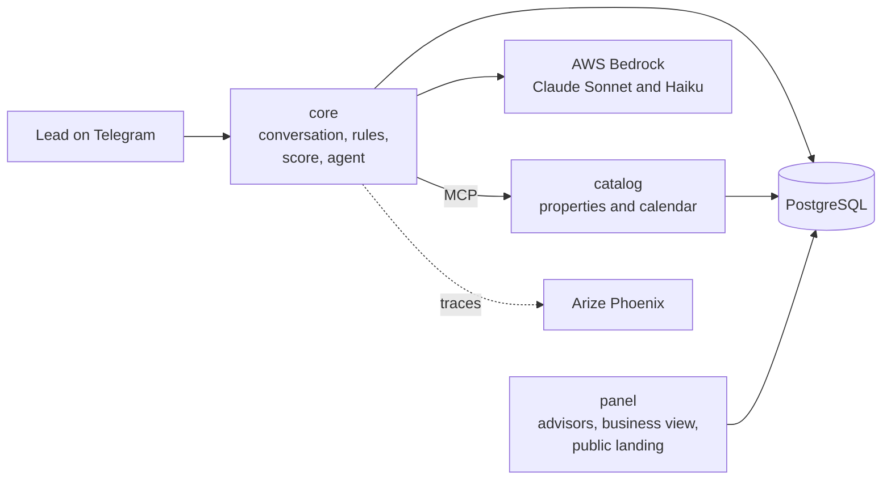

# Real Estate Lead Agent

A Telegram assistant for a real estate agency. It answers people interested in a property using only the
agency's catalog, qualifies them, books a visit and hands them over to a human advisor. Advisors work from a
web panel that ranks their leads and shows each conversation.

Built by Team #2 of the SoftServe Project Lab (Santiago Martínez, David Barreto, Miguelangel Vélez).

## Documentation

This README is self-contained: it covers what the system does, how it works, how to run it and how it was
evaluated. The design, a diagram per component, the architecture decisions and the test guide (in Spanish) are
indexed in [`docs/README.md`](docs/README.md). The team's working notes live in `docs/internal/` and superseded
documents in `docs/archive/`; they may not be part of every copy of this repository.

## What it does

The agent was evaluated live against the real model (see [Results](#results)). The table separates what was
observed working with the real model from what is built and covered only by automated tests.

| Feature | Status |
| :--- | :--- |
| **Conversation on Telegram**, starting from a property listing link or from scratch | Verified live |
| **Answers from the catalog**: price, size, bedrooms, availability, amenities, purchase or rental requirements, promotions | Verified live |
| **Search** by area, operation (sale, rent, pre-sale), property type and budget; when nothing matches, it offers the closest alternatives | Verified live |
| **Coverage**: says which areas it serves, without naming areas it doesn't have | Verified live |
| **Qualification** with a BANT-E score (Budget, Authority, Need, Timing, Eligibility) and a HOT / WARM / COLD band; checks the lead against the property's requirements | Verified live |
| **Visit booking**: offers three slots from the advisor's calendar (Monday to Saturday, 9:00 to 18:00), filtered by the day or time the lead asked for, and books the one they pick | Verified live |
| **Hand-over to an advisor** when the lead asks for a person or after booking a visit | Verified live |
| **Safety checks** on every message (see [How it works](#how-it-works)) | Verified live |
| **Advisor panel**: queue ordered by score (HOT first); an advisor takes a lead from it | Verified live |
| **Advisor notification** by Telegram when a lead qualifies | Verified live |
| **Conversion funnel** dashboard | Verified live |
| Lead profile in the panel with score, transcript, booked visits and in-panel notifications | Automated tests |
| Hand-over summary for the advisor, written by the model and checked like any reply | Automated tests |
| Hand-over when the lead is clearly frustrated after several unresolved turns | Automated tests |
| Visit reminder the day before; follow-ups after 24 hours of silence | Automated tests |
| Recording a closed deal from the lead profile | Automated tests |
| Business view: properties placed, days on the market, stale inventory, unmet demand, deals attributed to the bot | Automated tests, shown with six months of synthetic history |
| Weekly report to the manager by Telegram (optional) | Automated tests |
| Public landing page (`/properties`) with a Telegram link per available property | Automated tests |

**What it doesn't do:**

- **Only English.** A message in another language gets a fixed request to write in English.
- **Only the demo inventory:** 12 properties in five neighborhoods of Medellín and Bogotá, priced in US dollars.
  There is no screen to add or edit properties, so the "notify me when something like this comes up" alerts are
  stored but never fire in practice.
- **Nothing beyond the catalog.** Parking, pets, fees, floor, nearby places, legal or tax questions: the agent
  says an advisor will confirm, instead of guessing. It doesn't negotiate, hold a property or give opinions.
- **No external calendar.** Visits live in the system's own database.
- **One conversation at a time.** The model quota is 10 calls per minute per model, and a turn makes about 2.4
  calls on average (up to 4). Two people chatting at once can exhaust it, and leads then get a fallback reply.
- **Not production-ready:** everything runs locally with Docker, and the bot uses Telegram long polling.

## How it works



Three services run in Docker and share one PostgreSQL database:

| Service | What it does |
| :--- | :--- |
| `core` | Runs each conversation turn: the Telegram bot, the conversation state machine, the safety checks, the score and the LLM agent |
| `catalog` | Serves the property catalog to the agent as [MCP](https://modelcontextprotocol.io) tools, plus the advisors' calendar |
| `panel` | The advisors' web panel, the business view and the public landing page |

Every message from a lead goes through the same steps:

1. **Input checks.** Opt-out (`/stop`), personal data that wasn't asked for (ID or card numbers), attempts to
   change the agent's instructions, off-topic requests, protected characteristics (nationality, family,
   religion…) and language.
2. **Understanding.** A small, fast model (Claude Haiku 4.5) labels the message: what the lead wants, which of
   the properties already shown they mean, whether they want a visit and when, and whether they are frustrated.
3. **Deciding.** Code, not the model, decides what happens next: let the agent answer, offer visit slots, hand
   over to an advisor, or give a fixed answer.
4. **Writing.** A larger model (Claude Sonnet 4.5) writes the reply, calling the catalog tools when it needs data.
5. **Output checks.** Before anything is sent, the reply is checked against what the catalog returned. If it
   fails, it is rewritten once. If it fails again, the lead gets a safe answer that offers an advisor.

Three rules shape the design:

- **The model never invents property data.** It writes placeholders such as `{prop_00231.price}`, and code fills
  them in from what the catalog returned.
- **The model never sets the score.** The score is a deterministic function of what the lead said, and protected
  characteristics never reach it (fair housing).
- **A human is always one step away.** The lead can ask for a person at any moment.

The exact address of a property is withheld until the lead is qualified. Each turn records why it answered the
way it did (what the classifier understood, which route it took, which check fired) in the database and in the
traces, without storing message content in the traces.

## Results

Measured live against AWS Bedrock on 8 October 2026: 5 runs of the 12 demo scenarios, 285 conversation turns.

| Turns that met every expectation | Expected catalog tool used | Rewritten once | Fell back to the safe answer | Ended in the expected state | Response time (median / 95th percentile) |
| ---: | ---: | ---: | ---: | ---: | ---: |
| 99.6% | 100% | 6% | 0.4% | 100% | 6.3 s / 9.8 s |

- **Held-out set:** 6 conversations written before the run and never used to tune the agent, run once. Every
  reply was read by hand: no invented data and no unauthorized promises in 37 turns.
- **Cost:** about 2.4 model calls and 6,100 tokens per turn, under 2 US cents.
- **Caveats:** the 12 scenarios are the ones the team iterated on, and the held-out set is small and was written
  by the team. Known weak spots: it doesn't compare a lead's income against two properties at once, it asks for
  the city instead of searching when none is given, and its answers to questions outside the catalog are correct
  but repetitive.

## Quick start

**You need** Docker (Docker Desktop on Windows or macOS) running. Python 3.12+ is needed only to run the tests
outside Docker.

### 1. Without any credentials

The agent runs with a built-in *fake* model that answers from templates. This is enough to see the panel, the
database and the end-to-end flow.

```
docker compose up --build
```

| What | Where |
| :--- | :--- |
| Advisor panel | http://localhost:8080/panel/&lt;token&gt;. The `seed` service prints each advisor's URL |
| Public landing page | http://localhost:8080/properties |
| Core API | http://localhost:8000/health. Conversation turns go to `POST /events` |
| Traces (Phoenix) | http://localhost:6006 |
| PostgreSQL | `127.0.0.1:5432`, credentials in `.env.example` |

The `seed` service loads the demo data: 3 advisors, 12 properties and 3 promotions. Ports can be changed in
`.env` (copy it from `.env.example`).

### 2. With the real model and Telegram

Copy `.env.example` to `.env` and fill in:

| Variable | Value |
| :--- | :--- |
| `LLM_PROVIDER` | `bedrock` |
| `BEDROCK_MODEL_ID_CHAT` | `us.anthropic.claude-sonnet-4-5-20250929-v1:0` |
| `BEDROCK_MODEL_ID_CLASSIFIER` | `us.anthropic.claude-haiku-4-5-20251001-v1:0` |
| `AWS_ACCESS_KEY_ID`, `AWS_SECRET_ACCESS_KEY` | An AWS account with access to those models in `BEDROCK_REGION` (default `us-east-1`) |
| `TELEGRAM_BOT_TOKEN` | A bot created with [@BotFather](https://t.me/BotFather) |

Then start the demo stack:

```
bash scripts/demo/up.sh      # starts the stack, loads demo data and prints the panel and Telegram links
bash scripts/demo/down.sh    # saves the conversations as text, then stops everything and deletes the data
```

`up.sh` prints a link such as `https://t.me/<bot>?start=prop_00231`: opening it starts a conversation as a lead
who came from that property's listing. Only one person should chat at a time (see the quota above).

## Tests

```
python -m venv .venv
source .venv/bin/activate          # Windows (Git Bash): .venv/Scripts/activate
pip install -r requirements-dev.txt
ruff check .
docker compose up -d postgres      # most suites need PostgreSQL
python -m pytest tests/contracts
```

There are seven suites, and each runs with its own command because the services share the package name `app`:
`tests/contracts`, `tests/infra`, `db/tests`, `services/core/tests`, `services/catalog/tests`,
`services/panel/tests` and `tests/harness`. CI runs all of them on every pull request.

- **Gold sets:** fixed sets of cases for each safety check (invented data, the exact address, unauthorized
  promises, fair housing, language). They run with the suites, and a pull request that drops one below its
  threshold fails.
- **End-to-end:** `docker compose run --rm --build harness` replays scripted conversations against the
  containers, using the fake model.
- **Live evaluation with the real model:** `python harness/scripts/evaluate.py --reps 5` (about two hours at the
  quota above). See [`harness/README.md`](harness/README.md).

## Shortcuts with `make` (optional)

The root `Makefile` wraps the commands above. It comes with macOS and Linux. On Windows you don't need it: the
`docker compose` commands and the scripts in `scripts/demo/` do the same.

```
make help      # every target, by section
make start     # stack + demo data + URLs
make install   # .venv with the development dependencies
make test      # the seven suites, as CI runs them
```

| Area | Targets |
| :--- | :--- |
| Stack | `up`, `down` / `stop`, `clean` (deletes volumes), `reset`, `rebuild s=core`, `logs s=core`, `ps`, `shell s=core`, `info` |
| Database | `db-up`, `migrate`, `seed`, `seed-history`, `seed-history-clear`, `seed-all`, `db-reset`, `psql`, `migration m="..."` |
| Quality | `lint`, `test`, `test-<suite>` (`contracts infra db core catalog panel harness`), `ci` |
| Demo and harness | `demo`, `demo-down`, `demo-purge`, `harness`, `live-run`, `conversar`, `exportar`, `smoke` |

Extra arguments go in `ARGS`, for example `make test-core ARGS="-k consent"`.

## Repository layout

| Folder | Contents |
| :--- | :--- |
| `services/core/` | The conversation engine: Telegram bot, state machine, safety checks, score, LLM agent, scheduler |
| `services/catalog/` | Catalog and calendar service (MCP and HTTP over PostgreSQL) |
| `services/panel/` | Advisor panel, business view and public landing page |
| `db/` | Shared Python package: database models, migrations (Alembic), settings, logging, business metrics |
| `contracts/` | JSON schemas between components (message event, conversation state, catalog tools, calendar), with examples |
| `harness/` | End-to-end conversation scripts and the live evaluation with the real model |
| `scripts/` | Demo data, demo start and stop scripts, GitHub setup |
| `config/` | Product settings per service (no secrets) |
| `tests/` | Contract tests, harness tests and checks of the Docker setup and documentation links |
| `docs/` | Design, architecture decisions, test guide and demo script, in Spanish; team notes in `docs/internal/`, superseded documents in `docs/archive/` |

Contributing rules are in [`CONTRIBUTING.md`](CONTRIBUTING.md).
