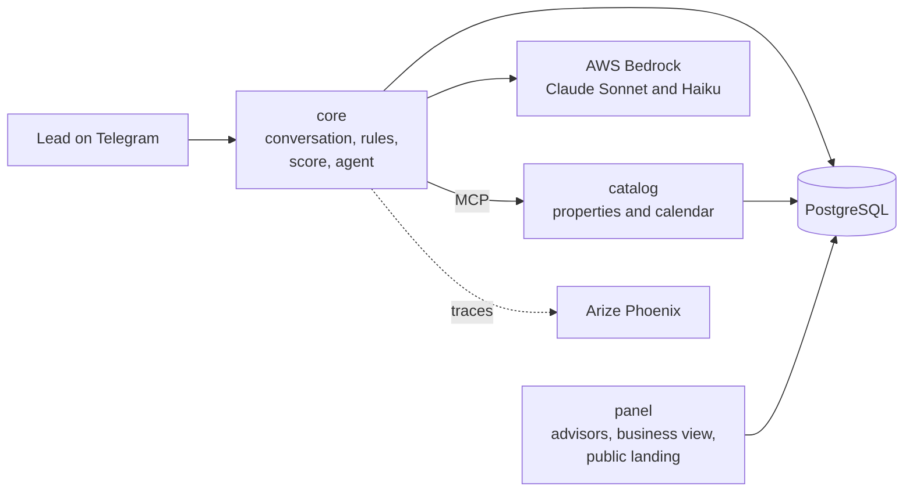

# Real Estate Lead Agent

A Telegram assistant for a real estate agency. It answers people interested in a property using only the
agency's catalog, qualifies them, books a visit and hands them over to a human advisor. Advisors work from a
web panel that ranks their leads and shows a summary of each conversation.

Built by Team #2 of the SoftServe Project Lab (Santiago Martínez, David Barreto, Miguelangel Vélez).

## Documentation

This README is the entry point. The rest of the documentation is in Spanish, under `docs/`, and
[`docs/README.md`](docs/README.md) is its only index.

| If you want to… | Read |
| :--- | :--- |
| See what is actually built (and what isn't) | [`docs/DESIGN/design.md`](docs/DESIGN/design.md), section 5 |
| Run the stack and test it by hand | [`docs/TESTING.md`](docs/TESTING.md) |
| Run the live demo | [`docs/DEMO.md`](docs/DEMO.md) |
| Understand the safety rules (guardrails) | [`docs/DESIGN/guardrails.md`](docs/DESIGN/guardrails.md) |
| Know *why* something was built a certain way | [`docs/DECISIONS/decisions.md`](docs/DECISIONS/decisions.md) (entries `DT-1` to `DT-71`) |
| See the evaluation evidence | [`docs/evidencia/2026-10-08/`](docs/evidencia/2026-10-08/README.md) |
| Contribute | [`CONTRIBUTING.md`](CONTRIBUTING.md) and [`docs/ONBOARDING.md`](docs/ONBOARDING.md) |

## What it does

**For the person looking for a property (the lead), on Telegram:**

- They can start from a property listing (a link that opens the chat about that property) or just ask.
- The agent answers price, size, availability, amenities, requirements and promotions straight from the
  catalog, searches by area, type and budget, and offers alternatives when nothing matches.
- It qualifies the lead with a **BANT-E** score (Budget, Authority, Need, Timing, Eligibility), computed by code.
- It books a visit with the right advisor, in real calendar slots, and sends a reminder the day before.
- It hands the lead over to an advisor when they ask for a person, when they are ready, or when the agent
  can't help.

**For the advisor, on the web panel:**

- A queue of their leads ordered by score (HOT first), with notifications for new qualified leads.
- Each lead's profile: score, conversation transcript, a summary written for the hand-over, and the booked visit.
- Recording a closed deal.

**For the agency manager:**

- A business view: properties placed, days on the market, stale inventory, demand nobody could serve, and
  deals attributed to the bot. A weekly report by Telegram is optional.
- A public landing page (`/properties`) with a Telegram link for each available property.

## How it works



Three services run in Docker and share one PostgreSQL database:

| Service | What it does |
| :--- | :--- |
| `core` | Runs each conversation turn: the Telegram bot, the conversation state machine, the safety checks, the score and the LLM agent |
| `catalog` | Serves the property catalog to the agent as [MCP](https://modelcontextprotocol.io) tools, plus the advisors' calendar |
| `panel` | The advisors' web panel, the business view and the public landing page |

Every message from a lead goes through the same steps:

1. **Input checks.** Opt-out (`/stop`), personal data that wasn't asked for, attempts to change the agent's
   instructions, off-topic questions, protected characteristics (nationality, family, religion…) and language.
2. **Understanding.** A small, fast model (Claude Haiku) labels the message: what the lead wants, which property
   they mean, whether they want a visit and when, and whether they are frustrated.
3. **Deciding.** Code, not the model, decides what happens next: answer with the agent, offer visit slots,
   hand over to an advisor, or give a fixed answer.
4. **Writing.** A larger model (Claude Sonnet) writes the reply, calling the catalog tools when it needs data.
5. **Output checks.** Before anything is sent, the reply is checked against the catalog. If it fails, it is
   rewritten once. If it fails again, the lead gets a safe answer that offers an advisor.

Three rules shape the design:

- **The model never invents property data.** It writes placeholders such as `{prop_00231.price}`, and code fills
  them in from what the catalog returned. Anything the catalog doesn't record (parking, pets, fees…) is left to
  an advisor instead of being answered with a yes or a no.
- **The model never sets the score.** The score is a deterministic function, and protected characteristics
  never reach it (fair housing).
- **A human is always one step away.** The lead can ask for a person at any moment.

## Results

Measured live against AWS Bedrock on 8 October 2026: 5 runs of the 12 demo scenarios, 285 conversation turns.

| Turns that met every expectation | Expected catalog tool used | Rewritten once | Fell back to the safe answer | Ended in the expected state | Response time (median / 95th percentile) |
| ---: | ---: | ---: | ---: | ---: | ---: |
| 99.6% | 100% | 6% | 0.4% | 100% | 6.3 s / 9.8 s |

- **Held-out set:** 6 conversations written beforehand and run once, never used to tune the agent. Every reply
  was read by hand: no invented data and no unauthorized promises in 37 turns.
- **Cost:** about 2.4 model calls and 6,100 tokens per turn, under 2 US cents.

Details, known gaps and the raw reports are in [`docs/evidencia/2026-10-08/`](docs/evidencia/2026-10-08/README.md).

## Quick start

**You need** Docker (Docker Desktop on Windows or macOS) running. Python 3.12+ is needed only to run the tests
outside Docker.

### 1. Without any credentials

The agent runs with a built-in *fake* model that answers from templates. This is enough to see the panel, the
database and the end-to-end flow.

```
docker compose up --build
```

| What | Where |
| :--- | :--- |
| Advisor panel | http://localhost:8080/panel/&lt;token&gt;. The `seed` service prints each advisor's URL |
| Public landing page | http://localhost:8080/properties |
| Core API | http://localhost:8000/health. Conversation turns go to `POST /events` |
| Traces (Phoenix) | http://localhost:6006 |
| PostgreSQL | `127.0.0.1:5432`, credentials in `.env.example` |

The `seed` service loads the demo data: 3 advisors and 12 properties in Medellín and Bogotá, in US dollars.

### 2. With the real model and Telegram

Copy `.env.example` to `.env` and fill in:

| Variable | Value |
| :--- | :--- |
| `LLM_PROVIDER` | `bedrock` |
| `BEDROCK_MODEL_ID_CHAT`, `BEDROCK_MODEL_ID_CLASSIFIER` | Claude Sonnet 4.5 and Claude Haiku 4.5 (the exact IDs are in [`docs/TESTING.md`](docs/TESTING.md)) |
| `AWS_ACCESS_KEY_ID`, `AWS_SECRET_ACCESS_KEY` | An AWS account with access to those models in `BEDROCK_REGION` |
| `TELEGRAM_BOT_TOKEN` | A bot created with [@BotFather](https://t.me/BotFather) |

Then start the demo stack:

```
bash scripts/demo/up.sh      # starts the stack, loads demo data and prints the panel and Telegram links
bash scripts/demo/down.sh    # saves the conversations as text, then stops everything and deletes the data
```

The step-by-step demo script is in [`docs/DEMO.md`](docs/DEMO.md).

> **One person at a time.** The Bedrock quota is 10 calls per minute per model, and a turn makes about 2.4
> calls on average (up to 4). Two people chatting at once can exhaust it, and leads then get a fallback reply.

## Tests

```
python -m venv .venv
source .venv/bin/activate          # Windows (Git Bash): .venv/Scripts/activate
pip install -r requirements-dev.txt
ruff check .
python -m pytest tests/contracts
```

- **Seven test suites**, each run with its own command because the services share the package name `app`.
  Several need PostgreSQL running. The list is in [`docs/TESTING.md`](docs/TESTING.md). CI runs all of them on
  every pull request.
- **Quality checks:** fixed test sets ("gold sets") for every safety check, such as invented data, the exact
  address, unauthorized promises, fair housing and language. They run in CI, and a pull request that drops one
  below its threshold fails.
- **End-to-end:** `docker compose run --rm --build harness` replays scripted conversations against the
  containers, using the fake model.
- **Live evaluation with the real model:** `python harness/scripts/evaluate.py --reps 5`. See
  [`harness/README.md`](harness/README.md).

## Shortcuts with `make` (optional)

The root `Makefile` wraps the commands above. It comes with macOS and Linux. On Windows you don't need it: the
`docker compose` commands and the scripts in `scripts/demo/` do the same.

```
make help      # every target, by section
make start     # stack + demo data + URLs
make install   # .venv with the development dependencies
make test      # the seven suites, as CI runs them
```

| Area | Targets |
| :--- | :--- |
| Stack | `up`, `down` / `stop`, `clean` (deletes volumes), `reset`, `rebuild s=core`, `logs s=core`, `ps`, `shell s=core`, `info` |
| Database | `db-up`, `migrate`, `seed`, `seed-history`, `seed-history-clear`, `seed-all`, `db-reset`, `psql`, `migration m="..."` |
| Quality | `lint`, `test`, `test-<suite>` (`contracts infra db core catalog panel harness`), `ci` |
| Demo and harness | `demo`, `demo-down`, `demo-purge`, `harness`, `live-run`, `conversar`, `exportar`, `smoke` |

Extra arguments go in `ARGS`, for example `make test-core ARGS="-k consent"`.

## Repository layout

| Folder | Contents |
| :--- | :--- |
| `services/core/` | The conversation engine: Telegram bot, state machine, safety checks, score, LLM agent, scheduler |
| `services/catalog/` | Catalog and calendar service (MCP and HTTP over PostgreSQL) |
| `services/panel/` | Advisor panel, business view and public landing page |
| `db/` | Shared Python package: database models, migrations (Alembic), settings, logging, business metrics |
| `contracts/` | Frozen JSON schemas between components (message event, state, catalog tools, calendar), with examples |
| `harness/` | End-to-end conversation scripts and the live evaluation with the real model |
| `scripts/` | Demo data, demo start and stop scripts, GitHub setup |
| `config/` | Product settings per service (no secrets) |
| `tests/` | Contract tests, harness tests and checks of the Docker setup and documentation links |
| `docs/` | All the documentation, in Spanish |

## Known limitations

- **English only.** A message in Spanish gets a fixed request to write in English.
- **Only the demo inventory:** five neighborhoods in Medellín and Bogotá.
- **One conversation at a time**, because of the Bedrock quota.
- **Questions outside the catalog** (parking, pets, fees, nearby places) are passed to an advisor. They are
  never answered with a guess, but repeated questions like these read as repetitive.
- **Not production-ready:** everything runs locally with Docker, and the bot uses Telegram long polling.

The full list, with the evidence for each item, is in [`docs/DESIGN/design.md`](docs/DESIGN/design.md),
section 5.4.
