# Arquitectura por piezas — 9 de octubre de 2026

Material de apoyo para las preguntas de arquitectura de la presentación del
[estado del 9 de octubre](../archive/presentations/2026-10-09-estado-del-proyecto.md). Hay un diagrama por pieza del sistema, con lo
mínimo para explicarla y las preguntas que suelen salir. Todo describe `main` al 9 de octubre (`06668ae`). El
porqué de cada elección está en [`decisions.md`](../DECISIONS/decisions.md), las tablas compartidas en
[`design.md`](design.md) y el detalle de los guardrails en [`guardrails.md`](guardrails.md).

| # | Pieza | Para preguntas sobre… |
| ---: | :--- | :--- |
| 1 | [Mapa general](#1-mapa-general) | Qué servicios hay y cómo se hablan |
| 2 | [Canal de Telegram](#2-canal-de-telegram) | Deep-link, orden de los mensajes, foto y botones |
| 3 | [El turno completo](#3-el-turno-completo) | Qué pasa entre que llega un mensaje y sale la respuesta |
| 4 | [Guardrail de entrada](#4-guardrail-de-entrada) | `/stop`, PII, fair housing, *jailbreak*, idioma |
| 5 | [Clasificador](#5-clasificador) | Qué decide Haiku y por qué no hay más llamadas |
| 6 | [Agente con tools](#6-agente-con-tools) | Cómo usa el catálogo Sonnet y cuándo no se le deja contestar |
| 7 | [Guardrails de salida](#7-guardrails-de-salida) | Factualidad, dirección, promesas, regenerar y degradar |
| 8 | [Marcadores](#8-marcadores-el-código-escribe-los-datos) | "¿Y si inventa un precio?" |
| 9 | [FSM](#9-fsm-el-embudo) | Estados del embudo y cómo se avanza |
| 10 | [Score BANT-E](#10-score-bant-e) | Cómo se califica y fair housing |
| 11 | [Agenda de visitas](#11-agenda-de-visitas) | Cómo se reserva sin que el LLM toque la agenda |
| 12 | [Traspaso a humano](#12-traspaso-a-humano) | Cuándo pasa al asesor y qué recibe |
| 13 | [Catálogo MCP](#13-catálogo-mcp) | Las tools, por qué MCP y la disponibilidad |
| 14 | [Scheduler](#14-scheduler-tareas-diferidas) | Seguimientos, recordatorios, alertas, reporte semanal |
| 15 | [Panel y landing](#15-panel-y-landing) | Qué ve el asesor, el gerente y el público |
| 16 | [Datos](#16-datos) | Tablas y qué guarda cada una |
| 17 | [Llamadas al LLM: cuota y reintentos](#17-llamadas-al-llm-cuota-y-reintentos) | 10 RPM, colas, respaldo |
| 18 | [Observabilidad](#18-observabilidad) | Trazas, auditoría y funnel |
| 19 | [Cómo se prueba](#19-cómo-se-prueba) | Qué corre en CI y qué contra Bedrock |

---

## 1. Mapa general

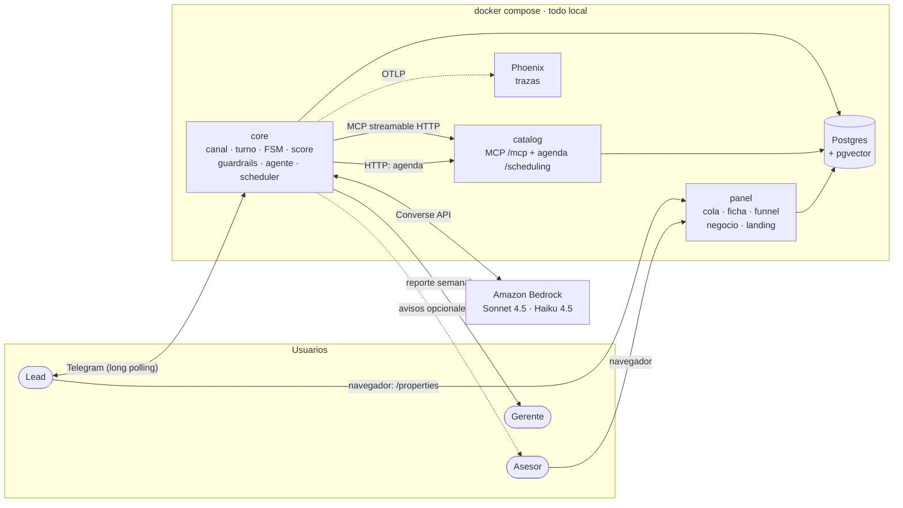

- **Tres servicios propios** en contenedores separados, más Postgres y Phoenix. Todo corre en local con un
  `docker compose` (`bash scripts/demo/up.sh`). La única dependencia externa es Bedrock.
- **`core` es el único que habla con el lead y con el LLM.** `catalog` no sabe nada de conversaciones;
  `panel` solo lee y escribe Postgres.
- **Telegram por *long polling*** (DT-4): no hace falta URL pública ni *webhook*.

**Si preguntan:**

- *¿Por qué no un monolito?* El catálogo se expone como servidor MCP: así el LLM ve las tools con su
  contrato, y el catálogo se prueba solo contra ese contrato (`contracts/mcp/`).
- *¿Y WhatsApp?* El canal traduce a un evento canónico (CT-1) antes del turno. WhatsApp sería otro adaptador,
  sin tocar el agente (DT-20).

## 2. Canal de Telegram

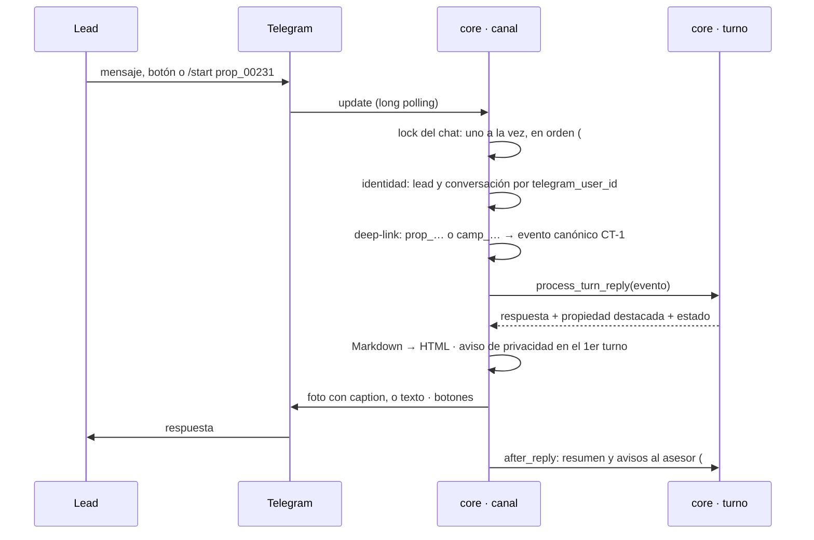

- **Un lock por chat** (#227): si el lead manda tres mensajes seguidos, se atienden de a uno y en orden.
- **El deep-link** `?start=prop_00231` llega como dato del evento: el agente ya sabe de qué propiedad habla
  (B-3). `camp_…` guarda la campaña de origen (N-5).
- **La foto** sale cuando el turno trata de una sola propiedad, con el texto como *caption* (B-10).
- **Los botones** ("Talk to an agent", "Schedule a visit") equivalen a escribir su texto fijo: pasan por el
  mismo turno, guardrails y score (B-11).
- **Lo lento va después de responder** (#231): el resumen del traspaso y los avisos al asesor no hacen
  esperar al lead.
- **Reintentos de envío** (#161): hasta 3, respetando `RetryAfter`; no reintenta un `TimedOut` para no
  duplicar.

## 3. El turno completo

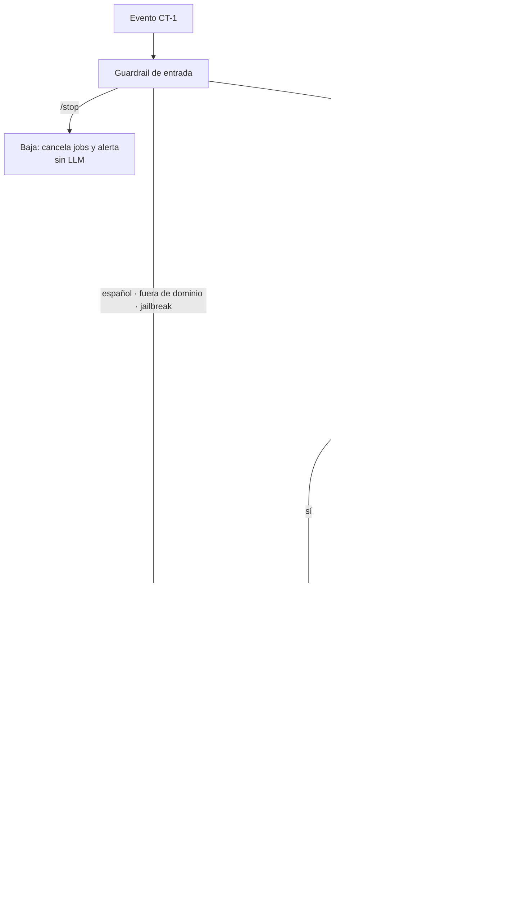

- **Todo el estado del turno se guarda en una sola transacción** (`turn.advance`, DT-14): la FSM, el
  score, los mensajes, la auditoría, el interés por propiedad, la visita y los *jobs*. Nunca queda el
  historial desfasado del estado.
- **El estado se bloquea por conversación** (`StateStore.lock`), además del lock del canal.
- **Los textos fijos no gastan LLM** y no suman a la racha de frustración.
- **Cada turno deja su decisión** en `audit_log` (`turn.decision`): intención, flags, propiedad y ruta
  (`agent`, `agenda`, `protected`, `handoff`, `degraded`, `llm_error`…).

## 4. Guardrail de entrada

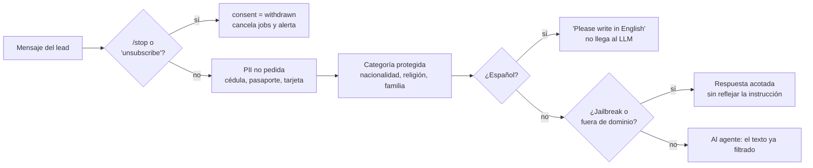

- **Determinista, sin LLM** (`input_guard.py`, `language_guard.py`, DT-15, DT-55).
- **La PII** no se guarda y se le recuerda al lead qué datos hacen falta.
- **Fair housing en la entrada:** la mención se quita o se generaliza ("my wife" → "my partner", "my kids"
  → "my family") antes de que la vea el LLM. Así el lead no pierde los puntos de Authority (DT-38, DT-40).
- **"I'm Colombian, does that matter?"**: si el clasificador marca `asks_if_it_matters`, sale una respuesta
  fija: no influye (DT-69).
- **Idioma:** cuenta palabras exclusivas de cada idioma y no cuenta nombres de zonas ("El Poblado") ni
  direcciones ("Calle 10"). La baja, la PII y fair housing se aplican antes, en los dos idiomas.
- **Regla general:** nunca corta la conversación en seco salvo `/stop`.

## 5. Clasificador

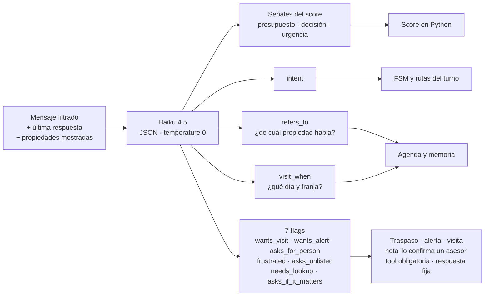

- **Una sola llamada a Haiku por turno, que ya existía** para las señales del score. Desde #247 devuelve
  además lo que antes se adivinaba con expresiones regulares sobre el texto (DT-62).
- **`refers_to` elige entre las propiedades ya mostradas**; si no se sabe cuál, el agente pregunta y no se
  adivina (DT-63).
- **`asks_unlisted`**: parqueo, mascotas, piso… no están en la ficha. Se contesta que lo confirma un asesor,
  nunca con sí o no (DT-66).
- **`needs_lookup`** obliga a Sonnet a llamar una tool antes de escribir (DT-68).
- **`frustrated`**: la racha de 3 turnos sin resolver solo traspasa si el último mensaje muestra molestia
  (DT-65).
- **Se mide con un gold set** de mensajes reales (`harness/gold/classifier.jsonl`, hoy 93) contra Haiku
  real: un cambio de prompt se acepta solo si ningún campo baja. No corre en CI porque necesita Bedrock.

**Si preguntan:** *¿por qué no un segundo LLM que juzgue las respuestas?* Con 10 llamadas por minuto, sería
una llamada más por turno. Preferimos que el clasificador devuelva campos y que el código verifique.

## 6. Agente con tools

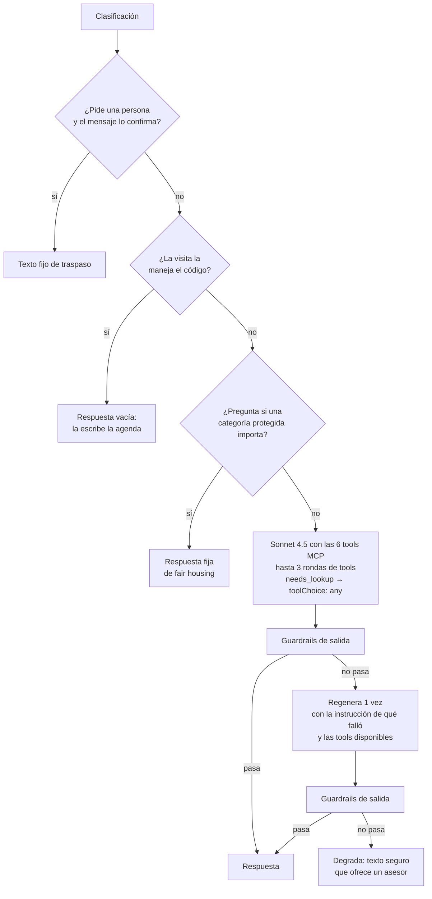

- **El modelo solo escribe cuando hace falta redactar.** El traspaso, la respuesta de fair housing y la
  agenda son textos del código.
- **`lead_qualified` no lo controla el LLM** (`CODE_CONTROLLED_ARGUMENTS`): el código lo agrega a la llamada
  de la tool, y el catálogo solo da la dirección exacta con ese valor.
- **Un traspaso a humano es terminal:** si el clasificador dice "quiere una persona" pero el mensaje no lo
  pide, el turno sigue como uno más (#228).
- **La regeneración reutiliza los resultados de las tools** del primer intento (#232).
- **Una respuesta cortada por `max_tokens`** termina en su última frase completa (#235).

## 7. Guardrails de salida

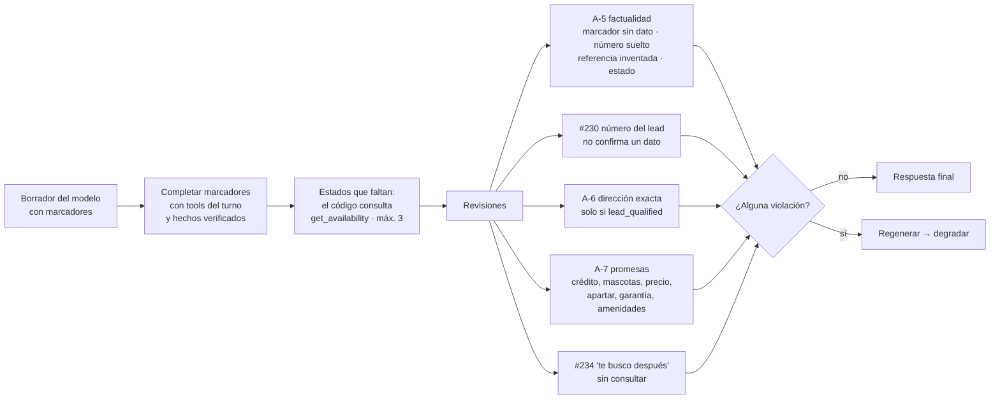

- **Todas comparten el mismo *pipeline* de regenerar y degradar** (DT-23).
- **La dirección y las promesas se revisan sobre el texto ya completado**, tal como lo va a leer el lead.
- **La memoria de hechos** (`facts.py`, DT-59) guarda durante 24 horas los campos citables de cada propiedad
  que una tool dio en la conversación, nunca su estado: el estado siempre es del turno.
- **El resumen para el asesor** pasa por las mismas revisiones y además no puede mencionar categorías
  protegidas. Si falla, la ficha sale sin resumen (DT-46).
- **Medido en vivo (8-oct):** 6% de turnos regenerados y 0,4% degradados en la demo × 5.

## 8. Marcadores: el código escribe los datos

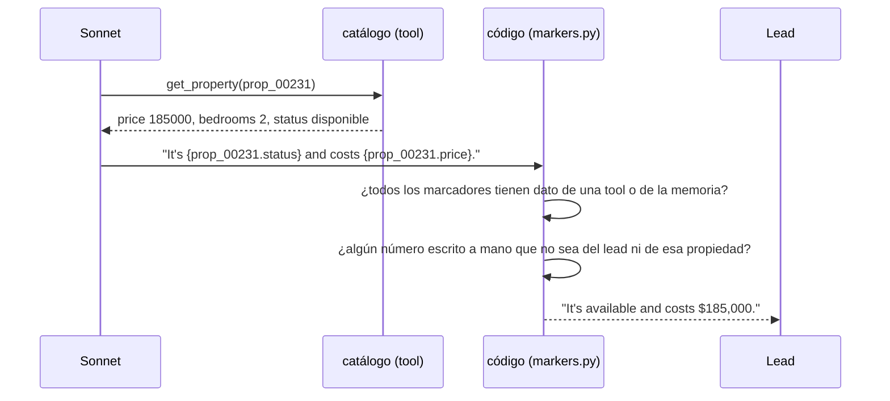

- **El modelo no puede equivocarse en un precio porque no lo escribe** (DT-60): escribe la referencia y el
  campo, y el código pone el valor.
- **Un marcador que no se puede completar** (una propiedad o un campo que ninguna tool dio) bloquea la
  respuesta.
- **Un número escrito a mano** pasa solo si lo dijo el lead, si es la numeración de una lista o si es el dato
  de la propiedad que nombra la línea. Si es dato de dos propiedades, la corrección le pide elegir el
  marcador.
- **Antes de DT-60** la comparación era literal (DT-23): necesitaba una excepción por redacción y no veía el
  precio real de *otra* propiedad.

## 9. FSM: el embudo

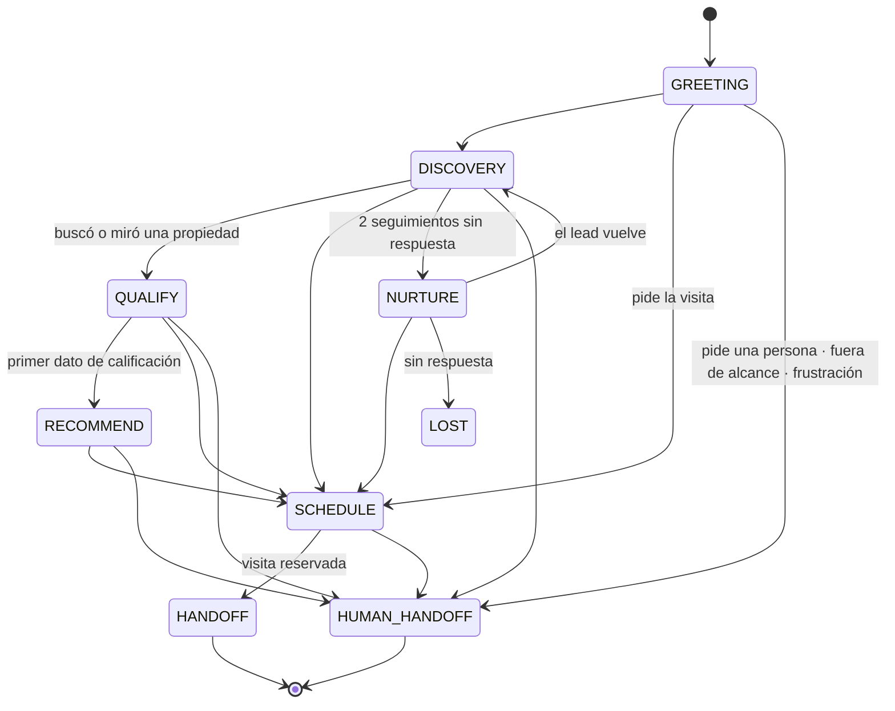

- **9 estados** (`fsm.py`, DT-12). `HUMAN_HANDOFF` se alcanza desde cualquier estado activo.
- **Avanza por lo que pasó, no por etiquetas** (DT-61): buscar o mirar una propiedad cierra `DISCOVERY`; el
  primer dato de calificación (presupuesto, cómo se decide, cuándo o `check_requirements`) cierra `QUALIFY`.
- **`SCHEDULE` desde cualquier estado activo** si hay una propiedad visitable (DT-61, DT-67). Es la
  conversión principal: el lead que llega del anuncio pide la visita sin buscar antes.
- **`NURTURE` y `LOST` los mueve el *scheduler***, no un mensaje (§14).
- **Una suite de tests cubre cada arista** (OBS-3).

## 10. Score BANT-E

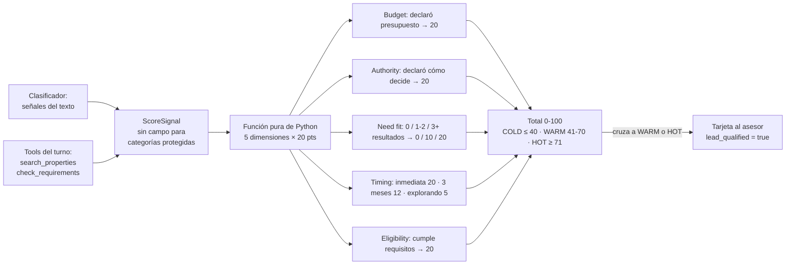

- **El LLM nunca pone la nota:** extrae señales; el número lo calcula `scoring.py`, con su razón por
  dimensión (`reasons`).
- **Need fit y Eligibility salen de las tools, no del LLM**: cuántas propiedades encontró la búsqueda y si
  `check_requirements` dio que cumple.
- **Fair housing es estructural:** `ScoreSignal` no tiene dónde guardar nacionalidad, religión o familia.
  `decision_maker` dice *si* el lead declaró cómo decide, no *con quién* (DT-38, DT-40).
- **Gold set de perfiles pareados** (C-6): 54 pares iguales salvo el dato protegido, diferencia 0 en todos.
  Corre en CI.
- **Calificar** (WARM o HOT) libera la dirección exacta y manda la tarjeta al asesor.

## 11. Agenda de visitas

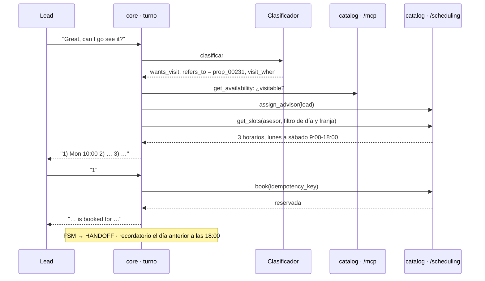

- **La agenda la maneja el código, no el LLM** (DT-32, DT-39): las rutas de `/scheduling` no son tools MCP,
  así que el modelo no puede reservar ni inventar horarios.
- **`book` es idempotente** y la base impide dos visitas del mismo asesor a la misma hora.
- **Una propiedad apartada o cerrada no se agenda**: se lo dice y ofrece alternativas (DT-67).
- **Si la agenda no responde**, el lead deja su horario preferido y el asesor lo ve en la ficha.

## 12. Traspaso a humano

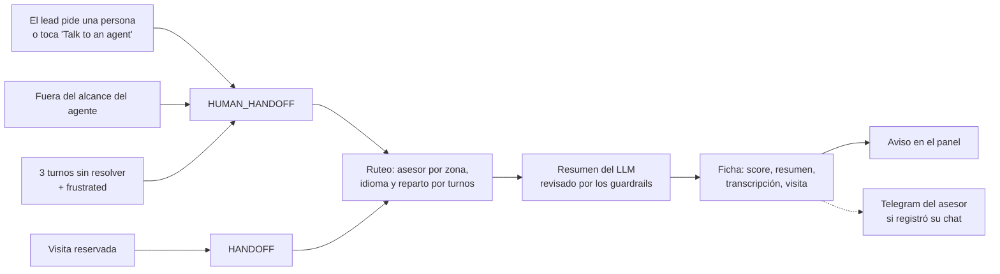

- **El humano siempre está a un mensaje o a un botón**, desde cualquier estado.
- **El asesor no lee el chat entero:** lee el resumen (qué busca, objeciones, siguiente paso) y la nota
  (A-16, DT-46).
- **El ruteo lo decide la agenda** (`assign_advisor`, DT-33); si no responde, una regla local por zona.
- **Los avisos son de mejor esfuerzo:** si Telegram falla, el lead igual aparece en la cola del panel.

## 13. Catálogo MCP

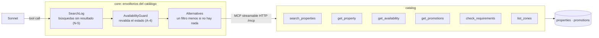

- **6 tools con contrato** (`contracts/mcp/`, CT-2): el servidor publica el mismo `inputSchema` contra el que
  valida (#182).
- **Streamable HTTP, no `stdio`** (DT-2): `core` y `catalog` son contenedores separados.
- **La disponibilidad se revalida** después de cada búsqueda o ficha (A-4): nunca se ofrece algo apartado o
  cerrado como disponible.
- **Una búsqueda vacía trae alternativas** con un filtro menos, que busca el código (DT-57).
- **`list_zones`** contesta la cobertura sin inventar barrios (DT-58).
- **`address_exact`** la redacta el catálogo si `lead_qualified` es falso.

## 14. Scheduler: tareas diferidas

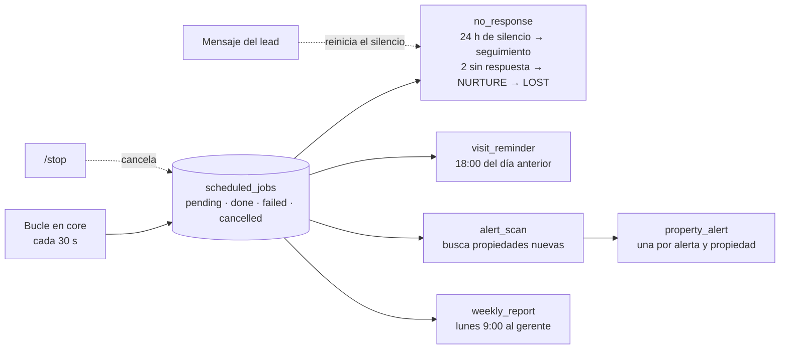

- **Corre dentro de `core`, sin Redis ni cola externa** (DT-3, DT-44): una tabla en Postgres.
- **El reporte semanal** son dos clases: `weekly_report_plan` arma un *job* `weekly_report` por destinatario.
- **Un solo pendiente por clase y `dedupe_key`**; ningún *job* corre dos veces; los fallidos se reintentan 2
  veces.
- **Los mensajes del *scheduler* no usan LLM**, salvo que se revisan con los guardrails de salida antes de
  mandar una alerta.
- **Todo respeta el consentimiento:** `/stop` cancela lo pendiente y desactiva la alerta.

## 15. Panel y landing

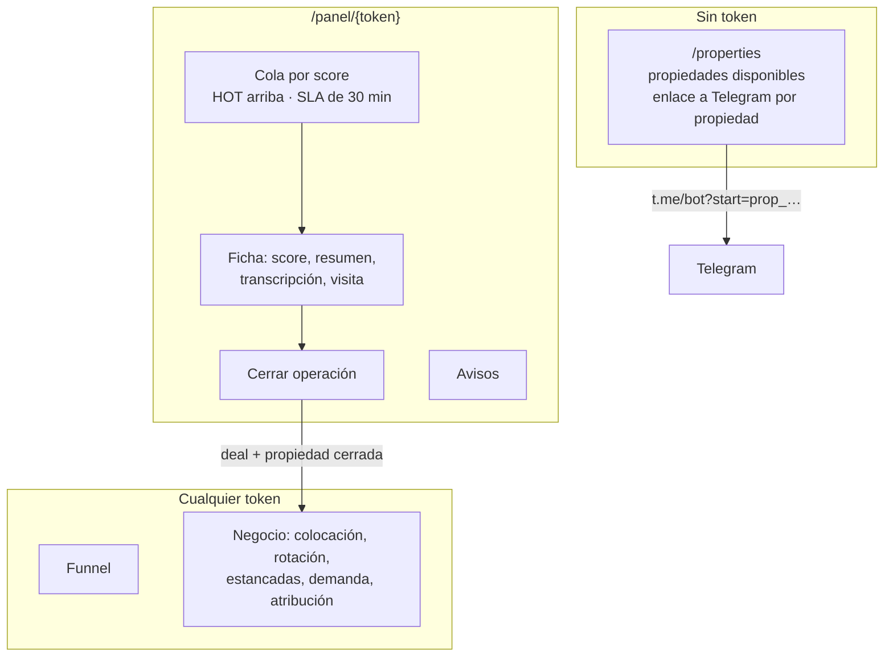

- **FastAPI con plantillas, leyendo Postgres.** La autenticación es un token por asesor (DT-5); cada asesor
  ve los leads de su zona y los asignados (DT-42).
- **La landing es una ruta más del panel**, de solo lectura y sin datos sensibles: nunca `address_exact` ni
  leads (DT-71).
- **Cerrar una operación** escribe en una transacción el `deal`, el lead en `closed_won` y la propiedad en
  `cerrado` con su evento (N-3, DT-52).
- **Atribución al bot** (DT-41): un cierre es del bot si el lead tocó esa propiedad con el bot en los 60
  días previos.
- **Historia sintética** de seis meses para la demo, marcada `synthetic` y excluida de la cola y del funnel
  (N-9, DT-49).

## 16. Datos

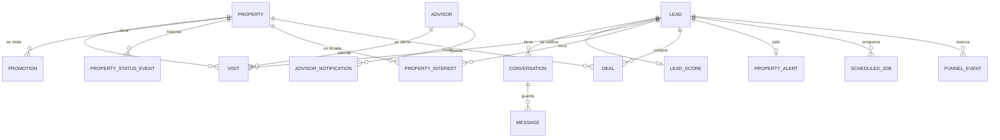

- **Postgres como fuente de verdad desde el día 1** (DT-1). `pgvector` está instalado para la FAQ (C-5), que quedó como trabajo
  futuro.
- **Solo agregados sin texto del lead** en las tablas de negocio: `property_interest`, `unmet_searches`,
  `property_alerts`.
- **`property_status_events`**: el estado de una propiedad solo cambia por `db/property_history.py` (N-1).
- **`audit_log`**: guardrails, intentos de abuso y la decisión de cada turno. **`funnel_events`**:
  *append-only*, una fila por transición real (DT-17).

## 17. Llamadas al LLM: cuota y reintentos

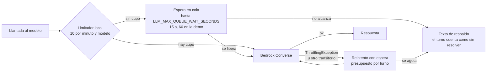

- **10 llamadas por minuto por modelo, fijas** (DT-6, DT-19). Un turno usa unas 2,4: el sistema aguanta unos
  4 turnos por minuto en total.
- **Ventana deslizante en memoria con cola por orden de llegada**, sin Redis. Es por proceso: el compose
  corre un solo *worker*.
- **Reintentos con presupuesto compartido por turno** (A-14, DT-30): un turno no puede quedar reintentando
  sin fin.
- **Sin LLM no se inventa nada:** el respaldo es un texto seguro (A-13).
- **Costo medido:** menos de 2 centavos de dólar por turno; el 96% son tokens de entrada.

## 18. Observabilidad

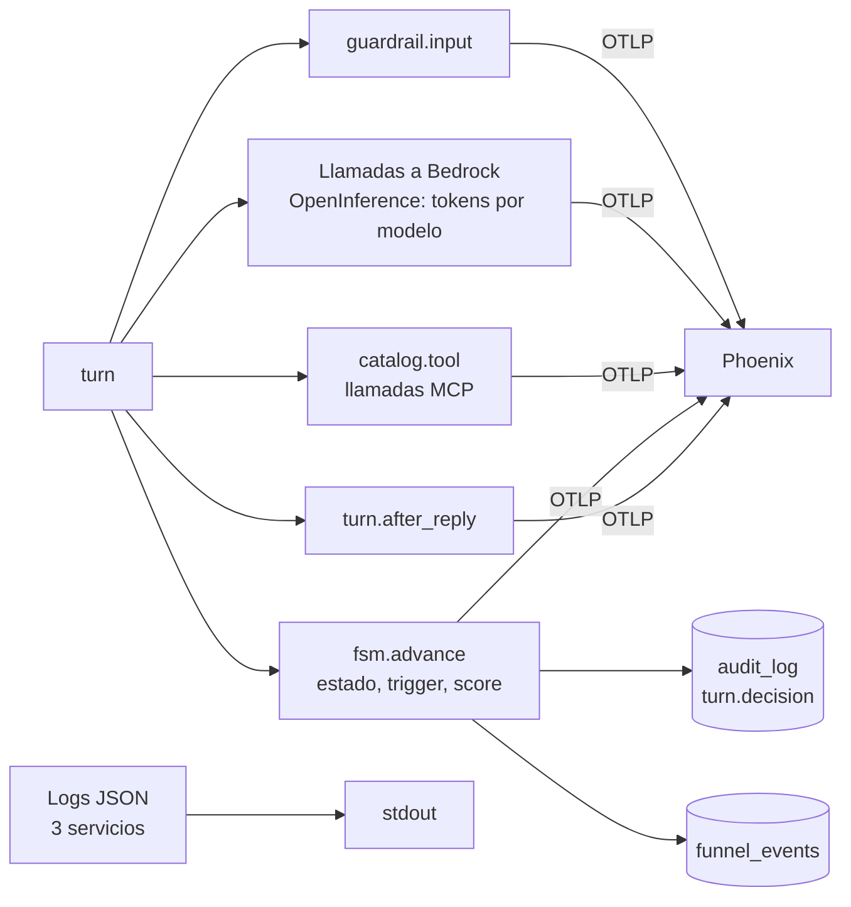

- **Phoenix autoalojado con OpenTelemetry** (DT-9), con la instrumentación de OpenInference para Bedrock y
  MCP.
- **Trazas por turno sin el texto de los leads** (DT-18): ruta, intención, flags, tools y violaciones por
  tipo, nunca el valor. En la UI de Phoenix, la entrada y la salida de las llamadas a Bedrock salen como
  `__REDACTED__`: es a propósito, no una falla. **El texto vive en Postgres** (`messages`, ya filtrado, y la
  decisión de cada turno en `audit_log`), y se lee en la ficha del panel o con `scripts/demo/exportar.py`.
  `TRACE_CONTENT=1` lo muestra también en Phoenix, solo para depurar con datos de prueba.
- **Los tokens de cada corrida** salen de Phoenix con `harness/scripts/tokens.py`.
- **Logs JSON** en los tres servicios (DT-27). Ningún log imprime texto del lead.
- **Plan B:** Jaeger recibe las mismas trazas cambiando solo el *endpoint* OTLP (OBS-8, DT-31).

**Si preguntan:** *¿por qué las trazas están "vacías"?* No lo están: tienen tiempos, tokens, tools y
decisiones. Lo que falta es el texto de la conversación, que es un dato personal. Separarlo es la decisión:
Postgres es la fuente de verdad del contenido, con su control de acceso, y Phoenix se queda solo con
métricas.

## 19. Cómo se prueba

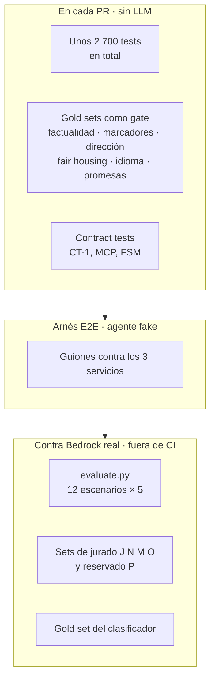

- **CI corre sin LLM:** los gold sets usan la salida real del catálogo de demo y el extractor determinista.
  Un gold set nuevo que nadie registró hace fallar el registro (`test_gold_sets_gate.py`, DT-37).
- **La evaluación en vivo** mide con lo que quedó en Postgres (tools, guardrails, ruta, estado final) y no
  fija frases, así que vale con cualquier modelo que haga lo correcto.
- **El set reservado P** se corrió una sola vez, sin ajustar nada antes ni después: mide generalización.
  J, N, M y O se usaron para arreglar, así que solo miden regresión.
- **Límite de proceso:** CI no bloquea el merge en este plan de GitHub; el *gate* depende del acuerdo del
  equipo.
