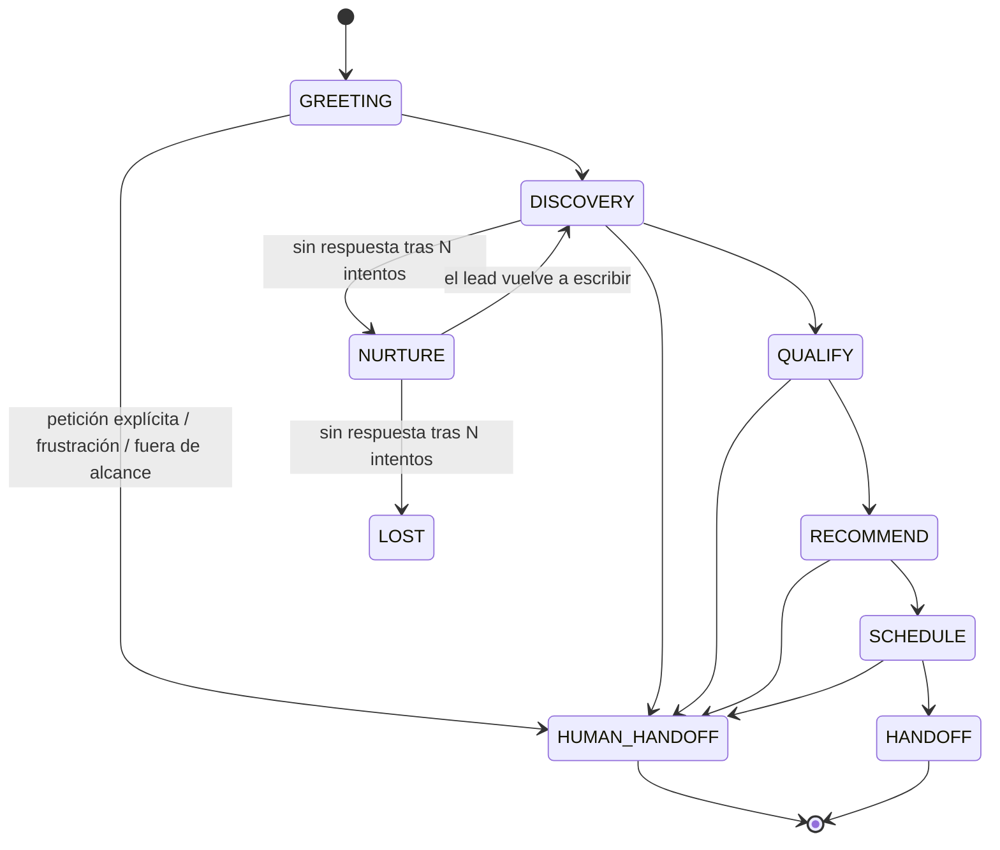

# Diseño — referencia compartida entre historias

Este documento **no es una narrativa de arquitectura completa** — es la tabla/lista/regla exacta
que 2 o más historias necesitan usar *igual* para que el trabajo en paralelo no diverja. Si una
historia puede definir algo por sí sola sin que otra dependa de esa definición exacta, ese detalle
vive en la propia historia (`docs/STORIES/<ID>.md`), no acá.

El *por qué* de cada elección de arquitectura vive en `docs/DECISIONS/decisions.md`.

## 1. Entidades principales

Usado por `CT-3` (contrato `FsmState`/`LeadScore`/`Conversation`) y `C-3` (migraciones).

| Entidad | Campos clave | Notas |
| :--- | :--- | :--- |
| `Lead` | id, telegram_user_id, phone, email, consent_status, status (nuevo/mql/sql/visit_scheduled/closed_won/closed_lost), zone, budget, timing | Identidad única por canal |
| `Conversation` | id, lead_id, fsm_state, started_at, last_message_at | Una por hilo de conversación |
| `Message` | id, conversation_id, role, content, tool_calls, created_at | Historial completo |
| `LeadScore` | lead_id, need_fit, budget, authority, timing, eligibility, total, band (COLD/WARM/HOT), reasons | Persistido, nunca calculado por el LLM directamente |
| `Property` | id, title, price, type (venta/renta/preventa), zone, m2, bedrooms, bathrooms, amenities, status (disponible/apartado/cerrado), address_exact, address_approx | `address_exact` reservada hasta `lead_qualified=true` |
| `Promotion` | id, property_id, title, description, valid_until | Siempre atada a una propiedad; alimenta `catalog.get_promotions` |
| `Advisor` | id, name, zone, language, access_token | `access_token` = auth del panel (ver `decisions.md`) |
| `Visit` | id, lead_id, property_id, advisor_id, scheduled_at, idempotency_key | Idempotente para evitar duplicados por reintento de webhook del proveedor de calendario |
| `FaqEntry` | id, question, answer, embedding vector(N) | N = dimensión del modelo de embeddings elegido |
| `FunnelEvent` | id, lead_id, event_type, created_at | Tabla *append-only* para métricas del funnel |
| `AuditLog` | id, actor, action, payload, created_at | Trazabilidad de guardrails e intentos de abuso |

## 2. Estados de la FSM

Usado por `CT-3` (enum del contrato) y `A-1` (implementación).

Enum: `GREETING | DISCOVERY | QUALIFY | RECOMMEND | SCHEDULE | HANDOFF | HUMAN_HANDOFF | NURTURE | LOST`.
`HUMAN_HANDOFF` es alcanzable desde **cualquier** estado — no es exclusivo del final del funnel.
Se llega por tres caminos: petición explícita del lead, una intención fuera del alcance del agente, o una
racha de 3 turnos seguidos sin resolver (proxy de frustración); el detalle está en `decisions.md` (DT-16).

## 3. Calificación de leads — BANT-E

Usado por `C-4` (implementación), `A-9` (integración en la FSM), `A-11`/`C-6` (fair housing), `A-4`
(banda mínima para recomendar).

5 dimensiones, 0-20 puntos cada una, total 0-100. Bandas: **COLD** ≤ 40 · **WARM** 41-70 · **HOT** ≥ 71.

| Dimensión | Señal de entrada | Regla de puntos |
| :--- | :--- | :--- |
| **B**udget | `budget_hint` (texto libre u opcional, del contrato `ScoreSignal`) | `None`/vacío → 0 · cualquier valor declarado → 20 (no se parsea como rango numérico — el contrato solo transporta texto libre) |
| **A**uthority | `decision_maker` (enum: `solo`/`pareja`/`familia`/`no_declarado`) | `solo` → 20 · `pareja` → 12 · `familia` → 8 · `no_declarado` → 0 |
| **N**eed fit | `matching_properties` (conteo de `search_properties` del turno, no del LLM) | 0 → 0 · 1-2 → 10 · 3+ → 20 |
| **T**iming | `urgency` (enum: `inmediata`/`3_meses`/`explorando`/`no_declarada`) | `inmediata` → 20 · `3_meses` → 12 · `explorando` → 5 · `no_declarada` → 0 |
| **E**ligibility | `meets_requirements` (booleano de `check_requirements`, no del LLM) | `True` → 20 · `False`/`None` (no verificado todavía) → 0 |

**Regla de oro:** el LLM nunca emite el número final. Emite una señal estructurada (`ScoreSignal`)
por turno; una función pura de Python calcula el score y lo persiste — esto es lo que hace el
score auditable y testeable con casos límite. Cada dimensión trae su propia razón en texto
(`reasons`), no solo el número.

**Fair housing:** el esquema de `ScoreSignal` no tiene campo para categoría protegida (origen,
religión, situación familiar, nacionalidad, género) — es una garantía estructural del contrato,
no solo de la lógica que lo calcula. Si el lead lo menciona espontáneamente, se ignora.

Los pesos de esta tabla son una elección de partida sin respaldo de datos reales — si el gold set
de fair housing (`C-6`) o las primeras pruebas muestran que algún peso produce bandas
contraintuitivas, se ajustan acá sin tocar el contrato (`CT-3`) ni la integración (`A-9`).

## 4. Contrato MCP del Catalog Service — transporte

Usado por `CT-8` (fake), `C-1b` (real), `A-3` (cliente).

Transporte **streamable HTTP**, montado en `/mcp` dentro del propio FastAPI de `catalog` (junto a
`/health`) — no `stdio`: `catalog` y `core` corren en contenedores Docker separados, comunicándose
por red, y `stdio` asume que el cliente lanza al servidor como proceso hijo hablando por sus
*pipes*, lo cual es incompatible con dos contenedores independientes. El cliente de `core` se
conecta apuntando a `${CATALOG_SERVICE_URL}/mcp`. Ver `decisions.md` para el detalle y el
*gotcha* de *lifespan* al montar el sub-app.

Las 5 tools (`search_properties`, `get_property`, `get_availability`, `get_promotions`,
`check_requirements`) y sus schemas de input/output son responsabilidad de `CT-2` — este
documento solo fija el transporte, no el contenido de cada tool.
