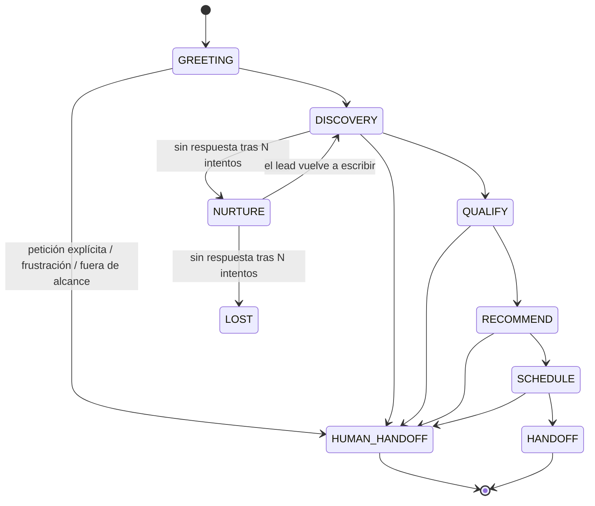
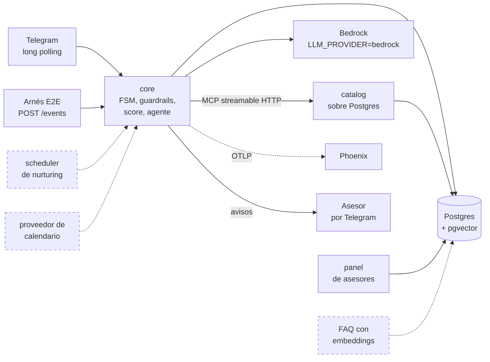

# Diseño — referencia compartida entre historias

Este documento **no es una narrativa de arquitectura completa** — es la tabla/lista/regla exacta
que 2 o más historias necesitan usar *igual* para que el trabajo en paralelo no diverja. Si una
historia puede definir algo por sí sola sin que otra dependa de esa definición exacta, ese detalle
vive en la propia historia (`docs/STORIES/<ID>.md`), no acá.

El *por qué* de cada elección de arquitectura vive en `docs/DECISIONS/decisions.md`.

## 1. Entidades principales

Usado por `CT-3` (contrato `FsmState`/`LeadScore`/`Conversation`) y `C-3` (migraciones).

| Entidad | Campos clave | Notas |
| :--- | :--- | :--- |
| `Lead` | id, telegram_user_id, phone, email, consent_status, status (nuevo/mql/sql/visit_scheduled/closed_won/closed_lost), zone, budget, timing | Identidad única por canal |
| `Conversation` | id, lead_id, fsm_state, started_at, last_message_at | Una por hilo de conversación |
| `Message` | id, conversation_id, role, content, tool_calls, created_at | Historial completo |
| `LeadScore` | lead_id, need_fit, budget, authority, timing, eligibility, total, band (COLD/WARM/HOT), reasons | Persistido, nunca calculado por el LLM directamente |
| `Property` | id, title, price, type (venta/renta/preventa), zone, m2, bedrooms, bathrooms, amenities, status (disponible/apartado/cerrado), address_exact, address_approx | `address_exact` reservada hasta `lead_qualified=true` |
| `Promotion` | id, property_id, title, description, valid_until | Siempre atada a una propiedad; alimenta `catalog.get_promotions` |
| `Advisor` | id, name, zone, language, access_token | `access_token` = auth del panel (ver `decisions.md`) |
| `Visit` | id, lead_id, property_id, advisor_id, scheduled_at, idempotency_key | Idempotente para evitar duplicados por reintento de webhook del proveedor de calendario |
| `FaqEntry` | id, question, answer, embedding vector(N) | N = dimensión del modelo de embeddings elegido |
| `FunnelEvent` | id, lead_id, event_type, created_at | Tabla *append-only* para métricas del funnel |
| `AuditLog` | id, actor, action, payload, created_at | Trazabilidad de guardrails e intentos de abuso |

## 2. Estados de la FSM

Usado por `CT-3` (enum del contrato) y `A-1` (implementación).

Enum: `GREETING | DISCOVERY | QUALIFY | RECOMMEND | SCHEDULE | HANDOFF | HUMAN_HANDOFF | NURTURE | LOST`.
`HUMAN_HANDOFF` es alcanzable desde **cualquier** estado — no es exclusivo del final del funnel.
Se llega por tres caminos: petición explícita del lead, una intención fuera del alcance del agente, o una
racha de 3 turnos seguidos sin resolver (proxy de frustración); el detalle está en `decisions.md` (DT-16).

## 3. Calificación de leads — BANT-E

Usado por `C-4` (implementación), `A-9` (integración en la FSM), `A-11`/`C-6` (fair housing), `A-4`
(banda mínima para recomendar).

5 dimensiones, 0-20 puntos cada una, total 0-100. Bandas: **COLD** ≤ 40 · **WARM** 41-70 · **HOT** ≥ 71.

| Dimensión | Señal de entrada | Regla de puntos |
| :--- | :--- | :--- |
| **B**udget | `budget_hint` (texto libre u opcional, del contrato `ScoreSignal`) | `None`/vacío → 0 · cualquier valor declarado → 20 (no se parsea como rango numérico — el contrato solo transporta texto libre) |
| **A**uthority | `decision_maker` (enum: `solo`/`pareja`/`familia`/`no_declarado`) | `solo`/`pareja`/`familia` → 20 · `no_declarado` → 0. Mide si se dijo quién decide, no con quién (fair housing, DT-38) |
| **N**eed fit | `matching_properties` (conteo de `search_properties` del turno, no del LLM) | 0 → 0 · 1-2 → 10 · 3+ → 20 |
| **T**iming | `urgency` (enum: `inmediata`/`3_meses`/`explorando`/`no_declarada`) | `inmediata` → 20 · `3_meses` → 12 · `explorando` → 5 · `no_declarada` → 0 |
| **E**ligibility | `meets_requirements` (booleano de `check_requirements`, no del LLM) | `True` → 20 · `False`/`None` (no verificado todavía) → 0 |

**Regla de oro:** el LLM nunca emite el número final. Emite una señal estructurada (`ScoreSignal`)
por turno; una función pura de Python calcula el score y lo persiste — esto es lo que hace el
score auditable y testeable con casos límite. Cada dimensión trae su propia razón en texto
(`reasons`), no solo el número.

**Fair housing:** el esquema de `ScoreSignal` no tiene campo para categoría protegida (origen,
religión, situación familiar, nacionalidad, género) — es una garantía estructural del contrato,
no solo de la lógica que lo calcula. Si el lead lo menciona espontáneamente, se ignora.

Los pesos de esta tabla son una elección de partida sin respaldo de datos reales — si el gold set
de fair housing (`C-6`) o las primeras pruebas muestran que algún peso produce bandas
contraintuitivas, se ajustan acá sin tocar el contrato (`CT-3`) ni la integración (`A-9`).

## 4. Contrato MCP del Catalog Service — transporte

Usado por `CT-8` (fake), `C-1b` (real), `A-3` (cliente).

Transporte **streamable HTTP**, montado en `/mcp` dentro del propio FastAPI de `catalog` (junto a
`/health`) — no `stdio`: `catalog` y `core` corren en contenedores Docker separados, comunicándose
por red, y `stdio` asume que el cliente lanza al servidor como proceso hijo hablando por sus
*pipes*, lo cual es incompatible con dos contenedores independientes. El cliente de `core` se
conecta apuntando a `${CATALOG_SERVICE_URL}/mcp`. Ver `decisions.md` para el detalle y el
*gotcha* de *lifespan* al montar el sub-app.

Las 5 tools (`search_properties`, `get_property`, `get_availability`, `get_promotions`,
`check_requirements`) y sus schemas de input/output son responsabilidad de `CT-2` — este
documento solo fija el transporte, no el contenido de cada tool.

## 5. Estado real del sistema

Las secciones 1-4 son el plan compartido y no se reescriben. Esta sección solo agrega qué existe de
verdad, para no tener que cruzar el backlog con el código. Es una foto del sistema, no el estado de
las historias: ese vive en GitHub Issues/Project. Se actualiza en el PR que cambie algo de lo que dice.

**Corte:** 2026-09-24, `main` en `0cccd76`.

Tres niveles, de más a menos evidencia:

- **Verificado en vivo:** probado a mano contra el sistema real (bot de Telegram de @BotFather,
  Bedrock, Postgres del stack). La evidencia está en la entrada de `decisions.md` o en el PR citado.
- **Construido y probado con tests:** en `main`, cubierto por la suite de su servicio en CI y, cuando
  aplica, por el arnés E2E en Docker (`docker compose run --rm --build harness`). Nadie lo ha visto
  funcionar contra el sistema real.
- **Diseñado pero no construido:** está en las secciones 1-4, en `decisions.md` o en una historia,
  pero no hay código que lo haga.

Las cajas con borde punteado no están construidas.

### 5.1 Verificado en vivo

| Qué | Evidencia |
| :--- | :--- |
| Bot de Telegram por *long polling*: aviso de privacidad en el primer turno, *deep-link* `?start=prop_<id>`, baja con `STOP` | DT-20 |
| El *deep-link* llega al agente: el saludo nombra la propiedad, el lead toma su zona y Bedrock responde sobre ella sin pedir la referencia; la tarjeta de B-7 llegó en el turno que cruzó a WARM (52/100) | #122 |
| Tarjeta de lead calificado al asesor (`B-7`): una sola al cruzar a WARM, ninguna en los turnos siguientes; registro del asesor con `?start=adv_<token>` | PR #83 |
| `Lead.zone` derivada de la propiedad que consulta el lead: el lead aparece en la cola del asesor de su zona y no en las demás | PR #82 |
| Cola del panel priorizada por score (HOT arriba) y "tomar lead" que lo deja en `sql` (`B-6`) | PR #85 |
| Dashboard del funnel (`B-9`): los conteos por etapa coinciden con la consulta de DT-17 en `psql` | PR #86 |
| Llamadas reales a Bedrock con reintentos (`A-14`): ráfaga de 8 turnos, 36 `ThrottlingException` reintentadas, ningún turno cayó al texto de respaldo (Haiku 4.5, `us-east-1`) | DT-30 |
| La conversación nueva tras un traspaso conserva el score del lead (#84): el caso se vio en vivo y quedó cubierto por un test | DT-29 |

### 5.2 Construido y probado con tests, sin verificar en vivo

- **FSM** con los 9 estados y todas las aristas de la sección 2, `HUMAN_HANDOFF` desde cualquier estado
  no terminal por sus tres caminos (DT-12, DT-16). La suite de transiciones cubre cada arista (`OBS-3`).
- **Score BANT-E** acumulado turno a turno en Postgres, en la misma transacción que la FSM (DT-14).
- **Guardrail de entrada**: los 5 detectores de `guardrails.md` §1 (DT-15).
- **Fair housing en el scoring** (`A-11`, DT-38): Authority da lo mismo a `solo`, `pareja` y `familia`, y
  "mis hijos" se generaliza a "mi familia" en vez de borrarse. El gold set de perfiles pareados de `C-6`
  queda en 25 de 25 con diferencia 0. Lo que haga el modelo real con una mención protegida no se ha
  probado: el gold set usa el extractor determinista.
- **Guardrails de salida** con el agente de Bedrock: disponibilidad revalidada (`A-4`, DT-21),
  factualidad (`A-5`, DT-23), dirección reservada (`A-6`, DT-25) y 6 de los 8 *claims* prohibidos (`A-7`,
  DT-26). Sus gold sets corren con la suite de `core` en CI. Ninguno se ha visto dispararse contra
  Bedrock: el modelo no suele inventar a propósito y los casos se prueban con respuestas fijas.
- **Ficha de traspaso** al asesor en `HANDOFF` y `HUMAN_HANDOFF`, con la transcripción completa partida
  en varios mensajes (`A-12`, DT-28). Usa el mismo envío que la tarjeta de `B-7`, que sí se verificó en
  vivo.
- **Catálogo sobre Postgres** con las 5 tools por MCP (`C-1`). El arnés E2E recorre `core` → `catalog`
  por red.
- **Agenda en el catálogo** (`C-2`, DT-32): `assign_advisor`, `get_slots` y `book` por HTTP en
  `/scheduling`, fuera de MCP para que el LLM no las vea. `book` es idempotente, y la base impide dos
  visitas del mismo asesor a la misma hora. `core` usa `assign_advisor`; `get_slots` y `book`, todavía
  no: ver §5.3.
- **Ruteo del lead al asesor** (`A-10`, DT-33): la tarjeta y la ficha de traspaso van al asesor que
  elige la agenda, por zona, idioma y reparto por turnos, solo entre los que ya abrieron el bot. Si el
  catálogo no responde, se usa la regla local de `B-7`. Verificado en el stack con Docker llamando a
  `notify_advisor`, sin Telegram real.
- **Panel de asesores** con ficha, etapa y transcripción (`B-5`), autenticado por token (DT-5).
- **Trazas por turno** hacia Phoenix sin texto de los leads (DT-18) y **logs JSON** en los 3 servicios
  (DT-27).
- **Métricas del funnel**: una fila de `funnel_events` por transición real (DT-17).
- **Límite de tasa local** por modelo (DT-19). Con el valor por defecto (10 por minuto) corta las ráfagas
  antes que los reintentos de DT-30: ver el final de esa entrada.

### 5.3 Diseñado pero no construido

| Qué | Dónde está diseñado | Qué pasa hoy |
| :--- | :--- | :--- |
| Agendar la visita de verdad (proveedor de calendario, reserva desde la conversación) | `B-8`; entidad `Visit` en §1 | `get_slots` y `book` ya existen en el catálogo (`C-2`, DT-32), pero `core` no los llama: `SCHEDULE -> HANDOFF` lo dispara la intención `agendar_visita` del lead sin reservar nada, así que la ficha de traspaso nunca muestra una visita |
| *Scheduler* de *nurturing* (`DISCOVERY -> NURTURE -> LOST`) | DT-3, DT-12 | Las aristas `no_response` existen en la FSM y en sus tests, pero nada las dispara: ningún lead llega a `NURTURE` ni a `LOST` |
| FAQ con embeddings | `FaqEntry` en §1, DT-7, `C-5` | La tabla y `pgvector` existen; no hay modelo de embeddings ni búsqueda |
| Cancelar los *jobs* de un lead en `/stop` | `guardrails.md` §1 | No hay *jobs* que cancelar hasta que exista el *scheduler* |
| *Claim* 6 completo (promoción genérica sin número) | `guardrails.md` §2.2, DT-26 | Solo se bloquea si trae un número inventado |
| Gold sets y *contract tests* como *gate* de merge | `guardrails.md` §4, `OBS-4`, `OBS-5` | Corren en CI y un fallo deja el PR en rojo, pero nada impide hacer merge igual: ver §5.4 |
| Conversaciones E2E contra el bot real | `OBS-6` | Corrida real hecha el 2-oct con el agente *fake*: 8/8 guiones contra `core`, `catalog` y `panel` en Docker, comprobados en Postgres y en la cola del asesor (`harness/scripts/live_run.py`, DT-39), más una conversación manual por Telegram (deep-link, traspaso con tarjeta al asesor, `STOP`). Falta la corrida con Bedrock (`--sin-frases`), que espera credenciales |
| Plan B de observabilidad | `OBS-8`, DT-31 | Documentado y probado una vez: Jaeger recibe las trazas de `core` cambiando solo `OTEL_EXPORTER_OTLP_ENDPOINT`. No está en el compose, a propósito |

### 5.4 Límites conocidos de lo construido

- **CI no bloquea el merge.** `main` no exige ningún *status check* (`scripts/github/protect_main.sh`),
  y en un repositorio privado del plan gratuito GitHub no permite exigirlo. Un PR en rojo se puede
  mergear: el *gate* de `guardrails.md` §4 depende de que el equipo no lo haga.
- **CI no construye las imágenes de Docker.** Instala `requirements-dev.txt`, así que una dependencia que
  falta en el `requirements.txt` de un servicio solo aparece con `docker compose run --rm --build harness`.
- **Con el agente *fake* (el valor por defecto) no hay LLM:** las respuestas salen de plantillas y los
  guardrails de salida no aplican, porque el *fake* arma el texto directo de los resultados reales.
- **El límite de tasa es por proceso** (DT-19): con varios *workers* se multiplica. El compose corre uno.
- **Los avisos al asesor son de mejor esfuerzo:** si Telegram falla en ese turno no se reintentan
  (DT-24, DT-28). El asesor sigue viendo al lead en el panel.
- **Factualidad literal:** no sabe de qué propiedad habla un número si es real en otro resultado del
  mismo turno (DT-23).
