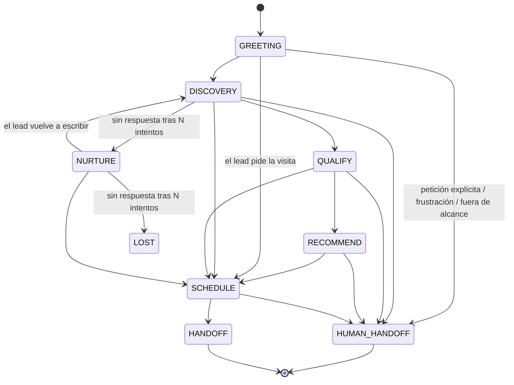
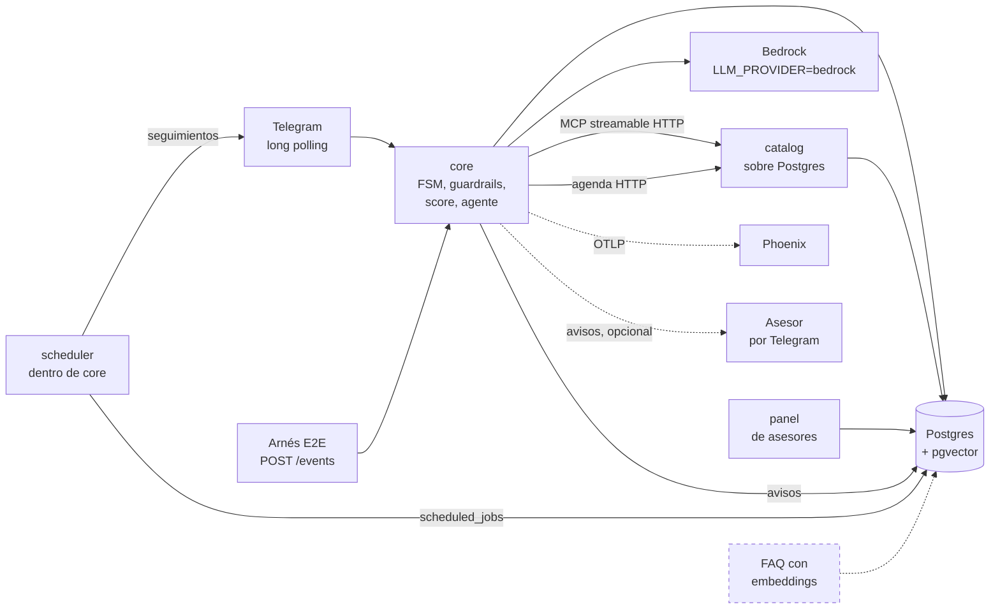

# Diseño — referencia compartida entre historias

Este documento **no es una narrativa de arquitectura completa** — es la tabla/lista/regla exacta
que 2 o más historias necesitan usar *igual* para que el trabajo en paralelo no diverja. Si una
historia puede definir algo por sí sola sin que otra dependa de esa definición exacta, ese detalle
vive en la propia historia (`docs/STORIES/<ID>.md`), no acá.

El *por qué* de cada elección de arquitectura vive en `docs/DECISIONS/decisions.md`.

## 1. Entidades principales

Usado por `CT-3` (contrato `FsmState`/`LeadScore`/`Conversation`) y `C-3` (migraciones).

| Entidad | Campos clave | Notas |
| :--- | :--- | :--- |
| `Lead` | id, telegram_user_id, phone, email, consent_status, status (nuevo/mql/sql/visit_scheduled/closed_won/closed_lost), zone, budget, timing, utm_campaign, handoff_summary, synthetic | Identidad única por canal. `utm_campaign` es la del primer contacto (`N-5`). `handoff_summary` es el resumen del último traspaso (`A-16`, DT-46) |
| `Conversation` | id, lead_id, fsm_state, started_at, last_message_at | Una por hilo de conversación |
| `Message` | id, conversation_id, role, content, tool_calls, created_at | Historial completo |
| `LeadScore` | lead_id, need_fit, budget, authority, timing, eligibility, total, band (COLD/WARM/HOT), reasons | Persistido, nunca calculado por el LLM directamente |
| `Property` | id, title, price, type (venta/renta/preventa), kind (departamento/casa/terreno/local/estudio), zone, m2, bedrooms, bathrooms, amenities, status (disponible/apartado/cerrado), address_exact, address_approx, photo_url | `type` es la operación y `kind` el inmueble (#188, DT-54). `address_exact` reservada hasta `lead_qualified=true`. `status` solo cambia por `db/property_history.py` (`N-1`) |
| `Promotion` | id, property_id, title, description, valid_until | Siempre atada a una propiedad; alimenta `catalog.get_promotions` |
| `Advisor` | id, name, zone, language, access_token | `access_token` = auth del panel (ver `decisions.md`) |
| `Visit` | id, lead_id, property_id, advisor_id, scheduled_at, idempotency_key | Idempotente para evitar duplicados por reintento de webhook del proveedor de calendario |
| `AdvisorNotification` | id, advisor_id, lead_id, kind (calificado/traspaso), body, created_at, read_at | Aviso al asesor en el panel; Telegram es un canal adicional (`B-15`, DT-42) |
| `PropertyStatusEvent` | id, property_id, from_status, to_status, changed_at, actor, synthetic | Historial de estados de la propiedad; `from_status` nulo es el alta. Lo escribe solo `db/property_history.py` (`N-1`) |
| `Deal` | id, property_id, lead_id, advisor_id, kind (renta/venta), price, closed_at, synthetic | Operación cerrada desde la ficha (`N-3`). La propiedad queda en `cerrado` |
| `PropertyInterest` | id, lead_id, property_id, kind (anuncio/consulta/busqueda/visita), created_at, synthetic | Qué propiedades tocó cada lead con el bot (`N-4`); base de la atribución (DT-41). Sin texto del lead |
| `UnmetSearch` | id, zone, type, bedrooms, budget_min, budget_max, created_at, synthetic | Búsqueda sin resultados (`N-5`), sin lead ni texto |
| `ScheduledJob` | id, kind (no_response/visit_reminder/alert_scan/property_alert), dedupe_key, lead_id, payload, run_at, status (pending/done/failed/cancelled), attempts, last_error, created_at, finished_at | Tarea diferida del *scheduler* de `core` (`A-17`, DT-44). Un solo pendiente por clase y `dedupe_key` |
| `PropertyAlert` | id, lead_id, conversation_id, zone, type, bedrooms, budget_min, budget_max, active, created_at, expires_at | Alerta de propiedades nuevas (`A-18`, DT-45): los filtros de una búsqueda, sin texto del lead. Una activa por lead, 90 días |
| `FaqEntry` | id, question, answer, embedding vector(N) | N = dimensión del modelo de embeddings elegido |
| `FunnelEvent` | id, lead_id, event_type, created_at | Tabla *append-only* para métricas del funnel |
| `AuditLog` | id, actor, action, payload, created_at | Trazabilidad de guardrails e intentos de abuso |

## 2. Estados de la FSM

Usado por `CT-3` (enum del contrato) y `A-1` (implementación).

Enum: `GREETING | DISCOVERY | QUALIFY | RECOMMEND | SCHEDULE | HANDOFF | HUMAN_HANDOFF | NURTURE | LOST`.
`HUMAN_HANDOFF` es alcanzable desde **cualquier** estado — no es exclusivo del final del funnel.
Se llega por tres caminos: petición explícita del lead, una intención fuera del alcance del agente, o una
racha de 3 turnos seguidos sin resolver en la que el último mensaje muestra molestia (el campo `frustrated` del
clasificador); el detalle está en `decisions.md` (DT-16, DT-65).

`SCHEDULE` también se alcanza desde cualquier estado activo: pedir la visita arranca la agenda si hay una
propiedad de interés que se pueda visitar. Cuál es lo dice el clasificador (`refers_to`), eligiendo entre las
propiedades que la conversación ya mostró; si no se sabe cuál, el agente pregunta y no se adivina (DT-63). Los
horarios se filtran por el día y la franja que pidió el lead (`visit_when`, DT-64). El embudo avanza por lo que
pasó en la conversación y
no solo por la intención: buscar o mirar una propiedad cierra `DISCOVERY`, y el primer dato de calificación
(presupuesto, cómo se decide, cuándo, o `check_requirements`) cierra `QUALIFY` (DT-61).

## 3. Calificación de leads — BANT-E

Usado por `C-4` (implementación), `A-9` (integración en la FSM), `A-11`/`C-6` (fair housing), `A-4`
(banda mínima para recomendar).

5 dimensiones, 0-20 puntos cada una, total 0-100. Bandas: **COLD** ≤ 40 · **WARM** 41-70 · **HOT** ≥ 71.

| Dimensión | Señal de entrada | Regla de puntos |
| :--- | :--- | :--- |
| **B**udget | `budget_hint` (texto libre u opcional, del contrato `ScoreSignal`) | `None`/vacío → 0 · cualquier valor declarado → 20 (no se parsea como rango numérico — el contrato solo transporta texto libre) |
| **A**uthority | `decision_maker` (enum: `declarado`/`no_declarado`) | `declarado` → 20 · `no_declarado` → 0. Mide si se dijo cómo se decide; el contrato no guarda con quién (fair housing, DT-38, DT-40) |
| **N**eed fit | `matching_properties` (conteo de `search_properties` del turno, no del LLM) | 0 → 0 · 1-2 → 10 · 3+ → 20 |
| **T**iming | `urgency` (enum: `inmediata`/`3_meses`/`explorando`/`no_declarada`) | `inmediata` → 20 · `3_meses` → 12 · `explorando` → 5 · `no_declarada` → 0 |
| **E**ligibility | `meets_requirements` (booleano de `check_requirements`, no del LLM) | `True` → 20 · `False`/`None` (no verificado todavía) → 0 |

**Regla de oro:** el LLM nunca emite el número final. Emite una señal estructurada (`ScoreSignal`)
por turno; una función pura de Python calcula el score y lo persiste — esto es lo que hace el
score auditable y testeable con casos límite. Cada dimensión trae su propia razón en texto
(`reasons`), no solo el número.

**Fair housing:** el esquema de `ScoreSignal` no tiene campo para categoría protegida (origen,
religión, situación familiar, nacionalidad, género) — es una garantía estructural del contrato,
no solo de la lógica que lo calcula. Si el lead lo menciona espontáneamente, se ignora.

Los pesos de esta tabla son una elección de partida sin respaldo de datos reales — si el gold set
de fair housing (`C-6`) o las primeras pruebas muestran que algún peso produce bandas
contraintuitivas, se ajustan acá sin tocar el contrato (`CT-3`) ni la integración (`A-9`).

## 4. Contrato MCP del Catalog Service — transporte

Usado por `CT-8` (fake), `C-1b` (real), `A-3` (cliente).

Transporte **streamable HTTP**, montado en `/mcp` dentro del propio FastAPI de `catalog` (junto a
`/health`) — no `stdio`: `catalog` y `core` corren en contenedores Docker separados, comunicándose
por red, y `stdio` asume que el cliente lanza al servidor como proceso hijo hablando por sus
*pipes*, lo cual es incompatible con dos contenedores independientes. El cliente de `core` se
conecta apuntando a `${CATALOG_SERVICE_URL}/mcp`. Ver `decisions.md` para el detalle y el
*gotcha* de *lifespan* al montar el sub-app.

Las 6 tools (`search_properties`, `get_property`, `get_availability`, `get_promotions`,
`check_requirements` y `list_zones`, #194) y sus schemas de input/output son responsabilidad de `CT-2` — este
documento solo fija el transporte, no el contenido de cada tool. El servidor publica en `list_tools` el
`inputSchema` del contrato, el mismo contra el que valida, y no el que el SDK deriva de la firma de Python,
que es más laxo: con ese, el LLM no sabía qué campos lleva `lead_profile` (#182).

## 5. Estado real del sistema

Las secciones 1-4 son el plan compartido y no se reescriben. Esta sección solo agrega qué existe de
verdad, para no tener que cruzar el backlog con el código. Es una foto del sistema, no el estado de
las historias: ese vive en GitHub Issues/Project. Se actualiza en el PR que cambie algo de lo que dice.

**Corte:** 2026-10-02, `main` en `d8d0425`.

Tres niveles, de más a menos evidencia:

- **Verificado en vivo:** probado a mano contra el sistema real (bot de Telegram de @BotFather,
  Bedrock, Postgres del stack). La evidencia está en la entrada de `decisions.md` o en el PR citado.
- **Construido y probado con tests:** en `main`, cubierto por la suite de su servicio en CI y, cuando
  aplica, por el arnés E2E en Docker (`docker compose run --rm --build harness`). Nadie lo ha visto
  funcionar contra el sistema real.
- **Diseñado pero no construido:** está en las secciones 1-4, en `decisions.md` o en una historia,
  pero no hay código que lo haga.

Las cajas con borde punteado no están construidas.

### 5.1 Verificado en vivo

| Qué | Evidencia |
| :--- | :--- |
| Bot de Telegram por *long polling*: aviso de privacidad en el primer turno, *deep-link* `?start=prop_<id>`, baja con `STOP` | DT-20 |
| El *deep-link* llega al agente: el saludo nombra la propiedad, el lead toma su zona y Bedrock responde sobre ella sin pedir la referencia; la tarjeta de B-7 llegó en el turno que cruzó a WARM (52/100) | #122 |
| Tarjeta de lead calificado al asesor (`B-7`): una sola al cruzar a WARM, ninguna en los turnos siguientes; registro del asesor con `?start=adv_<token>` | PR #83 |
| `Lead.zone` derivada de la propiedad que consulta el lead: el lead aparece en la cola del asesor de su zona y no en las demás | PR #82 |
| Cola del panel priorizada por score (HOT arriba) y "tomar lead" que lo deja en `sql` (`B-6`) | PR #85 |
| Dashboard del funnel (`B-9`): los conteos por etapa coinciden con la consulta de DT-17 en `psql` | PR #86 |
| Conversaciones E2E contra los 3 servicios (`OBS-6`): con el agente *fake*, 8/8 guiones comprobados en Postgres y en la cola del panel, más una conversación manual por Telegram (deep-link, traspaso, `STOP`); con Bedrock (Haiku 4.5, 3-oct, `--sin-frases`), ningún turno al texto de respaldo. El modelo suele pedir la zona antes de buscar, así que algunos guiones terminan en `QUALIFY` o `SCHEDULE` en vez del estado del agente *fake*: caminos válidos que la corrida con el LLM real acepta | DT-43, #48 |
| Llamadas reales a Bedrock con reintentos (`A-14`): ráfaga de 8 turnos, 36 `ThrottlingException` reintentadas, ningún turno cayó al texto de respaldo (Haiku 4.5, `us-east-1`) | DT-30 |
| La conversación nueva tras un traspaso conserva el score del lead (#84): el caso se vio en vivo y quedó cubierto por un test | DT-29 |

### 5.2 Construido y probado con tests, sin verificar en vivo

- **FSM** con los 9 estados y todas las aristas de la sección 2, `HUMAN_HANDOFF` desde cualquier estado
  no terminal por sus tres caminos (DT-12, DT-16). La suite de transiciones cubre cada arista (`OBS-3`).
- **Score BANT-E** acumulado turno a turno en Postgres, en la misma transacción que la FSM (DT-14).
- **Guardrail de entrada**: los 5 detectores de `guardrails.md` §1 (DT-15).
- **Fair housing en el scoring** (`A-11`, DT-38; #119, DT-40): `decision_maker` solo dice si el lead
  declaró cómo se decide, sin con quién. "mis hijos" se generaliza a "mi familia" y "mi esposa" o "mi
  marido" a "mi pareja" en vez de borrarse. El gold set de perfiles pareados de `C-6` queda en 27 de 27
  con diferencia 0. Lo que haga el modelo real con una mención protegida no se ha
  probado: el gold set usa el extractor determinista.
- **Guardrails de salida** con el agente de Bedrock: disponibilidad revalidada (`A-4`, DT-21),
  factualidad (`A-5`, DT-23), dirección reservada (`A-6`, DT-25) y 6 de los 8 *claims* prohibidos (`A-7`,
  DT-26). Sus gold sets corren con la suite de `core` en CI. Ninguno se ha visto dispararse contra
  Bedrock: el modelo no suele inventar a propósito y los casos se prueban con respuestas fijas.
- **Ficha de traspaso** al asesor en `HANDOFF` y `HUMAN_HANDOFF`, con la transcripción completa partida
  en varios mensajes (`A-12`, DT-28). Usa el mismo envío que la tarjeta de `B-7`, que sí se verificó en
  vivo.
- **Catálogo sobre Postgres** con las 5 tools por MCP (`C-1`). El arnés E2E recorre `core` → `catalog`
  por red.
- **Agenda en el catálogo** (`C-2`, DT-32): `assign_advisor`, `get_slots` y `book` por HTTP en
  `/scheduling`, fuera de MCP para que el LLM no las vea. `book` es idempotente, y la base impide dos
  visitas del mismo asesor a la misma hora. `core` usa las tres: `assign_advisor` para el ruteo, y
  `get_slots` y `book` para agendar la visita.
- **Visita agendada desde la conversación** (`B-8`, DT-39): al pedirla, el lead elige entre 3 horarios
  numerados de su asesor y `core` la reserva con `book`. Si la agenda no responde, el lead deja su horario
  preferido y el asesor lo ve en la ficha de traspaso.
- **Foto de la propiedad en Telegram** (`B-10`, DT-50): cuando el turno trata de una sola propiedad (el
  *deep-link* o un `get_property` sin búsqueda), el bot manda su foto con el texto del turno como
  *caption*. Sin foto, con un texto que no cabe en un *caption* o si Telegram la rechaza, va solo el
  texto. Las fotos de la demo son URLs de Unsplash que siembra `seed_catalog.py`.
- **Botones en Telegram** (`B-11`, DT-51): bajo una respuesta sobre una propiedad van "Talk to an
  agent" y, en `RECOMMEND`, "Schedule a visit". Tocar uno es lo mismo que escribir su texto fijo, en inglés
  como todo lo que lee el lead (#202): pasa por el guardrail de entrada, la FSM y el score, y el evento CT-1
  no cambia.
- **Ruteo del lead al asesor** (`A-10`, DT-33): la tarjeta y la ficha de traspaso van al asesor que
  elige la agenda, por zona, idioma y reparto por turnos, entre todos los asesores (DT-42). Si el
  catálogo no responde, se usa la regla local de `B-7`. Verificado en el stack con Docker llamando a
  `notify_advisor`, sin Telegram real.
- **Avisos al asesor en el panel** (`B-15`, DT-42): cada tarjeta y ficha de traspaso se guarda en
  `advisor_notifications` y se ve en `/panel/<token>/avisos`, con el contador de no leídos. Telegram es
  un canal adicional para el asesor que registró su chat.
- **Panel de asesores** con ficha, etapa y transcripción (`B-5`), autenticado por token (DT-5). Cada
  asesor ve los leads de su zona y los que tiene asignados (DT-42).
- **Cerrar operación desde la ficha** (`N-3`, DT-52): el asesor elige la propiedad (primero las que el lead
  tocó, después las disponibles o apartadas de su zona), renta o venta, precio y fecha. En una
  transacción quedan la fila en `deals`, el lead en `closed_won` y la propiedad en `cerrado` con su
  evento. Una propiedad ya cerrada no se vuelve a cerrar, y un cierre rechazado no escribe nada.
- **Esquema de inteligencia comercial** (`N-1`, migración `0008`): `property_status_events`, `deals`,
  `property_interest` y `unmet_searches`, más `leads.utm_campaign`, `properties.photo_url` y `synthetic`.
  `db/property_history.py` es la única vía para cambiar el estado de una propiedad. Hoy se escriben
  `property_interest` (`N-4`), `unmet_searches` y `leads.utm_campaign` (`N-5`). `deals` y el historial de
  estados reales los escribe "Close a deal" (`N-3`); la historia sintética de `N-9` siembra los suyos
  aparte.
- **Interés del lead por propiedad** (`N-4`): cada turno guarda, en su misma transacción, las propiedades
  que el lead tocó: `anuncio` (el *deep-link*), `consulta` (`get_property`), `busqueda` (cada resultado de
  `search_properties`) y `visita` (la visita reservada). Sin texto del lead. Es la base de la atribución de
  DT-41. Reglas de conteo, para quien lo lea (`N-6`, `N-7`):
  - Una fila por propiedad y tipo **en cada turno**: la misma búsqueda en dos turnos son dos filas. Para
    contar leads interesados, contar `lead_id` distintos.
  - La propiedad del anuncio es `anuncio` y no también `consulta`, aunque el turno la consulte para
    saludar.
  - No cuentan la propiedad recordada de turnos anteriores ni una oferta de horarios sin reservar.
  - Una propiedad que no está en `properties` no se registra y deja un `warning` en el log de `core`.
  - Con el agente de Bedrock, si un turno llama dos veces a `get_property`, solo queda la última.
- **Campaña de origen y demanda insatisfecha** (`N-5`): la campaña del *deep-link* (`?start=camp_…`) se
  guarda en `leads.utm_campaign` la primera vez y no se pisa después. Cada `search_properties` que el
  catálogo contesta sin resultados deja una fila en `unmet_searches` con sus filtros (zona, tipo,
  recámaras y presupuesto), sin lead ni texto. Cuenta lo que contestó el catálogo, antes de revalidar la
  disponibilidad. La misma búsqueda repetida en un turno es una fila; en dos turnos, dos. Un filtro que la
  tabla rechazaría queda vacío en vez de tumbar el turno.
- **Atribución al bot y conversión** (`N-7`, DT-41): `db/metrics/attribution.py` (DT-47), de solo lectura,
  con cuatro consultas por periodo. Se ven en el panel con `N-8`.
  - Cierres atribuidos al bot sobre el total del periodo, con la regla de DT-41 (ventana de 60 días en
    `ATTRIBUTION_WINDOW_DAYS`).
  - Tiempo del primer contacto al cierre: mediana y p90. El primer contacto es `leads.created_at`, porque
    el lead se crea con su primer mensaje.
  - Conversión a `closed_won` por banda (HOT, WARM, COLD), con la banda actual del lead.
  - Retorno por `utm_campaign`: leads, calificados y cierres.
  Las dos primeras toman los cierres del periodo; las dos últimas, los leads creados en él. Cada una
  excluye lo sintético salvo que se pida (`include_synthetic=True`), y ninguna devuelve un lead.
- **Inventario y rotación** (`N-6`): `db/metrics/inventory.py` (DT-47), de solo lectura; se ve en el
  panel con `N-8`. Por periodo (`week_of`, `month_of` o un rango):
  - Colocadas: operaciones de `deals`, por zona, tipo de propiedad y asesor.
  - Días en el mercado, del primer `disponible` al cierre: mediana por zona y por tipo.
  - Estancadas: `disponible` a la fecha de corte desde hace más de 30, 60 o 90 días, con sus consultas y
    visitas del periodo ("no inquiries", "inquiries but no visits"). El estado es el del último evento hasta
    el corte, no el de hoy: el reporte semanal corta en el pasado (#177).
  - Ranking por cierres, visitas y consultas, y las combinaciones de zona, tipo y recámaras más
    buscadas sin resultado.
  Consultas y visitas cuentan leads distintos de `property_interest`. Una propiedad sin historial de
  estados no se puede medir: hoy es el caso del inventario del *seed* sin la historia de `N-9`. Cada consulta excluye
  lo sintético salvo que se pida, y ninguna devuelve un lead.
- **Scheduler de tareas diferidas** (`A-17`, DT-44): corre dentro de `core` y toma de `scheduled_jobs` los
  *jobs* vencidos. Hoy hace los seguimientos de *nurturing*. Con 24 horas de silencio en `DISCOVERY`, le
  envía al lead un seguimiento fijo, sin LLM. Tras 2 seguimientos sin respuesta, la conversación pasa a
  `NURTURE`; ahí se repite lo mismo cada 7 días y termina en `LOST`. Cada mensaje del lead reinicia la
  cuenta, y `/stop` cancela todo lo pendiente. Un *job* que falla se reintenta 2 veces y luego queda en
  `failed`; ninguno se ejecuta dos veces. Los tiempos se cambian con `SCHEDULER_*` (`.env.example`).
- **Recordatorio de la visita** (`B-13`): el turno que reserva la visita programa un `visit_reminder` para
  las 18:00 del día anterior, en hora de Colombia (UTC-5, DT-55). Si esa hora ya pasó al reservar, no hay recordatorio.
  Dice la propiedad, la fecha, la hora y la dirección aproximada; la exacta, solo si el lead ya calificó
  (A-6). Uno por visita, y no se envía si el lead se dio de baja o si la visita ya pasó.
- **Alertas de propiedades nuevas** (`A-18`, DT-45). El lead pide "avísame si sale algo así"; lo detecta
  una regla, sin LLM. Se guardan los filtros de la búsqueda de ese turno o del anterior en
  `property_alerts`, sin texto del lead: una alerta activa por lead, durante 90 días. Si una búsqueda con
  filtros trae 2 propiedades o menos, el turno le ofrece la alerta al lead, una sola vez por conversación.
  - Cada `ALERT_SCAN_MINUTES`, un `alert_scan` busca las propiedades `disponible` que cumplen los filtros
    con los mismos criterios que `search_properties`. Solo cuentan las que entraron a `disponible` después
    de crearse la alerta, según `property_status_events`.
  - Por cada una, un `property_alert` le escribe al lead una sola vez. Antes revisa el consentimiento y
    que la propiedad siga disponible, y pasa el mensaje por los guardrails de salida (A-5, A-6, A-7).
  - El mensaje deja la propiedad como la de interés de la conversación. `/stop` desactiva la alerta.
  - Hoy ningún código da de alta propiedades: quien lo haga tiene que pasar por `db/property_history.py`
    para que la alerta las vea.
- **Vista de inventario y negocio** (`N-8`, DT-41): `/panel/<token>/negocio`, con las consultas de `N-6` y
  `N-7`. Como el funnel de `B-9`, la ve cualquier token de asesor y un token que no existe da 404. Periodo:
  la última semana (por defecto), el último mes o un rango de fechas, en hora local; un rango inválido
  muestra la última semana con un aviso. "Include demo history" suma lo sintético de `N-9`. Solo
  agregados: las estancadas y el ranking listan propiedades, nunca leads ni enlaces a una ficha. Con la
  base vacía, cada sección dice "No data for this period.". Enlazada desde el funnel y de vuelta.
- **Tiempo de atención del asesor** (`B-12`): "Mark as in progress" guarda la primera toma en
  `leads.claimed_at` (migración `0014`). La vista de `N-8` muestra, por asesor, la mediana de `qualified_at`
  a la toma (de todos los calificados y solo de los HOT), con `db/metrics/sla.py`.
  - Cuenta los leads tomados en el periodo. El asesor es el del lead (`advisor_id`), aunque lo haya tomado
    otro de la zona.
  - No cuentan los tomados antes de calificar ni los que nunca se tomaron desde el panel, como los que
    pasaron a `visit_scheduled` directo desde el bot.
  - En la cola, un HOT sin tomar que calificó hace más de `SLA_HOT_MINUTES` (30 por defecto) se marca con
    cuánto lleva esperando. Solo se marca: el aviso por Telegram queda fuera de B-12.
- **Reporte semanal al gerente** (`N-10`, DT-47): cada lunes a las 9:00 (hora local), un *job* del
  *scheduler* le manda por Telegram a cada chat de `WEEKLY_REPORT_CHAT_IDS` lo de la semana anterior: las
  colocadas por zona, las estancadas de más de 60 días con su demanda y las tres búsquedas sin resultado
  más repetidas, con el enlace a la vista de `N-8`. Usa las mismas consultas que el panel (`db/metrics/`).
  Solo agregados. Un reporte por semana y destinatario: si Telegram falla se reintenta, y una semana
  enviada no se repite. Sin chats configurados no se programa nada.
- **Historia sintética para la demo** (`N-9`, DT-49): `scripts/seed_history.py` siembra seis meses, hasta
  ayer, sobre el inventario de `C-9`: el historial de estados de cada propiedad, 6 cierres, unos 170 leads
  con su puntaje, su toma por el asesor y su interés por propiedades, y búsquedas sin resultado. Todo con
  `synthetic = true`.
  - El historial de cada propiedad termina en el estado que ya tiene (`record_past`), así que el seed no
    cambia el inventario. Una propiedad con historial real, o en otro estado, no se toca.
  - Determinista e idempotente: semilla fija, y cada corrida borra la historia anterior y la vuelve a
    sembrar. `--borrar` la quita sin tocar datos reales.
  - Solo la ven las vistas agregadas con "Include demo history" (`N-8`) o con
    `WEEKLY_REPORT_INCLUDE_SYNTHETIC=1` (`N-10`). La cola, la ficha, el funnel, el reparto de leads y las
    alertas de propiedades nuevas la excluyen.
- **Resumen del traspaso para el asesor** (`A-16`, DT-46): al llegar a `HANDOFF` o `HUMAN_HANDOFF`, el
  turno genera un resumen de la conversación: qué busca el lead, sus objeciones y el siguiente paso. Con
  Bedrock lo redacta el LLM; con el agente *fake*, una plantilla. Pasa por los guardrails de salida y no
  puede mencionar categorías protegidas. Se guarda en `leads.handoff_summary` y lo muestran la ficha del
  panel y la ficha de traspaso, antes de la transcripción. Si falla, la ficha sale sin resumen.
- **Reintento del envío al lead por Telegram** (#161): si la respuesta del turno no sale por un fallo de
  conexión, el bot la reenvía hasta 3 veces, tras 1 y 2 segundos. Con `RetryAfter`, espera lo que pide
  Telegram, hasta 30 segundos. No reintenta un `TimedOut` (el mensaje pudo llegar y saldría duplicado) ni
  `BadRequest` o `Forbidden`. Agotados los intentos, queda en el log; el turno no se repite.
- **Trazas por turno** hacia Phoenix sin texto de los leads (DT-18) y **logs JSON** en los 3 servicios
  (DT-27).
- **Métricas del funnel**: una fila de `funnel_events` por transición real (DT-17).
- **Límite de tasa local** por modelo (DT-19). Con el valor por defecto (10 por minuto) corta las ráfagas
  antes que los reintentos de DT-30: ver el final de esa entrada. Un turno que no consigue cupo responde
  con el texto de respaldo y deja un `warning` `LocalRateLimit` en el log de `core`.

### 5.3 Diseñado pero no construido

| Qué | Dónde está diseñado | Qué pasa hoy |
| :--- | :--- | :--- |
| FAQ con embeddings | `FaqEntry` en §1, DT-7, `C-5` | La tabla y `pgvector` existen; no hay modelo de embeddings ni búsqueda |
| *Claim* 6 completo (promoción genérica sin número) | `guardrails.md` §2.2, DT-26 | Solo se bloquea si trae un número inventado |
| Gold sets y *contract tests* como *gate* de merge | `guardrails.md` §4, `OBS-4`, `OBS-5` | Corren en CI y un fallo deja el PR en rojo, pero nada impide hacer merge igual: ver §5.4 |
| Plan B de observabilidad | `OBS-8`, DT-31 | Documentado y probado una vez: Jaeger recibe las trazas de `core` cambiando solo `OTEL_EXPORTER_OTLP_ENDPOINT`. No está en el compose, a propósito |

### 5.4 Límites conocidos de lo construido

- **CI no bloquea el merge.** `main` no exige ningún *status check* (`scripts/github/protect_main.sh`),
  y en un repositorio privado del plan gratuito GitHub no permite exigirlo. Un PR en rojo se puede
  mergear: el *gate* de `guardrails.md` §4 depende de que el equipo no lo haga.
- **CI no construye las imágenes de Docker.** Instala `requirements-dev.txt`, así que una dependencia que
  falta en el `requirements.txt` de un servicio solo aparece con `docker compose run --rm --build harness`.
- **Con el agente *fake* (el valor por defecto) no hay LLM:** las respuestas salen de plantillas y los
  guardrails de salida no aplican, porque el *fake* arma el texto directo de los resultados reales.
- **El límite de tasa es por proceso** (DT-19): con varios *workers* se multiplica. El compose corre uno.
- **Los avisos al asesor son de mejor esfuerzo:** si Telegram falla en ese turno no se reintentan
  (DT-24, DT-28). El asesor sigue viendo al lead en el panel.
- **Factualidad literal:** no sabe de qué propiedad habla un número si es real en otro resultado del
  mismo turno (DT-23).
