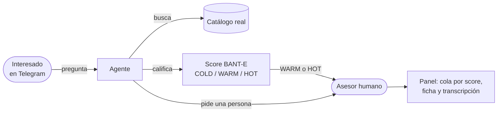
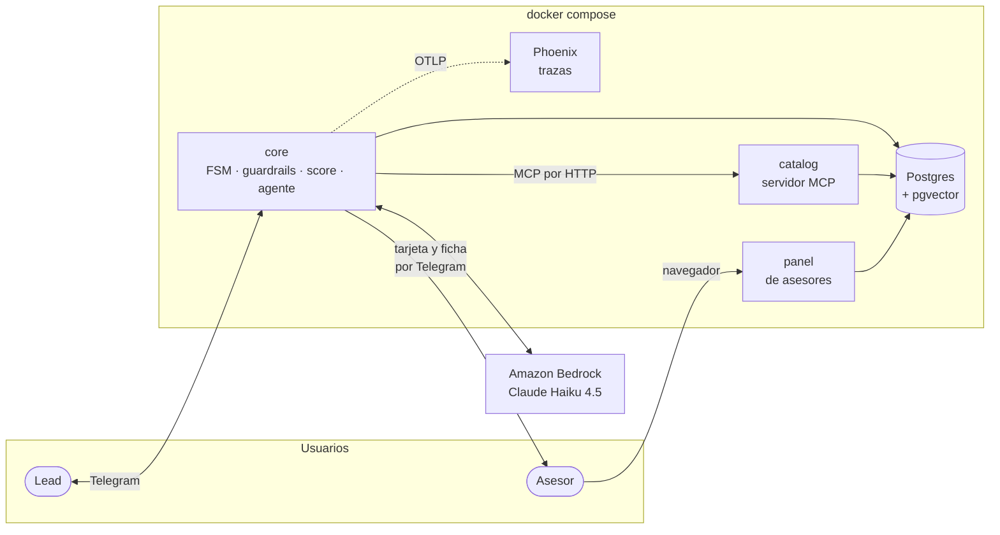
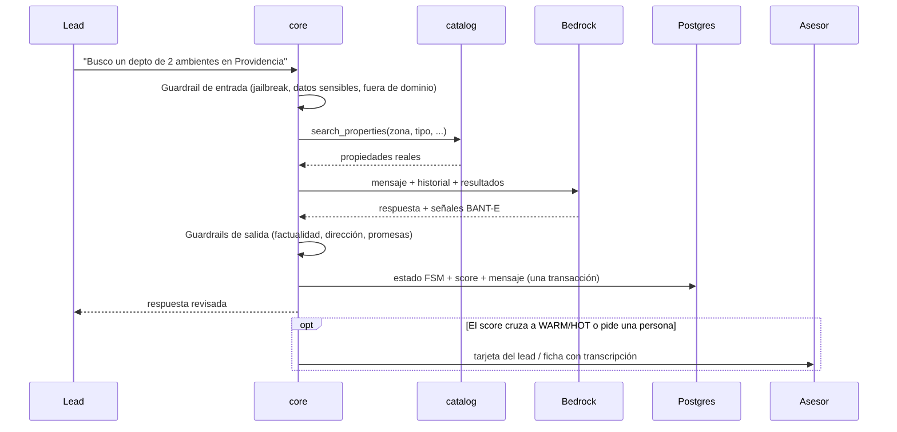
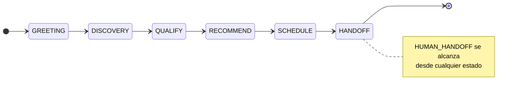
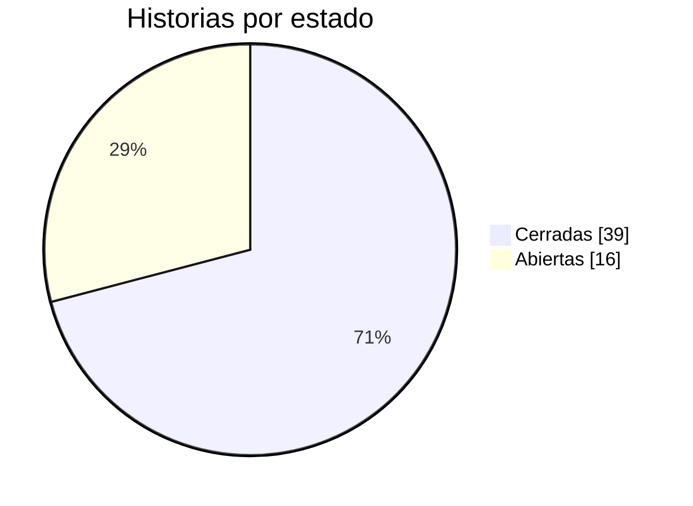
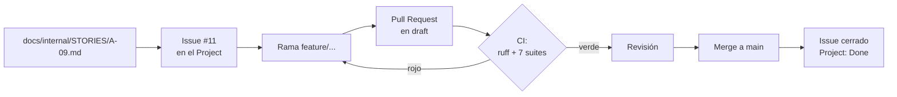
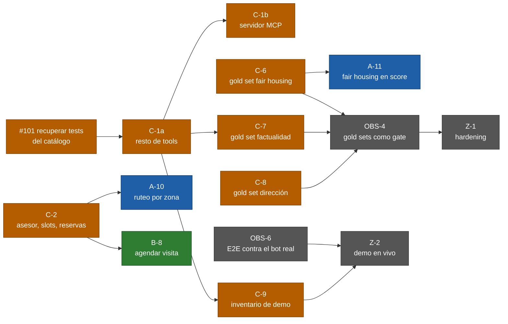

# Revisión de avance — jueves 24 de septiembre de 2026

Guion de la presentación del equipo, con un máximo de 9 minutos. Cada sección responde un punto de la consigna.
Los números son de `main` al 24 de septiembre. El estado vivo de cada historia está en el
[Project](https://github.com/orgs/softserve-leads-inmobiliaria/projects/1).

| Min. | Sección |
| ---: | :--- |
| 0:00 | [1. Objetivo del producto](#1-objetivo-del-producto) |
| 1:30 | [2. Arquitectura en una imagen](#2-arquitectura-en-una-imagen) |
| 3:00 | [3. Cómo está el backlog](#3-cómo-está-el-backlog) |
| 4:00 | [4. Una historia típica](#4-una-historia-típica-a-9) |
| 5:00 | [5. Objetivo de la próxima semana](#5-objetivo-de-la-próxima-semana) |
| 6:00 | [6. Funcionalidad funcionando (demo)](#6-funcionalidad-funcionando-demo) |
| 8:00 | [7. Otros puntos clave](#7-otros-puntos-clave) y [8. Preguntas](#8-preguntas) |

---

## 1. Objetivo del producto

> **Un agente conversacional por Telegram que atiende a quien pregunta por una propiedad, lo califica,
> le recomienda propiedades reales del catálogo y se lo pasa a un asesor humano listo para cerrar.**

El problema es que los asesores gastan su tiempo en conversaciones que no van a ningún lado y responden
tarde a las que sí. El agente resuelve la primera parte de la conversación y entrega al asesor solo lo
que vale la pena, con el contexto completo.

Tres reglas que definen el producto:

- **El LLM nunca inventa.** Precios, disponibilidad y direcciones salen del catálogo. Hay guardrails que
  revisan cada respuesta antes de enviarla.
- **El LLM nunca pone la nota.** Solo extrae señales del mensaje. El score lo calcula una función de Python,
  auditable y con tests.
- **El humano siempre está a un mensaje.** Cualquiera puede pedir un asesor en cualquier momento de la
  conversación.

## 2. Arquitectura en una imagen

- **`core`** es el cerebro: recibe el mensaje, lo pasa por los guardrails de entrada, avanza la máquina de
  estados, consulta el catálogo, llama al LLM, revisa la respuesta y guarda todo en Postgres.
- **`catalog`** expone las propiedades como *tools* MCP (`search_properties`, `get_property`, …). El agente
  solo puede ver lo que estas tools devuelven.
- **`panel`** es la web del asesor: su cola de leads ordenada por score, la ficha y la conversación.
- Todo corre en contenedores endurecidos: sin root, sistema de archivos de solo lectura y puertos solo
  en `127.0.0.1`.

**Qué pasa en un turno:**

**Los estados de la conversación:**

## 3. Cómo está el backlog

**55 historias en 6 épicas: 39 cerradas y 16 abiertas.** Todas viven como Issues en GitHub y en el
Project #1, con prioridad (P0/P1/P2), track, estimación y lote.

| Épica | Qué cubre | Cerradas | Abiertas |
| :--- | :--- | ---: | :--- |
| **E0** Contratos y entorno | Contratos congelados, CI, compose, *fakes*, esqueleto E2E | 9 / 9 | — |
| **E1** Motor del agente | FSM, agente, score, guardrails, traspaso | 12 / 14 | A-10, A-11 |
| **E2** Canal y borde | Bot de Telegram, identidad, panel, avisos, dashboard | 8 / 9 | B-8 |
| **E3** Datos y conocimiento | Catálogo, esquema, reglas BANT-E, FAQ, gold sets, inventario | 3 / 11 | C-1a, C-1b, C-2, C-5…C-9 |
| **E4** Observabilidad y calidad | Trazas, funnel, tests de FSM, logs, plan B | 5 / 8 | OBS-4, OBS-5, OBS-6 |
| **E5** Cierre y demo | Arquitectura final, docs, hardening, demo | 2 / 4 | Z-1, Z-2 |

Además de las historias, en la semana se cerraron **3 bugs** encontrados probando en vivo (#81, #84, #89)
y **2 tareas de deuda técnica** de seguridad de los contenedores (#65 cerrada, #104 casi completa).

**Cómo se reparte el trabajo:** un track por persona, cada uno dueño de sus carpetas para no pisarse.

| Track | Dueño de | Estado |
| :--- | :--- | :--- |
| **A** — motor del agente | `services/core` (FSM, agente, guardrails, score) | Terminado salvo A-10 y A-11, que esperan al track C |
| **B** — canal y panel | Bot de Telegram, `services/panel` | Terminado salvo B-8, que espera a C-2 |
| **C** — datos y catálogo | `services/catalog`, `db/`, gold sets | Es donde está el trabajo pendiente |

## 4. Una historia típica: A-9

Cada historia tiene su archivo en `docs/internal/STORIES/`, su Issue y su tarjeta en el Project.

> **A-9 — Scoring BANT-E integrado en la FSM** · Épica E1 · P0 · 2 puntos · Track A · Depende de C-4
>
> *Como asesor, quiero que el score BANT-E se acumule automáticamente turno a turno y se persista, para
> ver la calificación real de cada lead sin que el LLM la invente.*
>
> **Criterios de aceptación**
> - Score persistido en Postgres.
> - El LLM extrae la señal cruda por turno y nunca emite el número final.
>
> **Definition of Done:** PR revisado, suite en verde en CI, ningún *contract test* roto, estado actualizado
> en el Project y decisión de arquitectura registrada si la hubo (DT-14).

**Cómo se calcula el score:** 5 dimensiones de 0 a 20 puntos cada una.

| Dimensión | Señal | Ejemplo |
| :--- | :--- | :--- |
| **B**udget | ¿Declaró presupuesto? | Sí → 20 |
| **A**uthority | ¿Quién decide? | Solo → 20 · pareja → 12 · familia → 8 |
| **N**eed fit | ¿Cuántas propiedades del catálogo le sirven? | 3 o más → 20 |
| **T**iming | ¿Cuándo? | Inmediata → 20 · 3 meses → 12 |
| **E**ligibility | ¿Cumple los requisitos? (lo dice el catálogo) | Sí → 20 |

Total de 0 a 100: **COLD** ≤ 40 · **WARM** 41-70 · **HOT** ≥ 71.

**El recorrido de toda historia:**

## 5. Objetivo de la próxima semana

> **Propuesta:** llegar a la demo de punta a punta con datos reales. Un lead encuentra propiedades reales,
> se califica sin sesgos, llega al asesor de su zona y la visita queda agendada. Los gold sets tienen que
> estar funcionando como control de calidad.

Hoy el motor y el canal están listos, pero **el catálogo del stack arranca vacío**: toda búsqueda
devuelve cero propiedades. Todo lo que falta depende del track C:

Colores: naranja = track C · azul = track A · verde = track B · gris = transversal.

| Prioridad | Qué | Quién | Desbloquea |
| :--- | :--- | :--- | :--- |
| 1 | #101: recuperar los tests del catálogo, cerrar C-1a/C-1b | Track C | Todo lo demás del catálogo |
| 2 | **C-9** inventario de demo | Track C | La demo |
| 3 | **C-6** gold set de fair housing | Track C | A-11 y OBS-4 |
| 4 | **C-2** asesor, horarios y reservas | Track C | A-10 y B-8 |
| 5 | A-10, A-11 · B-8 · OBS-6 | Tracks A y B | Z-1 y Z-2 |
| 6 | Z-1 hardening y Z-2 demo ensayada | Los 3 | El cierre |

Mientras tanto, los tracks A y B apoyan al C con pares y revisiones, en lugar de abrir alcance nuevo.

## 6. Funcionalidad funcionando (demo)

Esto **no es la demo final**. La demo de punta a punta es Z-2 y necesita las historias que faltan (§5).
Lo que sí se puede mostrar hoy son las piezas que ya funcionan por separado.

**Qué se puede mostrar y con qué evidencia** ([`design.md` §5](../../DESIGN/design.md#5-estado-real-del-sistema)):

| Qué | Historias | Estado |
| :--- | :--- | :--- |
| Arnés E2E: 8 conversaciones guionadas contra el stack en Docker | CT-9 | Corre con un comando, sin depender de nada externo |
| Bot por *long polling*, aviso de privacidad, baja con `STOP` | B-1, B-2 | Verificado en vivo |
| Tarjeta al asesor por Telegram cuando el lead pasa a WARM | B-7 | Verificado en vivo |
| Cola del panel por score y "tomar lead" | B-5, B-6 | Verificado en vivo |
| Dashboard del funnel | B-9, OBS-2 | Verificado en vivo |
| Bedrock con reintentos ante *throttling* (36 reintentos en una ráfaga, 0 turnos perdidos) | A-14 | Verificado en vivo |
| Ficha con la transcripción al pedir un asesor | A-12, A-13 | Solo con tests: **ensayarla antes de presentar** |
| Traza del turno en Phoenix | OBS-1 | Solo con tests: **ensayarla antes de presentar** |

**Qué no se puede mostrar todavía:**

- **Recomendar propiedades.** El catálogo arranca vacío (falta C-9), así que el agente no encuentra nada.
- **Que el lead llegue solo al panel de su asesor.** La zona del lead sale de la primera propiedad que
  consulta. Sin propiedades, hay que asignarla a mano en la base antes de mostrar el panel.
- **Agendar la visita** (C-2, B-8) ni el ruteo por zona (A-10).

**Guion propuesto (unos 2 minutos):**

1. **Arnés E2E.** `docker compose run --rm --build harness`. Resultado esperado: `8/8 guiones en verde`.
2. **Bot de Telegram con Bedrock.** Saludar y recibir el aviso de privacidad y la respuesta del agente.
   Después dar presupuesto, quién decide y cuándo: con eso el score llega a WARM sin necesitar propiedades,
   y el asesor recibe la tarjeta.
3. **Pedir un asesor.** Escribir "quiero hablar con un asesor". El asesor recibe la ficha con la
   transcripción.
4. **Panel y dashboard.** Mostrar la cola ordenada por score, la ficha del lead y el funnel.

**Preparación antes de presentar:**

- `.env` con `TELEGRAM_BOT_TOKEN`, las credenciales de Bedrock y `LLM_PROVIDER=bedrock`.
- Un asesor registrado con `https://t.me/<bot>?start=adv_<token>` (el token sale de `docker compose logs seed`).
- Asignarle la zona al lead de la demo: `update leads set zone='Providencia' where ...`.
- Ensayar los pasos 2 y 3 completos una vez.

**Plan B si algo falla en vivo:** el arnés no depende de Telegram ni de Bedrock, porque usa el agente
*fake*. Si la red falla, se muestran el arnés, el panel y el funnel.

## 7. Otros puntos clave

**Lo que salió bien**

- **Contratos primero.** Congelar el evento canónico, el estado de la FSM y las tools MCP antes de escribir
  lógica permitió que los tres tracks avanzaran en paralelo sin bloquearse.
- **Probar en vivo encuentra lo que los tests no.** Los 3 bugs de la semana (#81, #84, #89) aparecieron así,
  con todos los tests en verde, y ya están corregidos.
- **Decisiones registradas.** 31 decisiones de arquitectura (DT-1…DT-31) con su porqué, en
  [`decisions.md`](../../DECISIONS/decisions.md).
- **Honestidad sobre el estado.** [`design.md` §5](../../DESIGN/design.md#5-estado-real-del-sistema) separa lo
  verificado en vivo, lo que solo tiene tests y lo que está diseñado pero no construido.

**Riesgos**

| Riesgo | Impacto | Mitigación |
| :--- | :--- | :--- |
| El track C concentra casi todo lo pendiente (8 de 16 historias) | La demo depende de C-9 | Priorizar C-9, C-6 y C-2 (#101) y que A y B ayuden con pares |
| CI no bloquea el merge: un repo privado en plan gratuito no permite exigir *checks* | Un PR en rojo se puede mergear | Acuerdo de equipo: nunca mergear en rojo |
| Límite de tasa de Bedrock | Respuestas de respaldo en ráfagas | Reintentos con *backoff* (A-14). Falta decidir el valor de `LLM_RATE_LIMIT_PER_MINUTE` |
| Las 44 vulnerabilidades HIGH de la imagen base Debian no tienen arreglo publicado | Seguridad | Decisión pendiente: imagen *distroless* (#104) |

**Decisiones que necesitamos del equipo**

1. ¿Cambiamos a una imagen base *distroless*? Elimina las 44 vulnerabilidades HIGH, pero los contenedores
   se quedan sin shell para depurar.
2. ¿Qué valor le damos a `LLM_RATE_LIMIT_PER_MINUTE` para la demo?

## 8. Preguntas

Preguntas que probablemente aparezcan, con su respuesta corta:

- **¿Por qué no dejar que el LLM calcule el score?** No sería auditable ni reproducible, y podría usar
  categorías protegidas. El contrato de señales ni siquiera tiene campos para ellas.
- **¿Qué pasa si el LLM inventa un precio?** El guardrail de factualidad compara cada número de la respuesta
  con los resultados del catálogo en ese turno. Si no coincide, la respuesta no sale.
- **¿Por qué MCP para el catálogo?** El agente solo accede a lo que exponen las tools. Además, el catálogo es
  un servicio aparte que se puede probar y reemplazar solo (hay un *fake* en memoria para los tests).
- **¿Por qué Telegram?** Con *long polling* no hace falta URL pública: se prueba desde cualquier laptop. El núcleo trabaja con un evento canónico, así que agregar otro canal es escribir un adaptador.
- **¿Qué falta para producción?** El catálogo con inventario real, la agenda (C-2/B-8), el *scheduler* de
  seguimiento y exigir CI en verde para mergear. El detalle está en
  [`design.md` §5.3 y §5.4](../../DESIGN/design.md#53-diseñado-pero-no-construido).
