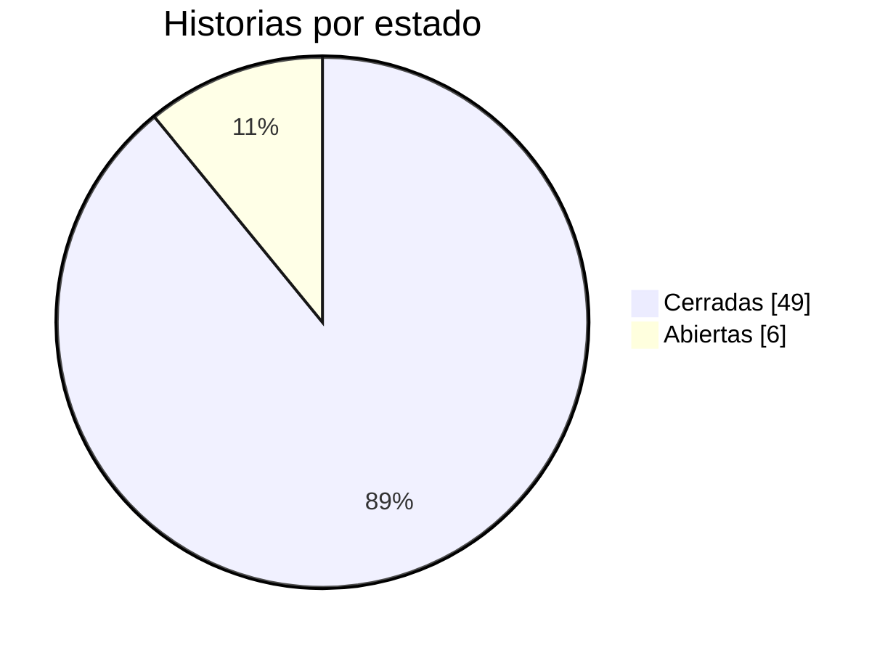
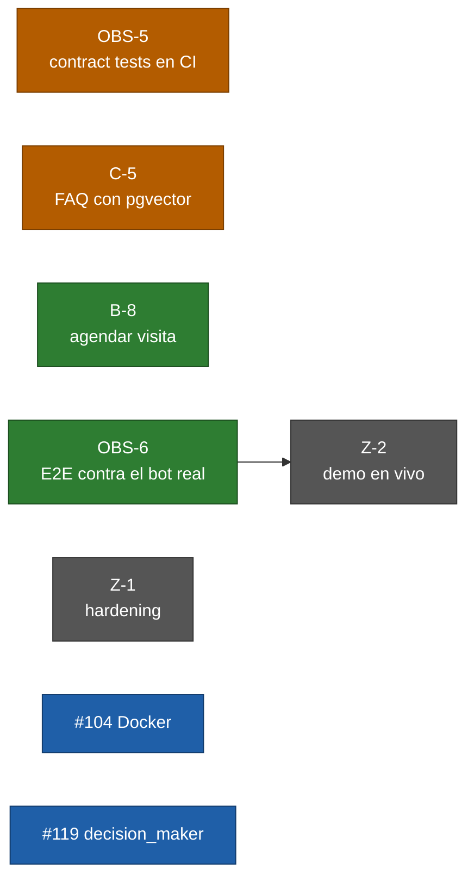

# Estado del proyecto — jueves 1 de octubre de 2026

Foto del proyecto a esta fecha: qué está hecho, qué funciona en vivo, qué falta y quién lo tiene. Los
números son de `main` al 1 de octubre (`9050179`, CI en verde). El estado vivo de cada historia está en el
[Project](https://github.com/orgs/softserve-leads-inmobiliaria/projects/1). La presentación anterior es la
[revisión de avance del 24 de septiembre](2026-09-24-revision-de-avance.md).

| Sección |
| :--- |
| [1. En una línea](#1-en-una-línea) |
| [2. Cómo está el backlog](#2-cómo-está-el-backlog) |
| [3. Qué cambió desde el 24 de septiembre](#3-qué-cambió-desde-el-24-de-septiembre) |
| [4. Qué funciona hoy en vivo](#4-qué-funciona-hoy-en-vivo) |
| [5. Qué falta y quién lo tiene](#5-qué-falta-y-quién-lo-tiene) |
| [6. Riesgos](#6-riesgos) |
| [7. Decisiones que necesitamos del equipo](#7-decisiones-que-necesitamos-del-equipo) |
| [8. Cómo preparar la demo](#8-cómo-preparar-la-demo) |

---

## 1. En una línea

> **El agente ya funciona de punta a punta en Telegram con datos reales:** el catálogo arranca con
> inventario, el lead llega desde el anuncio con su zona, se califica sin sesgos, se asigna al asesor de esa
> zona y los gold sets controlan la calidad en cada PR. Faltan 6 historias: la agenda con calendario real,
> la FAQ, dos de observabilidad y las dos de cierre.

## 2. Cómo está el backlog

**55 historias: 49 cerradas y 6 abiertas** (el 24 de septiembre eran 39 y 16).



| Épica | Qué cubre | Cerradas | Abiertas |
| :--- | :--- | ---: | :--- |
| **E0** Contratos y entorno | Contratos congelados, CI, compose, *fakes*, esqueleto E2E | 9 / 9 | — |
| **E1** Motor del agente | FSM, agente, score, guardrails, traspaso | 14 / 14 | — |
| **E2** Canal y borde | Bot de Telegram, identidad, panel, avisos, dashboard | 8 / 9 | B-8 |
| **E3** Datos y conocimiento | Catálogo, esquema, reglas BANT-E, FAQ, gold sets, inventario | 10 / 11 | C-5 |
| **E4** Observabilidad y calidad | Trazas, funnel, tests de FSM, logs, gold sets como *gate*, plan B | 6 / 8 | OBS-5, OBS-6 |
| **E5** Cierre y demo | Arquitectura final, docs, hardening, demo | 2 / 4 | Z-1, Z-2 |

Además quedan abiertos dos issues que no son historias, ambos de `dbarretol`: #104 (endurecer el stack de
Docker, casi completo) y #119 (un *gap* de fair housing en `decision_maker`, P2).

## 3. Qué cambió desde el 24 de septiembre

**10 historias y 3 *gaps* cerrados en una semana**, en 13 PRs. El cuello de botella del track C, que el 24
concentraba 8 de las 16 historias abiertas, quedó resuelto.

| Qué | Historias / issues | Efecto |
| :--- | :--- | :--- |
| Catálogo completo como servidor MCP, con sus tests recuperados | C-1a, C-1b, #101 | Las 5 tools `catalog.*` responden contra Postgres |
| Inventario de demo | C-9 | El catálogo deja de arrancar vacío: 12 propiedades, 3 promociones y 3 asesores |
| Asesor, horarios y reservas | C-2 | `assign_advisor`, `get_slots` y `book` existen en el catálogo |
| Ruteo por zona | A-10 | El lead calificado llega al asesor de su zona |
| Gold set de fair housing y su arreglo | C-6, A-11, #116 | 25 perfiles pareados, todos con diferencia 0. Authority ya no distingue pareja ni familia (DT-38), y el guardrail detecta gentilicios ("soy colombiano") |
| Gold set de factualidad sobre el catálogo real | C-7 | 75 casos contra la salida real del catálogo (DT-36) |
| Gold set de dirección reservada | C-8 | 18 casos |
| Gold sets como *gate* de merge | OBS-4 | Un registro central con el umbral de cada gold set. Si uno baja de su mínimo, o aparece uno nuevo sin registrar, CI falla (DT-37) |
| Enlace del anuncio | #122 | `t.me/<bot>?start=prop_<id>` saluda con la propiedad y le asigna la zona al lead |

Las decisiones de arquitectura pasaron de 31 a **38** (DT-32…DT-38), todas en
[`decisions.md`](../DECISIONS/decisions.md).

**Quién cerró qué en la semana:**

| Persona | PRs | Qué |
| :--- | ---: | :--- |
| `dbarretol` | 7 | C-2, A-10, A-11, #116, #122, el arreglo de host de Postgres y esta documentación |
| `miguelvelezsk` | 6 | Tests del catálogo (#101), C-9, C-6, C-7, OBS-4 |
| `SantiagoMartinez22` | 0 | — |

## 4. Qué funciona hoy en vivo

Verificado el 30 de septiembre levantando el stack completo desde cero (`docker compose up -d --build`):

| Qué | Resultado |
| :--- | :--- |
| Los 5 servicios (`catalog`, `core`, `panel`, `postgres`, `phoenix`) | Arriba y en verde en su *healthcheck* |
| Migraciones y *seed* | Terminan bien: 12 propiedades, 3 promociones (una vencida, que no se devuelve) y 3 asesores |
| Arnés E2E contra el stack | `8/8 guiones en verde` |
| Bot de Telegram | Escuchando por *long polling* |
| Amazon Bedrock | Los dos modelos (chat y clasificador, Claude Haiku 4.5) responden en ~1 s |
| Trazas en Phoenix | Llegan |

**Dos cosas que hay que configurar antes de mostrarlo** (no son bugs, son pasos de preparación):

1. **`LLM_PROVIDER=bedrock` en `.env`.** Por defecto está en `fake`: un agente de prueba que detecta la
   intención por palabras clave y responde con plantillas fijas. Sirve para tests y CI, que así no dependen
   de AWS, pero en una demo suena robótico. Con `bedrock` la conversación es libre.
2. **Registrar al menos un asesor en Telegram.** Ningún asesor del *seed* tiene chat asociado, así que la
   tarjeta del lead calificado no le llegaría a nadie. Ver [§8](#8-cómo-preparar-la-demo).

**Qué no se puede mostrar todavía:**

- **Agendar la visita con un calendario real** (B-8). Las tools de horarios y reservas existen, pero el
  agente todavía no las usa con un proveedor de calendario.
- **Responder preguntas frecuentes con la FAQ** (C-5).

## 5. Qué falta y quién lo tiene



Colores: naranja = `miguelvelezsk` · verde = `SantiagoMartinez22` · azul = `dbarretol` · gris = sin
responsable.

Todo lo que falta está desbloqueado salvo Z-2, que espera a OBS-6.

| Issue | Qué es | Prioridad | Responsable | ¿Se puede avanzar? |
| :--- | :--- | :--- | :--- | :--- |
| #47 **OBS-5** | Contract tests en CI | **P0** | `miguelvelezsk` | Sí, y está cerca: CI ya corre `tests/contracts` y hay tests para los 10 contratos. Falta auditar que no quede ninguno sin cubrir |
| #31 **C-5** | FAQ con embeddings en pgvector | P1 | `miguelvelezsk` | Sí: pgvector ya está en el compose y en la migración inicial. Falta elegir el modelo de embeddings y cargar 15-25 pares |
| #23 **B-8** | Agendar visita con el proveedor de calendario | P1 | `SantiagoMartinez22` | Sí: C-2 dejó listos `get_slots` y `book`. Falta el proveedor real y el *fallback* a "hora preferida" |
| #48 **OBS-6** | Conversaciones E2E contra el bot real | P1 | `SantiagoMartinez22` | Sí: el arnés existe. Faltan los guiones contra Bedrock y una corrida real contra los 3 servicios |
| #51 **Z-1** | Semana de hardening | **P0** | — | Sí: OBS-4 ya está. Solo *bugfix*, verificando contra los contenedores reales |
| #52 **Z-2** | Demo de punta a punta guionizada en vivo | **P0** | — | No: depende de OBS-6 |
| #104 | Endurecer el stack de Docker | P1 | `dbarretol` | En parte: falta la decisión sobre *distroless* y el lock de dependencias |
| #119 | `decision_maker` distingue pareja y familia; "mi esposa" no se redacta | P2 | `dbarretol` | En parte: la redacción de "mi esposa" se puede hacer ya; colapsar el enum necesita acuerdo |

**Sobre OBS-6 y las "frases fijas" del arnés.** Los guiones actuales verifican que la respuesta contenga
palabras exactas (`expect_reply_contains`). Con el agente `fake` eso siempre se cumple porque responde con
plantillas; con Bedrock el modelo puede responder bien con otras palabras y el guion fallaría. No es una
limitación del bot, que acepta conversación libre, sino de cómo están escritos esos tests. OBS-6 es justo
la historia que prueba el bot con el modelo real.

## 6. Riesgos

| Riesgo | Impacto | Mitigación |
| :--- | :--- | :--- |
| **OBS-6 y B-8 sin actividad desde el 19 de septiembre**, sin ramas ni PRs | Z-2 (la demo final, P0) depende de OBS-6 | Confirmar con `SantiagoMartinez22` si tiene trabajo local. Si no, repartir OBS-6 |
| **Z-1 y Z-2 (los dos P0 del cierre) sin responsable** | El cierre no tiene dueño | Asignarlos esta semana |
| CI no bloquea el merge (repo privado en plan gratuito) | Un PR en rojo se puede mergear | Acuerdo de equipo: nunca mergear en rojo. Pasó una vez esta semana (#117 y #118 juntos rompieron `main`) y se corrigió en el mismo día |
| Las vulnerabilidades HIGH de la imagen base Debian no tienen arreglo publicado | Seguridad | Decisión pendiente: imagen *distroless* (#104) |

## 7. Decisiones que necesitamos del equipo

1. **¿Quién toma Z-1 y Z-2?** Son los dos P0 que quedan sin dueño.
2. **¿Cambiamos a una imagen base *distroless*?** (#104) Elimina las vulnerabilidades de la imagen base,
   pero los contenedores se quedan sin shell para depurar.
3. **¿Colapsamos `pareja` y `familia` en el contrato de `decision_maker`?** (#119) Desde DT-38 valen lo
   mismo en el score; mantenerlos en el contrato solo deja una puerta abierta a que vuelvan a distinguirse.

## 8. Cómo preparar la demo

Con lo que hay en `main` hoy ya se puede mostrar el recorrido principal en Telegram.

**Preparación (una vez):**

1. `.env` con `TELEGRAM_BOT_TOKEN`, las credenciales de Bedrock y `LLM_PROVIDER=bedrock`.
2. Levantar el stack: `docker compose up -d --build`.
3. Registrar al asesor de Providencia. Su enlace de registro sale de la base:

   ```
   docker compose exec -T postgres sh -c 'psql -U "$POSTGRES_USER" -d "$POSTGRES_DB" -Atc "select ''https://t.me/<bot>?start=adv_'' || access_token from advisors where id=''adv_001''"'
   ```

   Se abre desde la cuenta de Telegram que hará de asesor, y el bot confirma el registro. Conviene usar dos
   cuentas distintas: una de lead y otra de asesor, en pantallas separadas.

**Guion sugerido (unos 5 minutos):**

| Paso | Qué hacer | Qué se ve |
| :--- | :--- | :--- |
| 1 | Entrar como lead por el enlace del anuncio: `t.me/<bot>?start=prop_00240` | Saludo con la propiedad; el lead queda en la zona de Providencia (#122) |
| 2 | "Busco algo en renta, mi presupuesto es 15 mil" | Búsqueda en el catálogo real, con precios que pasan el guardrail de factualidad |
| 3 | "Decido yo y me urge este mes" | El score BANT-E sube a WARM/HOT y **la tarjeta le llega al asesor** |
| 4 | "Soy colombiano, ¿eso influye?" | **Guardrail visible:** responde con normalidad y el dato no entra al score |
| 5 | "Quiero hablar con un asesor" | Traspaso a humano; el asesor recibe la ficha con la transcripción |
| 6 | Panel (`localhost:<PANEL_PORT>`) y Phoenix | El lead en la cola por score, el funnel y la traza del turno |

**Plan B si algo falla en vivo:** el arnés no depende de Telegram ni de Bedrock. Con
`docker compose run --rm --build harness` se muestran los 8 guiones en verde, y después el panel y el funnel.
