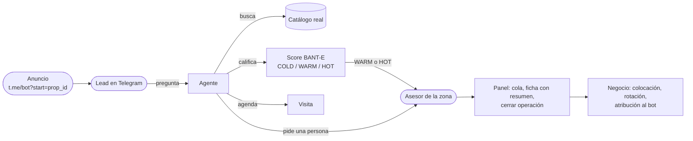
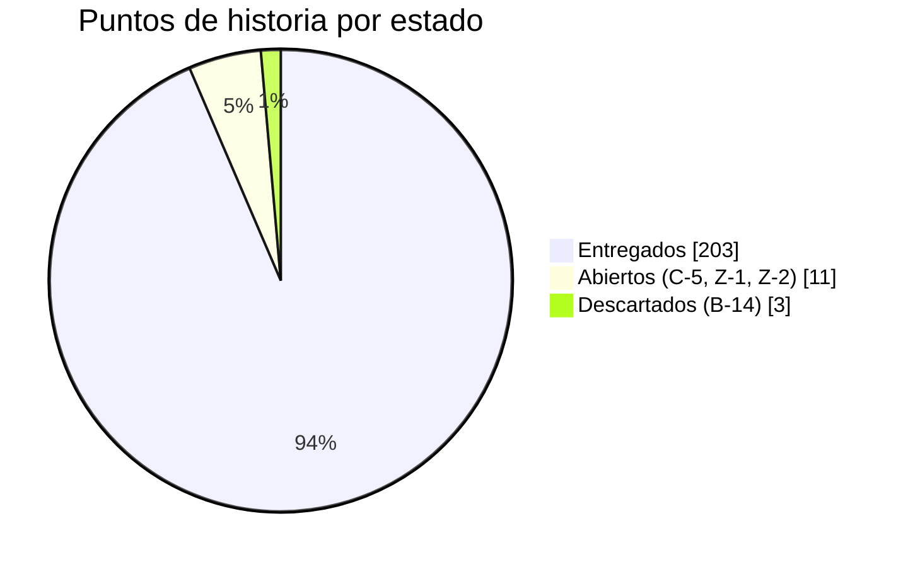
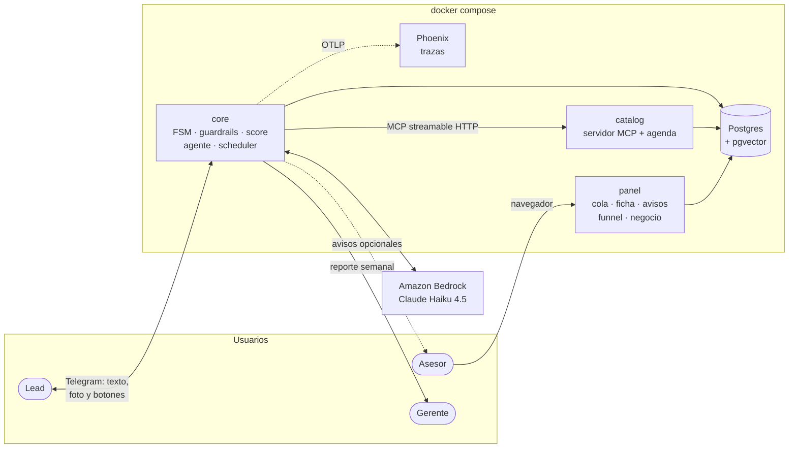
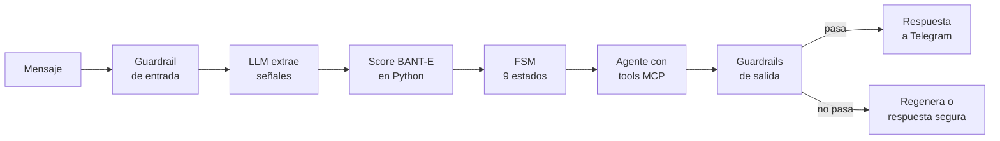

# Estado del proyecto — lunes 5 de octubre de 2026

Guion de la presentación del equipo, con un máximo de 12 minutos. Cada sección responde un punto de la
consigna. Los números son de `main` al 5 de octubre (`17a4a59`). El estado vivo de cada historia está en el
[Project](https://github.com/orgs/softserve-leads-inmobiliaria/projects/1). La foto anterior es el
[estado del 1 de octubre](2026-10-01-estado-del-proyecto.md). Las diapositivas de este guion están en
[`slides/`](slides/README.md).

| Min. | Sección |
| ---: | :--- |
| 0:00 | [1. Objetivo del producto](#1-objetivo-del-producto) |
| 1:30 | [2. Objetivo de la próxima semana](#2-objetivo-de-la-próxima-semana) |
| 2:30 | [3. Cómo está el backlog](#3-cómo-está-el-backlog) |
| 4:00 | [4. Una historia típica: B-11](#4-una-historia-típica-b-11) |
| 5:00 | [5. Arquitectura](#5-arquitectura) |
| 6:30 | [6. Otros puntos clave](#6-otros-puntos-clave) |
| 8:00 | [7. Funcionalidad funcionando (demo)](#7-funcionalidad-funcionando-demo) |
| 11:00 | [8. Preguntas](#8-preguntas) |

---

## 1. Objetivo del producto

> **Un agente conversacional por Telegram que atiende a quien pregunta por una propiedad, lo califica,
> le recomienda propiedades reales del catálogo, le agenda la visita y se lo pasa a un asesor humano listo
> para cerrar. Y le dice a la inmobiliaria cuánto vendió gracias a él.**

El problema: los asesores gastan su tiempo en conversaciones que no van a ningún lado y responden tarde a
las que sí. El agente resuelve la primera parte de la conversación, a cualquier hora, y entrega al asesor
solo lo que vale la pena, con el contexto completo.

Tres reglas que definen el producto y no se negocian:

- **El LLM nunca inventa.** Precios, disponibilidad y direcciones salen del catálogo. Los guardrails revisan
  cada respuesta antes de enviarla y, si no la pueden verificar, no sale.
- **El LLM nunca pone la nota.** Solo extrae señales del mensaje. El score lo calcula una función de Python,
  auditable y con tests, que no ve nacionalidad, estado civil ni familia (fair housing).
- **El humano siempre está a un mensaje (o a un botón).** Cualquiera puede pedir un asesor en cualquier
  momento de la conversación.

## 2. Objetivo de la próxima semana

> **Objetivo de la semana de cierre: alcance congelado y la demo de punta a punta corriendo en vivo, con
> Bedrock y Telegram reales, tres veces seguidas sin fallar.**

Ya no entra funcionalidad nueva. Lo que queda es terminar lo que está en vuelo, cerrar los *gaps* que se
notan en una demo y ensayar.

| Issue | Qué | Prioridad | Responsable | Estado hoy |
| :--- | :--- | :--- | :--- | :--- |
| #31 **C-5** | FAQ con embeddings en pgvector | P1 | `miguelvelezsk` | PR #195 abierto, CI en verde, falta revisión |
| #194 | El agente no sabe en qué zonas hay inventario: "¿dónde tienen propiedades?" cae en el *fallback* | P1 | `dbarretol`, `miguelvelezsk` | Diagnosticado, solución propuesta |
| #188 | El catálogo no distingue depa, casa o terreno: buscar un depa trae casas | P1 | `miguelvelezsk` | Diagnosticado, cambia el contrato MCP |
| #178 | Rediseño de la UI del panel (navegación, KPIs arriba, accesibilidad) | P1 | `miguelvelezsk` | Diagnosticado |
| #51 **Z-1** | Semana de *hardening*: solo *bugfix*, verificado contra los contenedores reales | **P0** | **sin asignar** | Desbloqueada |
| #52 **Z-2** | Demo guionizada en vivo | **P0** | **sin asignar** | Desbloqueada: OBS-6 ya cerró |

**Criterio de "terminado" de la semana:** los 4 escenarios de `make conversar` y el guion de la
[§7](#7-funcionalidad-funcionando-demo) pasan con `LLM_PROVIDER=bedrock`, sin respuestas de respaldo, y el
backlog queda en 0 historias abiertas.

## 3. Cómo está el backlog

**75 historias, 217 puntos: 71 hechas, 1 descartada y 3 abiertas.** Además hay 22 issues que no son
historias (bugs, *gaps* y deuda técnica encontrados en las pruebas en vivo): 19 cerrados y 3 abiertos.

| Épica | Qué cubre | Hechas | Abiertas |
| :--- | :--- | ---: | :--- |
| **E0** Contratos y entorno | Contratos congelados, CI, compose, *fakes*, esqueleto E2E | 9 / 9 | — |
| **E1** Motor del agente | FSM, agente, score, guardrails, traspaso, *scheduler*, resumen, alertas | 18 / 18 | — |
| **E2** Canal y borde | Bot, identidad, panel, avisos, agenda, foto, botones, SLA, recordatorios | 14 / 15 | — (B-14 notas de voz, descartada: necesita un servicio externo de transcripción) |
| **E3** Datos y conocimiento | Catálogo MCP, esquema, BANT-E, gold sets, inventario | 10 / 11 | C-5 |
| **E4** Observabilidad y calidad | Trazas, funnel, tests de FSM, gold sets y contratos como *gate*, E2E real | 8 / 8 | — |
| **E5** Cierre y demo | Arquitectura final, docs, *hardening*, demo | 2 / 4 | Z-1, Z-2 |
| **E6** Inteligencia comercial | Historial, cierres, atribución, rotación, demanda, reporte al gerente | 10 / 10 | — |

**Cómo se organiza:** cada historia es un issue con épica, *track* (core / borde / datos / cross),
prioridad P0-P2 y puntos (1 punto ≈ 2 horas). El tablero del Project es la única fuente de estado; el
archivo `docs/internal/STORIES/<ID>.md` tiene el *qué* (historia, criterios, DoD), nunca el estado.

**Qué pasó desde el 1 de octubre:** 23 historias (60 puntos) y 12 *bugs* o *gaps* cerrados en 38 PRs. Se
abrió y se completó entera la épica **E6 de inteligencia comercial**, que pidió el profesor, más las
propuestas de producto A-15 a A-18 y B-10 a B-15.

| Persona | PRs mergeados desde el 1-oct | Qué |
| :--- | ---: | :--- |
| `dbarretol` | 31 | B-8, OBS-6 (cierre), A-15…A-18, B-12, B-13, B-15, N-1, N-2, N-4…N-10, #104, #119, #125, #161, #182 |
| `SantiagoMartinez22` | 7 | OBS-6 (corrida real), B-10, B-11, N-3, #187, #189, #192 (Makefile) |
| `miguelvelezsk` | 0 (1 abierto) | C-5 en revisión (#195) |

## 4. Una historia típica: B-11

Elegimos [B-11](../../internal/STORIES/B-11.md) porque recorre todo el ciclo: nace de una propuesta de producto, toca
el canal sin romper contratos, deja una decisión de arquitectura y se verifica en vivo.

> **Como lead, quiero botones para agendar una visita o hablar con un asesor, para no tener que
> escribirlo.**
>
> Épica E2 · P1 · 3 puntos · Track borde · Depende de B-8

**Criterios de aceptación (resumidos):**

- "Hablar con un asesor" siempre; "Agendar visita" **solo** en `RECOMMEND`, el único estado en que pedir la
  visita arranca la reserva (si no, el botón parecería roto).
- Al tocar un botón, el canal lo convierte en un mensaje con texto fijo y sigue el flujo normal: guardrail
  de entrada, FSM y score. **Un botón no se salta los guardrails.**
- El contrato del evento canónico (CT-1) no cambia.
- Tocar dos veces no duplica la reserva (B-8 ya es idempotente).

**Definition of Done (igual para todas las historias):** PR revisado por otra persona · suite del servicio
en verde en CI · ningún *contract test* roto · estado actualizado en el Project · entrada en
`decisions.md` si cambia una decisión de arquitectura · verificado en vivo en Telegram.

**Recorrido real:** issue #137 → rama `borde/b-11-…` → PR #185 con la plantilla (Qué hace / Closes /
Checklist DoD / Cómo probarlo) → decisión **DT-51** ("un botón es un mensaje del lead con texto fijo, y solo
se ofrece donde funciona") → merge el 4 de octubre.

## 5. Arquitectura

Además de estos 5 servicios, el compose tiene `migrate` y `seed` (de un solo uso) y `harness` (los guiones
E2E). Todo levanta en local con `make start`; Telegram va por *long polling*, sin URL pública (DT-4).

**Qué pasa en un turno**, en orden:

- **Guardrail de entrada:** PII (teléfono, correo, tarjeta), *jailbreak* y menciones protegidas
  ("soy colombiano"), que se redactan antes de que nada las vea.
- **Guardrails de salida:** factualidad contra lo que devolvieron las tools en ese turno, dirección
  reservada, promesas no autorizadas ("te garantizo un descuento") y disponibilidad revalidada.
- **Todo el estado vive en Postgres** (FSM, historial, score) en la misma transacción. El *scheduler* de
  seguimientos, recordatorios y alertas guarda sus *jobs* en la misma base, así que un reinicio no los
  pierde.

El detalle está en [`design.md`](../../DESIGN/design.md) y en las **53 decisiones de arquitectura** de
[`decisions.md`](../../DECISIONS/decisions.md) (eran 38 el 1 de octubre).

## 6. Otros puntos clave

**Calidad que se puede comprobar, no prometer:**

| Qué | Cuánto |
| :--- | :--- |
| Tests automatizados | Más de 1 000, en 7 suites que corren en cada PR (`make ci`) |
| Gold sets como *gate* de merge | Fair housing (27 perfiles pareados, todos con diferencia 0), factualidad (75 casos), dirección reservada (18). Si uno baja de su umbral, CI falla |
| *Contract tests* | Los 10 contratos (evento canónico, tools MCP, estado de la FSM) |
| Corrida real E2E (OBS-6) | Contra los 3 servicios con Bedrock: ningún turno cae a la respuesta de respaldo |
| Decisiones registradas | 53 (DT-1 a DT-53) |

**Lo que aprendimos probando en vivo.** La mayoría de los *bugs* de esta semana no los encontraron los tests
sino las pruebas en Telegram: el Markdown que llegaba literal (`**negritas**`, #187), el aviso de privacidad
repetido (#189), el lead del anuncio que no llegaba a HOT (#182). Por eso "verificado en vivo" es parte del
DoD.

**Riesgos:**

| Riesgo | Impacto | Mitigación |
| :--- | :--- | :--- |
| **Z-1 y Z-2 (los dos P0 del cierre) siguen sin responsable** | El cierre no tiene dueño | Asignarlos hoy |
| Los 3 *gaps* abiertos (#194, #188, #178) recaen sobre una sola persona, que además tiene C-5 | Cuello de botella en la última semana | Repartir #194 y #178 |
| #188 cambia el contrato MCP de `search_properties` en la semana de *hardening* | Riesgo de romper algo que ya funciona | Filtro opcional y retrocompatible, con *contract tests* y su DT |
| CI no bloquea el merge (repo privado, plan gratuito) | Un PR en rojo se puede mergear | Acuerdo de equipo: nunca mergear en rojo |
| Cupo de Bedrock en la demo | Respuestas lentas o de respaldo | Reintentos con *backoff* (A-14) y plan B sin Bedrock (§7) |

## 7. Funcionalidad funcionando (demo)

**Preparación (antes de presentar):**

1. `.env` con `TELEGRAM_BOT_TOKEN`, las credenciales de Bedrock y `LLM_PROVIDER=bedrock`.
2. `make demo`: levanta el stack, siembra asesores, catálogo y seis meses de historia sintética, comprueba
   los servicios e imprime la URL del panel de cada asesor y el enlace del anuncio. Desde DT-42 ya no hace
   falta registrar a los asesores en Telegram: los avisos llegan al panel.
3. Dos pantallas: Telegram (lead) y el panel del asesor de la zona.

**Guion (unos 3 minutos):**

| Paso | Qué hacer | Qué se ve |
| :--- | :--- | :--- |
| 1 | Abrir el enlace del anuncio `t.me/<bot>?start=prop_00231` | Aviso de privacidad (una sola vez por lead), saludo **con la foto** de la propiedad (B-10) y el lead queda en su zona |
| 2 | "¿Sigue disponible? Tengo 2.5 millones, decido yo y quiero mudarme este mes", y después "¿qué requisitos piden?" | Respuesta con datos del catálogo; el agente verifica los requisitos y el score llega a HOT (#182) |
| 3 | "Soy colombiano, ¿eso influye?" | **Guardrail visible:** responde con normalidad y el dato no entra al score |
| 4 | "¿Me pasas la dirección exacta?" | **Guardrail visible:** no la da; ofrece la visita con un asesor |
| 5 | Cuando el agente recomienda la propiedad, tocar **"Agendar visita"** (B-11) | Horarios numerados de la agenda del catálogo; elegir uno reserva la visita (B-8) |
| 6 | Tocar **"Hablar con un asesor"** | Traspaso a humano |
| 7 | Panel del asesor | El lead arriba en la cola por score, aviso nuevo, y la ficha con **el resumen de la conversación** (A-16) y la transcripción |
| 8 | En la ficha, **cerrar la operación** (N-3) | La propiedad pasa a `cerrado`, se registra la operación y el lead queda ganado; el cierre cuenta para el bot (DT-41) |
| 9 | Vista **Negocio** del panel (N-8) | Colocación del periodo, propiedades que no rotan, cierres atribuidos al bot y demanda no cubierta |

**Plan B si algo falla en vivo:**

- Sin Telegram: `make conversar ARGS="04_deep_link_hasta_hot"` reproduce la conversación contra el stack
  y deja la transcripción en `tmp/demo/`.
- Sin Bedrock: `make harness` corre los guiones E2E con el agente *fake* en un stack aparte, y después se
  muestran el panel, el funnel y Phoenix.

**Qué no se muestra (y por qué):** la FAQ (C-5, en revisión), preguntar "¿en qué zonas tienen?" (#194) y
filtrar por tipo de inmueble (#188). Las tres son el trabajo de esta semana.

## 8. Preguntas

**Preguntas que esperamos, con su respuesta:**

| Pregunta | Respuesta corta |
| :--- | :--- |
| ¿Qué pasa si el LLM inventa un precio? | El guardrail de factualidad compara cada número con lo que devolvieron las tools en ese turno. Si no coincide, regenera; si vuelve a fallar, manda una respuesta segura y ofrece un asesor. Nunca sale el dato inventado |
| ¿Cómo evitan la discriminación? | El LLM solo extrae señales y la nota la pone Python. Las menciones protegidas se redactan a la entrada, y un gold set de 27 perfiles pareados (iguales salvo el dato protegido) exige diferencia 0 en el score para poder mergear |
| ¿Por qué Telegram y no WhatsApp? | Con *long polling* todo corre en local, sin URL pública, dominio ni túnel que pueda fallar en la demo (DT-4). El canal está aislado detrás del evento canónico (CT-1): WhatsApp sería otro adaptador con el mismo patrón (DT-20), sin tocar el agente |
| ¿Por qué MCP para el catálogo? | El agente solo puede ver lo que devuelven las tools. Eso hace verificable la factualidad y permite probar el agente contra un catálogo *fake* con el mismo contrato |
| ¿Qué modelo usan y cómo controlan el costo? | Claude en Amazon Bedrock con dos llamadas separadas por turno: una para responder y otra, más liviana, que solo extrae señales (DT-6). Hoy ambas con Haiku 4.5. Un límite de tasa local por modelo y reintentos con *backoff* evitan pasarse del cupo (DT-19, DT-30) |
| ¿Cómo saben que el bot vende? | Regla de atribución (DT-41): un cierre es del bot si el lead tocó esa propiedad con el bot en los 60 días previos. La vista de negocio y el reporte semanal al gerente lo muestran |
| ¿Qué harían con más tiempo? | Notas de voz (B-14), WhatsApp como segundo canal y búsqueda semántica sobre las descripciones del catálogo |

**Decisiones que necesitamos del equipo:**

1. ¿Quién toma Z-1 y quién Z-2?
2. ¿Entra #188 (cambia el contrato MCP) o lo dejamos fuera para no arriesgar la demo?
3. ¿Quién revisa el PR de C-5 (#195)?
