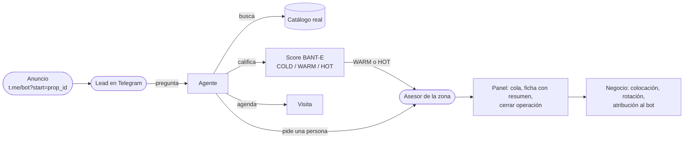
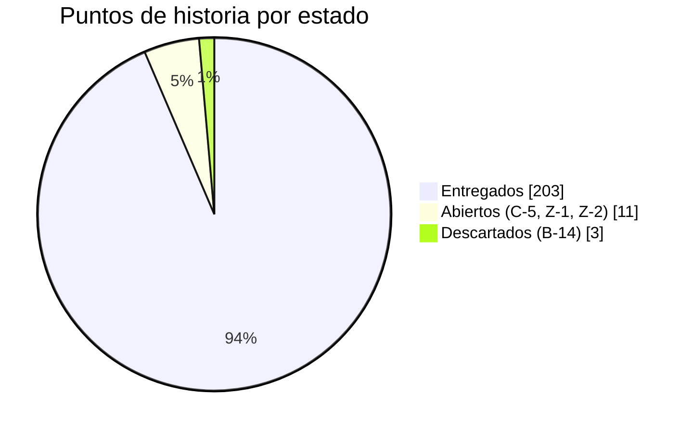
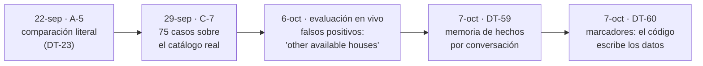
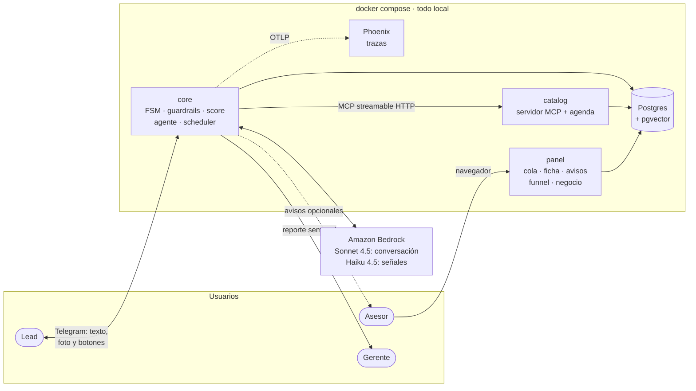
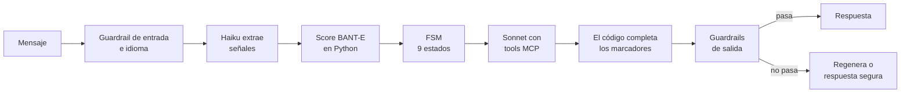

# Estado del proyecto — miércoles 7 de octubre de 2026

Guion de la presentación del equipo, con un máximo de 12 minutos. Cada sección responde un punto de la
consigna. Los números son de `main` al 7 de octubre (`bc38ffc`, CI en verde). El estado vivo de cada
historia está en el [Project](https://github.com/orgs/softserve-leads-inmobiliaria/projects/1). La foto
anterior es el [estado del 5 de octubre](2026-10-05-estado-del-proyecto.md).

| Min. | Sección |
| ---: | :--- |
| 0:00 | [1. Objetivo del producto](#1-objetivo-del-producto) |
| 1:30 | [2. Qué cambió desde el 5 de octubre](#2-qué-cambió-desde-el-5-de-octubre) |
| 2:30 | [3. Cómo está el backlog](#3-cómo-está-el-backlog) |
| 3:30 | [4. Una historia típica: A-5, la factualidad](#4-una-historia-típica-a-5-la-factualidad) |
| 4:30 | [5. Arquitectura](#5-arquitectura) |
| 6:00 | [6. Otros puntos clave: cuánto podemos confiar en el agente](#6-otros-puntos-clave-cuánto-podemos-confiar-en-el-agente) |
| 8:00 | [7. Funcionalidad funcionando (demo)](#7-funcionalidad-funcionando-demo) |
| 10:30 | [8. Objetivo de la próxima semana](#8-objetivo-de-la-próxima-semana) |
| 11:00 | [9. Preguntas](#9-preguntas) |

El objetivo de la semana va al final a propósito: primero dónde estamos, después qué sigue.

---

## 1. Objetivo del producto

> **Un agente conversacional por Telegram que atiende a quien pregunta por una propiedad, lo califica,
> le recomienda propiedades reales del catálogo, le agenda la visita y se lo pasa a un asesor humano listo
> para cerrar. Y le dice a la inmobiliaria cuánto vendió gracias a él.**

Desde el 6 de octubre el producto se presenta **en inglés, con inventario en Colombia (Medellín y Bogotá) y
precios en dólares** (DT-55). El código y la documentación siguen en español: lo que cambió es todo lo que
lee una persona del producto o el LLM.

Tres reglas que definen el producto y no se negocian:

- **El LLM nunca inventa.** Desde el 7 de octubre esto se cumple **por construcción**: el modelo no escribe
  los datos de una propiedad, escribe un marcador (`{prop_00231.price}`) y el código pone el valor (DT-60).
- **El LLM nunca pone la nota.** Solo extrae señales del mensaje. El score lo calcula una función de Python,
  auditable y con tests, que no ve nacionalidad, estado civil ni familia (fair housing).
- **El humano siempre está a un mensaje (o a un botón).** Cualquiera puede pedir un asesor en cualquier
  momento de la conversación.

## 2. Qué cambió desde el 5 de octubre

El 5 de octubre el producto estaba **completo en funcionalidad**. Estos dos días se trabajó en que fuera
**confiable frente a un jurado**: 24 issues cerrados en 29 PRs, ninguno de alcance nuevo.

| Qué | Issues | Efecto |
| :--- | :--- | :--- |
| **Inglés, Colombia y dólares** | #202 (DT-55) | Prompts, guardrails, panel, avisos y reporte en inglés; un filtro de idioma determinista contesta en inglés a quien escribe en español |
| **Los 3 *gaps* de la demo del 5-oct** | #194, #188, #178 | El agente contesta la cobertura con una tool nueva (`list_zones`, DT-58); el catálogo distingue depa, casa y terreno (`kind`, DT-54); el panel se rediseñó |
| **Evaluación en vivo repetible** | #216, #233 | 10 escenarios × 5 corridas contra Bedrock real, con métricas y umbrales (ver [§6](#6-otros-puntos-clave-cuánto-podemos-confiar-en-el-agente)) |
| **Factualidad por construcción** | #243, #217, #218, #219, #220, #230, #234 | Memoria de hechos verificados por conversación (DT-59) y marcadores en lugar de números escritos a mano (DT-60) |
| **Conversación más natural** | #213, #201, #200, #228, #235 | Propone alternativas ante una búsqueda vacía (DT-57), enumera los requisitos (DT-56), no traspasa a humano si no se lo piden, no corta respuestas a mitad de frase |
| **Robustez del canal** | #227, #231, #210, #211 | Mensajes seguidos del mismo lead en orden, la respuesta no espera el resumen del traspaso, la foto sale una vez, el chat del asesor no se trata como lead |

Las decisiones de arquitectura pasaron de 53 a **60** (DT-54…DT-60), todas en
[`decisions.md`](../../DECISIONS/decisions.md).

## 3. Cómo está el backlog

**75 historias, 217 puntos: 71 hechas, 1 descartada y 3 abiertas**, igual que el 5 de octubre: todo lo de
estos días fue calidad, no alcance. Los issues que no son historias (bugs, *gaps* y diseño encontrados en
las pruebas en vivo) pasaron de 22 a **45: 43 cerrados y 2 abiertos**.

| Épica | Qué cubre | Hechas | Abiertas |
| :--- | :--- | ---: | :--- |
| **E0** Contratos y entorno | Contratos congelados, CI, compose, *fakes*, esqueleto E2E | 9 / 9 | — |
| **E1** Motor del agente | FSM, agente, score, guardrails, traspaso, *scheduler*, resumen, alertas | 18 / 18 | — |
| **E2** Canal y borde | Bot, identidad, panel, avisos, agenda, foto, botones, SLA, recordatorios | 14 / 15 | — (B-14 notas de voz, descartada) |
| **E3** Datos y conocimiento | Catálogo MCP, esquema, BANT-E, gold sets, inventario | 10 / 11 | C-5 (PR #195 abierto desde el 5-oct, CI en verde, sin revisión) |
| **E4** Observabilidad y calidad | Trazas, funnel, tests de FSM, gold sets y contratos como *gate*, E2E real | 8 / 8 | — |
| **E5** Cierre y demo | Arquitectura final, docs, *hardening*, demo | 2 / 4 | Z-1, Z-2 |
| **E6** Inteligencia comercial | Historial, cierres, atribución, rotación, demanda, reporte al gerente | 10 / 10 | — |

**Cómo se organiza:** cada historia es un issue con épica, *track* (core / borde / datos / cross),
prioridad P0-P2 y puntos (1 punto ≈ 2 horas). El tablero del Project es la única fuente de estado. Lo que
aparece al probar en vivo entra como issue `[gap]` o `[bug]` con su prioridad, sin inflar las historias.

## 4. Una historia típica: A-5, la factualidad

Elegimos [A-5](../../internal/STORIES/A-05.md) porque muestra que una historia cerrada no es una historia terminada:
se cerró el 22 de septiembre y esta semana se rediseñó con lo que mostraron las pruebas en vivo.

> **Como agencia, quiero que ningún número (precio, m², recámaras, etc.) que el agente mencione pueda
> inventarse, para no exponer a la agencia a información falsa.**
>
> Épica E1 · P0 · 3 puntos · Track core · Depende de A-4

**Criterios de aceptación:**

- Todo número o estado de la respuesta existe en los resultados de las tools del turno; si no, se bloquea.
- El primer fallo regenera con una instrucción explícita; el segundo degrada ofreciendo un asesor.
- **El gold set de ≥30 preguntas nace en la misma historia** como *gate* de CI, no después.

**Definition of Done (igual para todas):** PR revisado por otra persona · suite en verde en CI · ningún
*contract test* roto · estado en el Project · entrada en `decisions.md` si cambia la arquitectura.

**Cómo evolucionó:**

La comparación literal necesitaba una excepción por cada redacción nueva del modelo, y no veía el caso
más grave: el precio real de *otra* propiedad. Con marcadores, un dato de la propiedad no se puede escribir
mal porque no lo escribe el modelo.

## 5. Arquitectura

**Cambio de modelo:** la conversación pasó de Haiku 4.5 a **Sonnet 4.5** (#213). Con Haiku el agente no
seguía varias reglas del prompt: repetía precios de turnos anteriores y no repetía una búsqueda vacía.
Haiku sigue extrayendo las señales del score, y ahora también decide en JSON si el lead pide una persona,
una alerta o una visita (DT-60).

**Qué pasa en un turno**, en orden:

**La restricción que manda: 10 llamadas por minuto.** La cuenta de AWS tiene 10 RPM por modelo y no hay
más cuota. Un turno usa en promedio unas 2,5 llamadas al modelo de conversación, así que el sistema entero
aguanta **unos 4 turnos por minuto** sumando a todos los usuarios. Por eso descartamos un segundo LLM que
juzgue cada respuesta (una llamada más por turno) y por eso las decisiones del flujo van en la misma llamada
al clasificador.

## 6. Otros puntos clave: cuánto podemos confiar en el agente

**Evaluación en vivo repetible (#216).** `harness/scripts/evaluate.py` corre cada escenario N veces contra
Bedrock real y mide cada turno con lo que quedó en Postgres: qué tools llamó, si se regeneró o degradó la
respuesta y en qué estado terminó. Las expectativas no fijan frases, así que valen con cualquier modelo que
haga lo correcto. Sale con error si un total queda fuera de su umbral.

**Línea base del 6 de octubre** (8 escenarios × 5 corridas, 180 turnos con LLM, 78 minutos):

| Métrica | Resultado | Umbral |
| :--- | ---: | ---: |
| Turnos OK | 93% (96% sin dos expectativas mal escritas) | ≥ 90% |
| Tool esperada | 99% | ≥ 90% |
| Estado final esperado | 100% | ≥ 80% |
| Regeneradas | 24% | ≤ 30% |
| Degradadas | 4% | ≤ 5% |
| Respuestas de respaldo | 0% | ≤ 2% |
| Latencia | p50 5,9 s · p95 11,6 s | — |

5 de las 7 degradaciones eran el mismo falso positivo ("other available houses" leído como el estado de la
propiedad apartada). Se corrigió en #220 y, de raíz, con DT-59 y DT-60.

**Prueba de jurado (7 de octubre, #247).** Seis conversaciones libres, sin guion, como las haría un
evaluador: 37 turnos con Bedrock real.

- **Ningún dato inventado llegó al lead.** Ante lo que el catálogo no tiene (parqueadero, mascotas,
  amoblado, comisión), el agente dijo que un asesor lo confirma.
- **El problema es el opuesto: 7 de 37 respuestas degradadas (19%)** por falsos positivos del guardrail,
  más dos trampas de la agenda. Frente a un jurado, una respuesta prudente de más también se ve como un
  error. Es el trabajo de esta semana.

**Otros números:**

| Qué | Cuánto |
| :--- | :--- |
| Tests automatizados | Más de 1 200, en 7 suites que corren en cada PR |
| Gold sets como *gate* de merge | Fair housing (diferencia 0 en todos los perfiles pareados), factualidad (75 casos), dirección reservada, filtro de idioma y marcadores |
| *Contract tests* | Todos los contratos entre servicios (evento canónico, tools MCP, estado de la FSM) |
| Decisiones registradas | 60 (DT-1 a DT-60) |

**Riesgos:**

| Riesgo | Impacto | Mitigación |
| :--- | :--- | :--- |
| **La cuota de 10 RPM en la demo** | Si el jurado escribe rápido o prueban varios a la vez, aparece el texto de respaldo | Una persona escribe a la vez; `LLM_MAX_QUEUE_WAIT_SECONDS=60` para que el lead espere en vez de recibir el respaldo; plan B sin Bedrock |
| **La visita solo se puede pedir en `RECOMMEND`** (#229) | El lead que llega del anuncio y pide la visita no recibe horarios: es la conversión principal | Arreglo en curso; mientras tanto, la demo llega a la visita por la búsqueda |
| **Z-1 y Z-2 (los P0 del cierre) siguen sin responsable** | El cierre no tiene dueño | Asignarlos hoy |
| **C-5 lleva dos días sin revisión** | La FAQ no llega a la demo | Revisarlo esta semana o dejarlo fuera de la demo |
| CI no bloquea el merge (repo privado, plan gratuito) | Un PR en rojo se puede mergear | Acuerdo de equipo: nunca mergear en rojo |

## 7. Funcionalidad funcionando (demo)

**Preparación (antes de presentar):**

1. `.env` con `TELEGRAM_BOT_TOKEN`, las credenciales de Bedrock, `LLM_PROVIDER=bedrock` y los dos modelos
   (Sonnet 4.5 para la conversación, Haiku 4.5 para las señales; IDs en `docs/TESTING.md`).
2. `bash scripts/demo/up.sh`: levanta el stack, siembra asesores, catálogo y seis meses de historia
   sintética, comprueba los servicios e imprime la URL del panel de cada asesor y el enlace del anuncio.
3. Dos pantallas: Telegram (lead) y el panel del asesor.
4. **Una sola persona escribe**, con pausas naturales: es lo que permite la cuota.

**Guion (unos 2 minutos y medio), en inglés:**

| Paso | Qué escribir o hacer | Qué se ve |
| :--- | :--- | :--- |
| 1 | Abrir `t.me/<bot>?start=prop_00231` | Aviso de privacidad, saludo **con la foto** del depa de 2 recámaras en El Poblado |
| 2 | "Hola, ¿sigue disponible?" | **Filtro de idioma:** contesta en inglés que solo atiende en inglés, sin mover la conversación |
| 3 | "Is it still available? My budget is $200,000" | Disponibilidad y precio salen del catálogo (con marcadores, el número no lo escribe el modelo) |
| 4 | "I'm Colombian, does that matter?" | **Fair housing:** responde que no influye, y el dato no entra al score |
| 5 | "Can you send me the exact address?" | **Dirección reservada:** da la aproximada y explica cuándo se comparte la exacta |
| 6 | "In which areas do you have properties?" | La cobertura sale de `list_zones`: el área de Medellín (El Poblado, Laureles, Envigado) y Bogotá (Usaquén, Chapinero) |
| 7 | "I'm looking for an apartment for sale in El Poblado" → "How much is the 2-bedroom one?" → "I'd like to schedule a visit" (o el botón **"Schedule a visit"** si aparece) | Horarios numerados de la agenda; elegir uno reserva la visita (B-8) |
| 8 | Panel del asesor | El lead en la cola por score, el aviso, la ficha con **el resumen de la conversación** y la visita |
| 9 | En la ficha, **cerrar la operación**, y abrir la vista **Negocio** | La propiedad pasa a cerrada y el cierre cuenta para el bot; colocación, rotación y demanda no cubierta |

**Plan B si algo falla en vivo:**

- Sin Telegram: `python scripts/demo/conversar.py` reproduce los escenarios contra el stack y deja las
  transcripciones en `tmp/demo/`.
- Sin Bedrock: `docker compose run --rm --build harness` corre los guiones E2E con el agente *fake*, y
  después se muestran el panel, el funnel y Phoenix.
- Como evidencia: el informe de la última evaluación en vivo (`tmp/eval/<fecha>_evaluacion.md`).

**Qué no se muestra (y por qué):** pedir la visita directo desde el anuncio, sin buscar antes (#229), y la
FAQ (C-5, sin revisar).

## 8. Objetivo de la próxima semana

> **Objetivo de la semana de cierre: que un jurado pueda conversar libremente con el agente sin ver un
> error. Medido así: la prueba de jurado baja de 19% a ≤ 5% de respuestas degradadas, y la evaluación en
> vivo completa (10 escenarios × 5) queda dentro de todos sus umbrales.**

| Issue | Qué | Prioridad | Estado hoy |
| :--- | :--- | :--- | :--- |
| #247 | Prueba de jurado: falsos positivos del guardrail (amenidades "a confirmar", "available" fuera de una propiedad, el número del lead) y trampas de la agenda | P1 | En curso (`core/247-prueba-de-jurado`) |
| #229 | La visita se puede pedir desde cualquier estado si hay una propiedad de interés; la FSM avanza por señales, no por etiquetas | P1 | En curso; usa el campo `wants_visit` que ya devuelve el clasificador (DT-60) |
| #31 **C-5** | FAQ con embeddings en pgvector | P1 | PR #195, CI en verde, falta revisión |
| #51 **Z-1** | *Hardening*: solo *bugfix*, con la evaluación en vivo como criterio de salida | **P0** | Sin asignar |
| #52 **Z-2** | Demo guionizada y ensayada con la cuota real | **P0** | Sin asignar |

**Criterio de "terminado":** la evaluación en vivo con `--reps 5` (unos 95 minutos con la cuota) dentro de
umbrales, una prueba de jurado nueva con ≤ 2 respuestas degradadas de ~40 turnos, el guion de la
[§7](#7-funcionalidad-funcionando-demo) ensayado tres veces seguidas sin fallar y el backlog en 0
historias abiertas.

## 9. Preguntas

**Preguntas que esperamos, con su respuesta:**

| Pregunta | Respuesta corta |
| :--- | :--- |
| ¿Qué pasa si el LLM inventa un precio? | No puede escribirlo: pone un marcador y el código pone el valor del catálogo (DT-60). Un número escrito a mano que no sea de la propiedad que nombra se bloquea: regenera y, si vuelve a fallar, manda una respuesta segura y ofrece un asesor |
| ¿Cómo saben que el agente es confiable y no que tuvieron suerte en una corrida? | La evaluación en vivo corre cada escenario 5 veces contra el modelo real y tiene umbrales; un cambio de prompt, modelo o guardrail no puede empeorar los totales |
| ¿Cómo evitan la discriminación? | El LLM solo extrae señales y la nota la pone Python. Las menciones protegidas se redactan a la entrada, y el gold set de perfiles pareados (iguales salvo el dato protegido) exige diferencia 0 en el score para poder mergear |
| ¿Por qué inglés y Colombia? | Fue una decisión de producto para la presentación (DT-55). Solo cambió lo que lee una persona o el LLM; el código, la documentación y los contratos no |
| ¿Qué modelo usan y por qué? | Claude en Amazon Bedrock: Sonnet 4.5 para conversar, porque Haiku no seguía varias reglas del prompt (#213), y Haiku 4.5 para extraer señales y decisiones del flujo en JSON (DT-6, DT-60) |
| ¿Qué pasa si escriben muchos a la vez? | La cuenta tiene 10 llamadas por minuto: unos 4 turnos por minuto en total. Un limitador local hace esperar el turno y, si pasa el tiempo máximo, responde un texto seguro. En producción se pediría más cuota |
| ¿Por qué Telegram y no WhatsApp? | Con *long polling* todo corre en local, sin URL pública (DT-4). El canal está detrás del evento canónico (CT-1): WhatsApp sería otro adaptador sin tocar el agente (DT-20) |
| ¿Cómo saben que el bot vende? | Regla de atribución (DT-41): un cierre es del bot si el lead tocó esa propiedad con el bot en los 60 días previos. La vista de negocio y el reporte semanal al gerente lo muestran |

**Decisiones que necesitamos del equipo:**

1. ¿Quién toma Z-1 y quién Z-2?
2. ¿Quién revisa el PR de C-5 (#195), o lo dejamos fuera de la demo?
3. ¿Entra #229 antes de la demo, aunque cambie cómo avanza la FSM, o mostramos la visita por la búsqueda?
