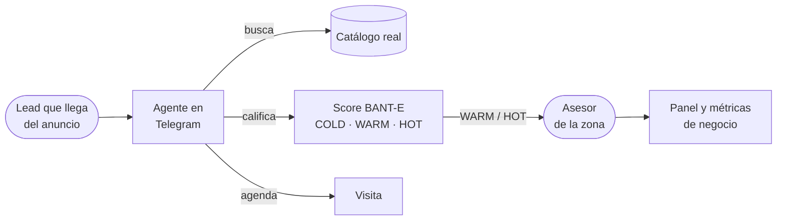
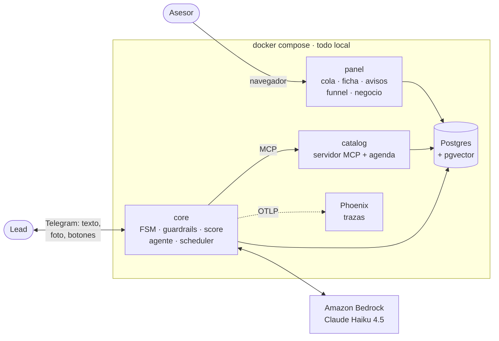

# Agente de Leads Inmobiliarios

Estado del proyecto · 5 de octubre de 2026

Equipo #2 · SoftServe Project Lab 
Santiago Martínez · David Barreto · Miguelangel Vélez

<!--
Presentarse en una frase. Avisar que hay demo en vivo a la mitad.
-->

---
layout: center
---

# Qué vamos a ver

① Objetivo del producto

⑤ Demo en vivo

② Cómo está el backlog

⑥ Puntos clave: calidad y riesgos

③ Una historia típica

⑦ Objetivo de la próxima semana

④ Arquitectura

⑧ Preguntas

<!--
10 segundos. Son los puntos de la consigna; el objetivo de la semana va al final para contar primero dónde estamos y después qué sigue.
-->

---
layout: statement
---

# Los asesores responden **tarde** a los leads buenos y pierden su tiempo con los que **no van a comprar**

<!--
El problema en una frase. Pausa antes de pasar a la solución.
-->

---

# ① Objetivo del producto

Un agente en <b>Telegram</b> que atiende al interesado a cualquier hora, lo <b>califica</b>, le recomienda
propiedades <b>reales</b>, le <b>agenda la visita</b> y se lo entrega al asesor listo para cerrar.

<!--
Leer la frase destacada. Recorrer el diagrama de izquierda a derecha: el lead llega del anuncio y termina en una métrica de negocio.
-->

---

# Tres reglas que no se negocian

🔎

### El LLM nunca inventa

Precios, disponibilidad y direcciones salen del catálogo. Los guardrails revisan cada respuesta antes de
enviarla.

⚖️

### El LLM nunca pone la nota

Solo extrae señales. El score lo calcula Python, auditable, y no ve nacionalidad, estado civil ni familia.

🙋

### El humano está a un botón

Cualquiera puede pedir un asesor en cualquier momento de la conversación.

<!--
Estas tres reglas explican casi todas las decisiones de arquitectura. Volvemos a ellas en la demo.
-->

---
layout: fact
---

# 71 de 75

historias hechas · **203 de 217 puntos** entregados

3 abiertas (C-5, Z-1, Z-2) · 1 descartada (B-14, notas de voz) 
Desde el 1 de octubre: 23 historias y 12 bugs cerrados en 38 PRs

<!--
② Backlog. El número grande primero; el detalle va en la siguiente.
-->

---

# ② Cómo está el backlog

| Épica | Hechas | Abiertas |
| :--- | ---: | :--- |
| **E0** Contratos y entorno | 9 / 9 | — |
| **E1** Motor del agente | 18 / 18 | — |
| **E2** Canal y panel | 14 / 15 | B-14 descartada |
| **E3** Datos y conocimiento | 10 / 11 | C-5 FAQ (en revisión) |
| **E4** Observabilidad y calidad | 8 / 8 | — |
| **E5** Cierre y demo | 2 / 4 | Z-1, Z-2 |
| **E6** Inteligencia comercial | 10 / 10 | — |

**Cómo lo organizamos**

- Cada historia es un issue con épica, track, prioridad P0-P2 y puntos (1 punto ≈ 2 h).
- El tablero de GitHub Projects es la **única** fuente de estado.
- 3 tracks paralelos: **core** (motor), **borde** (canal y panel) y **datos** (catálogo).
- E6 la pidió el profesor y se completó entera esta semana.

<!--
Mostrar el tablero en vivo si hay tiempo (10 s). Destacar que E6 se agregó y cerró en una semana.
-->

---

# ③ Una historia típica: B-11

<b>Como</b> lead, <b>quiero</b> botones para agendar una visita o hablar con un asesor,
<b>para</b> no tener que escribirlo.

E2 · P1 · 3 puntos · track borde · depende de B-8

**Criterios de aceptación**

- "Hablar con un asesor" siempre; "Agendar visita" **solo** donde funciona.
- El botón es un mensaje con texto fijo: **no se salta los guardrails**.
- El contrato del evento (CT-1) no cambia.
- Tocar dos veces no duplica la reserva.

**Definition of Done**, igual para todas

- PR revisado por otra persona
- Suite en verde en CI
- Ningún *contract test* roto
- Decisión registrada si cambia la arquitectura
- **Verificado en vivo en Telegram**

**Recorrido real**

Issue #137 → rama → PR #185 → decisión **DT-51** → merge el 4 de octubre

<!--
Elegimos B-11 porque recorre todo el ciclo y porque se ve en la demo. Remarcar "verificado en vivo": varios bugs de esta semana solo aparecieron así.
-->

---

# ④ Arquitectura

El agente solo ve lo que devuelven las tools del catálogo (MCP). Todo el estado vive en Postgres.
Telegram por <i>long polling</i>: sin URL pública. El gerente recibe un reporte semanal por Telegram.

<!--
Orden de lectura: lead → core → catálogo y Bedrock → Postgres → panel del asesor. Phoenix guarda una traza por turno.
-->

---

# Qué pasa en cada mensaje

<b>Guardrail de entrada</b>redacta PII y datos protegidos

→

<b>LLM extrae señales</b>no decide nada

→

<b>Score BANT&#8209;E</b>lo calcula Python

→

<b>FSM</b>9 estados

→

<b>Agente</b>solo ve las tools MCP

→

<b>Guardrails de salida</b>si no pasa, regenera

→

<b>Respuesta</b>texto, foto y botones

**Entrada:** PII, *jailbreak* y menciones protegidas ("soy colombiano") se redactan antes de que nada
las vea.

**Salida:** factualidad contra el catálogo, dirección reservada, promesas no autorizadas y disponibilidad
revalidada.

<!--
Aquí se ven las tres reglas: el score lo calcula Python, no el LLM; y nada sale sin pasar los guardrails.
-->

---
layout: center
class: text-center
---

# ⑤ Demo en vivo

Telegram (lead) · Panel (asesor)

1. Entra por el anuncio: foto y zona

2. Se califica hasta HOT

3. "Soy colombiano": guardrail

4. "¿La dirección exacta?": guardrail

5. Botón "Agendar visita"

6. Botón "Hablar con un asesor"

7. Panel: cola y resumen

8. Cerrar la operación

9. Vista de negocio

<!--
Antes: make demo, LLM_PROVIDER=bedrock, dos pantallas.
Enlace: t.me/<bot>?start=prop_00231
Mensajes: "¿Sigue disponible? Tengo 2.5 millones, decido yo y quiero mudarme este mes" → "¿Qué requisitos piden?" → "Soy colombiano, ¿eso influye?" → "¿Me pasas la dirección exacta?" → botones.
Plan B sin Telegram: make conversar ARGS="04_deep_link_hasta_hot". Sin Bedrock: make harness.
-->

---

# ⑥ Puntos clave: calidad que se puede comprobar

+1 000

tests en 7 suites, en cada PR

27 / 27

perfiles de fair housing con diferencia 0 en el score

75

casos de factualidad contra el catálogo real

53

decisiones de arquitectura registradas

- Los **gold sets** son un *gate*: si uno baja de su umbral, CI falla.
- Los 10 contratos entre servicios tienen *contract tests*.
- La corrida E2E real contra los 3 servicios con Bedrock no cayó nunca a la respuesta de respaldo.
- **Lo que aprendimos:** los bugs de esta semana (Markdown literal, aviso repetido, lead que no llegaba a
  HOT) los encontraron las pruebas en vivo, no los tests. Por eso "verificado en vivo" está en el DoD.

<!--
El mensaje: no pedimos que nos crean, se puede comprobar en CI.
-->

---

# Riesgos y cómo los cubrimos

| Riesgo | Mitigación |
| :--- | :--- |
| Cambiar el contrato del catálogo (#188, tipo de inmueble) en la semana de cierre | Filtro opcional y retrocompatible, con *contract tests* y su decisión registrada |
| El cupo de Bedrock en la demo | Límite de tasa local, reintentos con *backoff* y plan B sin Bedrock |
| CI no bloquea el merge (repo privado, plan gratuito) | Acuerdo de equipo: nunca se mergea en rojo |
| Tres *gaps* abiertos en una sola persona | Repartirlos al arrancar la semana |

<!--
Mostrar que conocemos los riesgos y que cada uno tiene dueño o plan.
-->

---

# ⑦ Objetivo de la próxima semana

Alcance congelado y la demo de punta a punta corriendo en vivo, con Bedrock y Telegram reales,
<b>tres veces seguidas sin fallar</b>.

| | Qué | Prioridad |
| :--- | :--- | :--- |
| **C-5** | FAQ con embeddings en pgvector (PR en revisión, CI en verde) | P1 |
| #194 | El agente sabe en qué zonas hay inventario | P1 |
| #188 | Buscar por tipo de inmueble: depa, casa, terreno | P1 |
| #178 | Rediseño visual del panel | P1 |
| **Z-1** | Semana de *hardening*: solo *bugfix* | P0 |
| **Z-2** | Demo guionizada y ensayada | P0 |

<!--
Lo pusimos al final a propósito: primero dónde estamos, después qué sigue. Criterio de terminado: los 4 escenarios de make conversar y el guion de la demo pasan con Bedrock, sin respuestas de respaldo.
-->

---
layout: center
class: text-center
---

# ⑧ Preguntas

Repositorio y guion completo: <code>docs/presentations/2026-10-05-estado-del-proyecto.md</code>

<!--
Respuestas preparadas:
- ¿Y si el LLM inventa un precio? La factualidad compara cada número con lo que devolvieron las tools; si no coincide regenera, y si vuelve a fallar manda una respuesta segura. El dato inventado nunca sale.
- ¿Cómo evitan la discriminación? El LLM solo extrae señales y Python pone la nota. Las menciones protegidas se redactan a la entrada; 27 perfiles pareados exigen diferencia 0 para poder mergear.
- ¿Por qué Telegram? Long polling: todo local, sin URL pública (DT-4). WhatsApp sería otro adaptador detrás del evento canónico (DT-20).
- ¿Por qué MCP? El agente solo ve lo que devuelven las tools: eso hace verificable la factualidad y permite probar con un catálogo fake.
- ¿Modelo y costo? Bedrock, dos llamadas por turno (responder y extraer señales, DT-6), hoy Haiku 4.5; límite de tasa local y reintentos (DT-19, DT-30).
- ¿Cómo saben que el bot vende? DT-41: un cierre es del bot si el lead tocó esa propiedad con el bot en los 60 días previos.
- ¿Con más tiempo? Notas de voz (B-14), WhatsApp y búsqueda semántica en las descripciones.
-->
