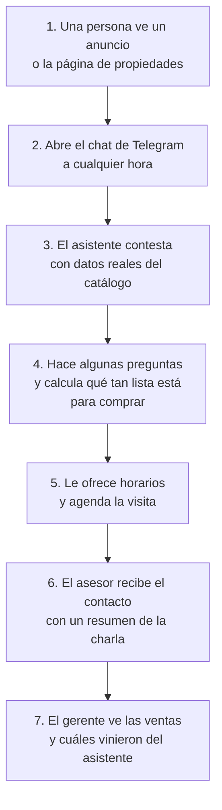
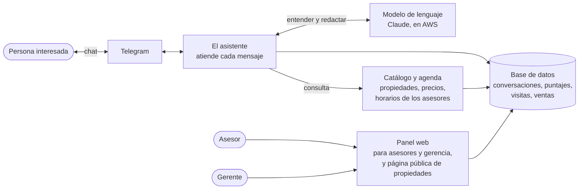
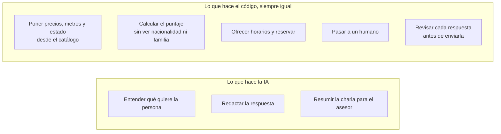
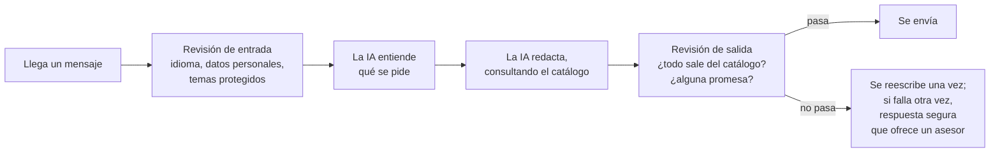
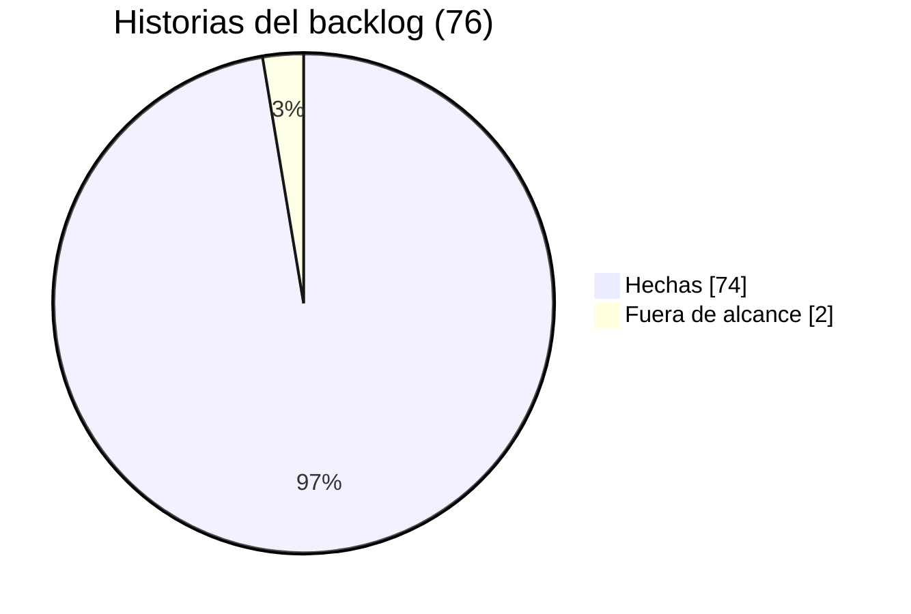

# Estado del proyecto — martes 14 de octubre de 2026

Pensado para quien no conoce el proyecto. Describe lo que el sistema **hace hoy**, con la evidencia de cada
cosa, no lo que se planeó. Los datos son de `main` al 14 de octubre (`e20360f`). La foto anterior es el
[estado del 9 de octubre](../../archive/presentations/2026-10-09-estado-del-proyecto.md); el detalle técnico de
cada pieza está en la [arquitectura por piezas](../../DESIGN/arquitectura-por-piezas.md).

## 1. En una frase

> **Un asistente por Telegram que atiende a quien pregunta por una propiedad, le contesta solo con datos reales
> del catálogo, lo califica, le agenda la visita y se lo pasa a un asesor humano con un resumen. La inmobiliaria
> ve en un panel quién está listo para comprar y cuánto vendió gracias al asistente.**

**Estado:** el alcance está terminado. Las 76 historias del backlog están cerradas (74 hechas y 2 fuera de
alcance), no hubo cambios de código desde el 9 de octubre y la demo en vivo por Telegram se hizo ese día. Lo
único abierto es una confirmación opcional de la evaluación ([§8](#8-qué-queda-pendiente)).

## 2. El problema y la solución

Los asesores contestan tarde a los interesados que sí van a comprar, y pierden tiempo con los que no. El
asistente atiende a todos de inmediato y le pasa al asesor solo a los que valen la pena, ya con el contexto.

En cualquier momento la persona puede pedir hablar con un humano, y el asistente lo pasa a un asesor.

## 3. Cómo funciona, sin tecnicismos

### 3.1 Las piezas

Todo corre en una sola máquina con Docker. Lo único externo es el modelo de lenguaje (Claude, de Anthropic, en
Amazon Bedrock).

### 3.2 Quién decide qué

La idea central del diseño: **la inteligencia artificial entiende y redacta, pero los datos y las decisiones
los pone el código.** Así el asistente no puede inventar un precio ni discriminar.

- **La IA no escribe los datos de una propiedad.** Escribe un marcador como `{precio}` y el código lo
  reemplaza con el valor del catálogo.
- **La IA no pone la nota.** Solo detecta lo que dijo la persona (presupuesto, urgencia, quién decide). El
  puntaje lo calcula una fórmula fija.
- **Lo que el catálogo no dice, no lo afirma.** Ante "¿tiene parqueadero?" contesta que lo confirma un asesor.

### 3.3 Un mensaje, paso a paso

Un mensaje tarda unos 6 segundos en contestarse cuando hace falta redactar, y menos de 2 cuando la respuesta la
da el código (horarios, traspaso, aviso de idioma).

## 4. Qué hace hoy, y cómo lo sabemos

La columna de evidencia distingue tres niveles: **en vivo** es que se vio funcionar con el modelo real (en la
evaluación del 8 de octubre o en la demo del 9); **en el stack** es que se comprobó con los servicios
levantados, sin una persona usándolo; **con tests** es que está construido y lo cubren las pruebas
automáticas, pero nadie lo usó en vivo.

| Capacidad | Evidencia |
| :--- | :--- |
| Conversar por Telegram, empezando desde el enlace de una propiedad (con su foto) o desde cero | En vivo |
| Contestar con datos del catálogo: precio, tamaño, habitaciones, disponibilidad, amenidades, requisitos, promociones | En vivo |
| Buscar por zona, operación, tipo de inmueble y presupuesto; si no hay nada, ofrecer lo más parecido | En vivo |
| Decir en qué zonas hay inventario, sin inventar barrios | En vivo |
| Calificar con un puntaje de 0 a 100 (FRÍO, TIBIO, CALIENTE) y comprobar los requisitos de compra | En vivo |
| Ofrecer tres horarios del asesor y reservar el que elija la persona | En vivo (evaluación del 8-oct; en la demo del 9 la persona pidió un humano antes de elegir) |
| Pasar a un asesor cuando la persona lo pide o después de agendar | En vivo |
| Contestar solo en inglés: un mensaje en español recibe un aviso fijo | En vivo |
| No dejar que la nacionalidad o la familia influyan, y decirlo si la persona pregunta | En vivo |
| Retener la dirección exacta hasta que la persona esté calificada | En vivo |
| Resumen de la conversación para el asesor, escrito por la IA y revisado como cualquier respuesta | En vivo (demo del 9-oct) |
| Avisos al asesor en el panel cuando un contacto califica y cuando se le traspasa | En vivo (demo del 9-oct) |
| Aviso al asesor por Telegram, si registró su chat | En vivo |
| Panel del asesor: cola ordenada por puntaje y tomar un contacto | En vivo |
| Embudo de conversión | En vivo |
| Página pública con las propiedades disponibles y un botón a Telegram por cada una | En el stack (9-oct: 9 propiedades, cada una con su enlace) |
| Ficha del contacto con puntaje, conversación y visitas | Con tests |
| Registrar una venta cerrada desde la ficha | Con tests |
| Vista de negocio: propiedades vendidas, días en el mercado, inventario estancado, demanda sin atender, ventas atribuidas al asistente | Con tests, y se muestra con seis meses de historia de ejemplo |
| Recordatorio de la visita el día anterior y seguimiento tras 24 horas de silencio | Con tests |
| Pasar a un humano si la persona se muestra molesta tras varios mensajes sin resolver | Con tests |
| Reporte semanal al gerente por Telegram (opcional, hay que configurar el destinatario) | Con tests |

**Qué no hace:**

- **Solo inglés**, y solo el inventario de demostración: 12 propiedades en Medellín y Bogotá, en dólares.
- **No hay pantalla para cargar propiedades.** Por eso las alertas de "avísame si sale algo así" se guardan pero
  en la práctica nunca se disparan.
- **Nada fuera del catálogo:** parqueadero, mascotas, cuota de administración o temas legales los confirma un
  asesor. No negocia, no aparta y no opina.
- **La agenda es propia**, no está conectada a un calendario externo.
- **Una conversación a la vez.** La cuenta de AWS permite 10 llamadas por minuto a cada modelo, y un mensaje usa
  unas 2,4. Si escriben varias personas a la vez, alguna puede recibir un texto de respaldo.
- **No está en producción:** todo corre en local con Docker.

## 5. Cuánto se puede confiar

**Evaluación del 8 de octubre** contra el modelo real: los 12 escenarios de la demo, 5 veces cada uno.

| Qué se midió | Resultado |
| :--- | ---: |
| Mensajes que cumplieron todo lo esperado (285 en total) | **99,6%** |
| Usó la herramienta del catálogo correcta | 100% |
| Tuvo que reescribir la respuesta | 6% |
| Terminó en la respuesta segura | 0,4% (1 mensaje) |
| Tiempo de respuesta, mediana y peor 5% | 6,3 s y 9,8 s |
| Preguntas nuevas, nunca vistas por el equipo al ajustar el asistente (37 mensajes, leídos uno por uno) | **0 errores graves**: ningún dato inventado ni promesa falsa |
| Costo | Menos de 2 centavos de dólar por mensaje |

**Demo en vivo del 9 de octubre**, una persona escribiendo por Telegram:

- 10 mensajes en 5 minutos, desde el anuncio hasta el traspaso a un asesor.
- Ningún dato inventado, ninguna respuesta reescrita, ningún error en los registros.
- Funcionaron el aviso de idioma, la respuesta fija ante "I'm Colombian", la dirección retenida y "lo confirma un
  asesor" ante el parqueadero.
- Costo total: unos 13 centavos de dólar.
- **Lo que no se vio:** la reserva de la visita (la persona pidió un humano antes de elegir horario) y el
  contacto como CALIENTE (no dijo quién decide ni cuándo, así que quedó TIBIO, 50 de 100).

**Lo honesto:** el conjunto de preguntas nuevas es pequeño (37 mensajes) y lo escribió el equipo. "0 errores
graves" es compatible con una tasa baja, no con una nula: de cada cien respuestas, una o dos salen como
respuesta segura.

**Cómo se comprueba:** unas 2 700 pruebas automáticas corren en cada cambio. Incluyen conjuntos de casos que
fallan si el asistente inventa datos, filtra la dirección o puntúa distinto a dos personas que solo difieren en
nacionalidad o familia. Las 71 decisiones de diseño están registradas con su porqué.

## 6. Cómo está el trabajo

| Grupo | Qué cubre | Hechas |
| :--- | :--- | ---: |
| Contratos y entorno | Reglas entre servicios, pruebas automáticas, arranque con Docker | 9 / 9 |
| Motor del asistente | Conversación, puntaje, revisiones, traspaso, tareas programadas | 18 / 18 |
| Canal y panel | Telegram, panel de asesores, agenda, fotos, botones, página pública | 15 / 16 |
| Datos | Catálogo, base de datos, casos de prueba | 10 / 11 |
| Calidad y observabilidad | Trazas, embudo, pruebas de extremo a extremo | 8 / 8 |
| Cierre y demo | Endurecimiento, documentación, demo ensayada | 4 / 4 |
| Inteligencia comercial | Ventas, atribución, rotación, demanda, reporte al gerente | 10 / 10 |

Las dos fuera de alcance son las notas de voz (B-14) y las preguntas frecuentes con búsqueda semántica (C-5).
Pasaron a trabajo futuro.

## 7. Qué cambió desde el 9 de octubre

- **Se hizo la demo en vivo por Telegram** (§5), con Bedrock real y sin incidentes.
- **Se fusionó el PR #261:** documentación reorganizada para quien llega por primera vez, la arquitectura por
  piezas y las diapositivas en inglés.
- **Ningún cambio de código.**

## 8. Qué queda pendiente

| Qué | Por qué importa | Estado |
| :--- | :--- | :--- |
| **#259**: repetir la evaluación de los conjuntos de jurado con el código congelado | Confirmaría que el último ajuste (los artículos en los títulos) no rompió nada. El riesgo es bajo: la demo × 5 ya pasó por esas partes | Abierto y condicional: necesita créditos de AWS (unos 90 minutos y US$4). Si no hay, se cierra y las cifras se presentan como están |
| **Fusionar dos correcciones de documentación** que quedaron fuera del PR #261 | Sin ellas, cuatro diagramas de la arquitectura por piezas no se ven en GitHub, y la guía de pruebas no explica por qué las trazas no guardan el texto | Vienen en el PR de este documento |

**Trabajo futuro, que no cuenta como pendiente:** preguntas frecuentes con búsqueda semántica, notas de voz,
fichas con más detalle (parqueadero, mascotas, administración), buscar sin indicar la ciudad, comparar el
ingreso con dos propiedades a la vez, bajar el costo con *prompt caching* y WhatsApp como segundo canal.

## Glosario

| Término | Qué es |
| :--- | :--- |
| Lead / contacto | La persona interesada en una propiedad |
| Asesor | La persona de la inmobiliaria que cierra la venta o el arriendo |
| Puntaje BANT-E | Qué tan lista está para comprar: presupuesto (*Budget*), quién decide (*Authority*), si hay propiedades que le sirvan (*Need*), cuándo (*Timing*) y si cumple los requisitos (*Eligibility*). De 0 a 100 |
| FRÍO, TIBIO, CALIENTE | Bandas del puntaje (COLD hasta 40, WARM de 41 a 70, HOT desde 71). Desde TIBIO se avisa al asesor |
| Traspaso | Cuando la conversación pasa de la IA a un asesor humano |
| Respuesta segura | Un texto fijo que ofrece un asesor, cuando la IA no logra una respuesta verificable |
| Modelo de lenguaje | La IA que entiende y redacta (Claude Sonnet 4.5 y Claude Haiku 4.5, de Anthropic) |
| Trazas (Phoenix) | El registro de tiempos, costos y decisiones de cada mensaje. No guarda el texto de la conversación, que es un dato personal y vive en la base de datos |
