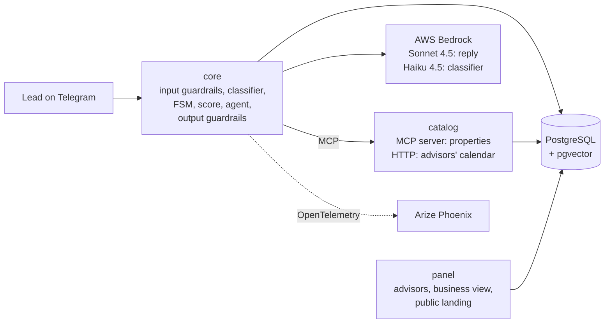

# Agentic system requirements: how the Real Estate Lead Agent covers them

Source document for a slide. It walks through the twelve aspects the course lists for a robust agentic system
and says, for each one, what the project actually does, where the evidence is, and what is missing and why.
Everything here describes `main` as of 15 October 2026 (`7089302`). When an aspect was not covered, it says so;
when there is a recorded decision behind it, it cites the decision (`DT-n` in
[`docs/DECISIONS/decisions.md`](../../DECISIONS/decisions.md)); when there is none, it says that too.

## 1. The system in one paragraph

A Telegram assistant for a real estate agency. It answers people interested in a property using only the
agency's catalog, qualifies them with a BANT-E score, books a visit and hands them over to a human advisor with
a summary. Advisors work from a web panel that ranks their leads; the manager sees the funnel and the business
view. Three own services (`core`, `catalog`, `panel`) plus PostgreSQL and Arize Phoenix run with Docker
Compose. The only external dependency is the LLM: Claude Sonnet 4.5 and Claude Haiku 4.5 on AWS Bedrock.

Each turn: **input checks** (deterministic rules) → **understanding** (Haiku labels the message) → **deciding**
(code, not the model, picks the route through a state machine) → **writing** (Sonnet replies, calling catalog
tools) → **output checks** (the reply is compared against what the tools returned; rewritten once, then a safe
fallback).

## 2. Coverage at a glance

| # | Aspect | Status | One-line answer |
| :-: | :--- | :--- | :--- |
| 1 | LLM as the brain, model swappable | **Met** | Claude on Bedrock behind an `Agent` interface; the model is an environment variable |
| 2 | Cloud-agnostic agent framework | **Not met to the letter (deliberate)** | Own harness instead of LangGraph & co. (DT-22); it has no cloud dependency |
| 3 | A proper UI | **Met** | Telegram for leads (mobile by nature), responsive web panel for advisors, public landing page |
| 4 | Login for critical components | **Partial** | Secret per-advisor token in the panel URL (DT-5); no login form, no expiry; core API and Phoenix rely on binding to localhost |
| 5 | Scalable vector DB for RAG | **Not met** | pgvector installed and a FAQ table created, but the FAQ (C-5) was moved to future work; answers come from structured MCP tools |
| 6 | Local, scalable observability | **Met** | Arize Phoenix self-hosted, OpenTelemetry traces per turn (DT-9, DT-18); Jaeger plan B verified (DT-31) |
| 7 | Docker Compose deployment, no Kubernetes | **Met** | One `docker-compose.yml`, hardened containers, one command to start |
| 8 | A designed system prompt per agent | **Met** | Three system prompts (classifier, chat, handoff summary) plus a correction prompt |
| 9 | At least one tool (MCP) | **Met** | Own MCP server with 6 catalog tools and JSON Schema contracts |
| 10 | Use a skill (agentskills.io) | **Not met** | No skill in the repository and no recorded decision about it |
| 11 | Safety measures / guardrails | **Met** | 6 input detectors, 4 output checks, gold sets that fail CI if they regress |
| 12 | Memory and context management | **Met** | Per-conversation state in PostgreSQL, 20-message window, row lock per conversation, handoff summary |

Score for the slide: **8 met, 1 partial, 3 not met** (one of those three by explicit design decision).

## 3. Aspect by aspect

### 3.1 LLM as the brain, swappable with few changes — Met

**What we built**

- Two Claude models on AWS Bedrock (DT-6): **Sonnet 4.5** writes the replies and calls the tools; **Haiku 4.5**
  classifies each message into structured fields (intent, budget, who decides, urgency, wants a visit, when,
  which property they mean, frustration…). A third call with Sonnet writes the handoff summary.
- All calls go through the Bedrock **Converse API** (`services/core/app/bedrock_llm.py`), which is the same for
  every model Bedrock serves.
- The agent is a Python `Protocol` (`Agent` in `services/core/app/agent.py`) with two implementations:
  `BedrockAgent` and `FakeAgent` (templates, no credentials, used for the offline demo, CI and the end-to-end
  harness). `services/core/app/llm_config.py` picks one from `LLM_PROVIDER` and fails at startup if the
  configuration is invalid.

**How easy is it to change the model**

| Change | Effort |
| :--- | :--- |
| Another model available on Bedrock (another Claude, or any model the Converse API supports) | Zero code: change `BEDROCK_MODEL_ID_CHAT` / `BEDROCK_MODEL_ID_CLASSIFIER` in `.env` |
| Another provider (OpenAI, Gemini, a local model) | One new class implementing `Agent` (or the LLM client inside it); the turn, the state machine and the guardrails don't change (DT-22, "Consequences") |
| No model at all | `LLM_PROVIDER=fake` |

**Honest caveat:** a second provider has not been written, so the "one new class" claim is a design property,
not something exercised. The prompts and the evaluation were tuned for Claude Sonnet / Haiku 4.5.

### 3.2 Cloud-agnostic agent framework — Not met to the letter, by decision

**What we did instead.** No LangChain, LangGraph, CrewAI, Pydantic AI or DeepAgents. The orchestration is own
code, and the team can explain every part of it:

- The **state machine** is a table `(state, trigger) → state` in `services/core/app/fsm.py` (states GREETING,
  DISCOVERY, QUALIFY, RECOMMEND, SCHEDULE, NURTURE, HANDOFF, HUMAN_HANDOFF, LOST).
- The **tool loop** is in `BedrockLLM._converse_loop`: the model asks for a tool, code runs it against the MCP
  catalog, returns the result, up to `MAX_TOOL_ROUNDS = 3`.
- **Retries** with exponential backoff and jitter for transient Bedrock errors (DT-30), and a **rate limiter**
  per model (10 requests/minute, DT-19).

**Why (DT-22).** LangGraph was evaluated piece by piece. Its checkpointer would be a second source of truth next
to PostgreSQL (DT-1); a graph of nodes would split the single transaction that saves state, score, audit and
messages; and the tool loop it would replace is short and holds guarantees we need to keep visible
(arguments fixed by code such as `lead_qualified`, the rate limiter, the safe fallback on errors). Pydantic AI,
CrewAI, DeepAgents and Strands were discarded because they target several collaborating agents or tie to a
provider, and this flow is one agent with a state machine.

**Cloud-agnostic?** Yes in the sense that matters here: the orchestration depends on no cloud. The only
provider dependency is the LLM client, isolated behind the `Agent` interface.

**Accepted downsides (also in DT-22):** we maintain code a framework would give us (tool loop, retries,
history); no built-in streaming, human-in-the-loop interrupts or parallel tools. The decision itself
acknowledges that it doesn't satisfy a requirement that names a framework, and leaves a contingency plan: a
two-node LangGraph `StateGraph` (call model ⇄ run tools) inside `BedrockAgent`, without touching the turn or
the state machine. That plan was not executed.

### 3.3 A proper UI — Met

| User | Interface | Notes |
| :--- | :--- | :--- |
| Lead (the buyer or tenant) | **Telegram** bot (`python-telegram-bot`, long polling, DT-4, DT-20) | Mobile-first by nature; the conversation can start from a property link (`?start=prop_…`) |
| Advisor | **Web panel** (FastAPI + Jinja2, server-rendered) | Lead queue ordered by score, lead profile with transcript, visits and notifications, "take the lead", record a closed deal |
| Manager | Same panel: **funnel** and **business view** | Properties placed, days on market, stale inventory, unmet demand, deals attributed to the bot |
| Anyone | **Public landing** `/properties` (DT-71) | One Telegram link per available property |

Why not Streamlit, Chainlit or Gradio: the lead's channel had to be a messaging app, not a web chat, and the
panel is a few server-rendered pages, which FastAPI + Jinja2 serve without another runtime. The panel and the
landing include a mobile viewport, a responsive breakpoint and dark mode. There is no TUI; none is needed for
these users.

### 3.4 Login for the critical components — Partial

**What exists (DT-5).** Each advisor gets a secret static token (`Advisor.access_token`) and enters through
`/panel/<token>`. Anything that doesn't belong to the token's advisor returns a **uniform 404**, never 401/403,
so the status code doesn't reveal whether a token exists (`services/panel/app/auth.py`). The public landing is
open on purpose (DT-71).

**What is missing, stated plainly**

- No login form, no password, no session expiry, no 2FA. The token *is* the session and it doesn't expire.
- The `core` API (`POST /events`) and the Phoenix UI have no authentication. Their protection is that every
  port is published only on `127.0.0.1` by default (`BIND_ADDRESS` in `docker-compose.yml`).

**Why.** DT-5: three known advisors, a demo that runs on one machine; a magic link needs an email provider and
OAuth needs a registered app, for marginal benefit at this size. DT-5 records that this is **not
production-grade authentication**. A real deployment would need a proper login for the panel and
authentication in front of `core` and Phoenix.

### 3.5 Scalable vector database for RAG — Not met

**What exists.** PostgreSQL runs the `pgvector/pgvector:0.8.6-pg16` image, the first migration enables the
`vector` extension and creates `faq_entries` with an `embedding vector(384)` column, and DT-7 already chose a
self-hosted embeddings model. The table is **empty and unused**: no embeddings are generated and nothing
retrieves from it.

**Why it stopped there.** The FAQ story (C-5, issue #31) was moved to future work on 7 October, outside the
capstone. The recorded reason: the catalog and DT-66 cover what the FAQ was going to answer.

- The agent's knowledge is **structured** (price, size, bedrooms, requirements, availability, promotions,
  areas). It is retrieved with exact filters through MCP tools, not by semantic similarity, and that exactness
  is what lets the output check compare every figure in the reply against the tool result.
- What the catalog doesn't record (pets, fees, floor, nearby places…) is not answered yes or no: the classifier
  flags it (`asks_unlisted`) and the agent says an advisor will confirm (DT-66).

**Slide wording suggestion:** "RAG infrastructure in place (pgvector), retrieval done through structured MCP
tools; semantic FAQ deferred." Do not present it as RAG working.

### 3.6 Local, scalable observability — Met

- **Arize Phoenix**, self-hosted as one container in the compose file, version pinned, with its own volume
  (DT-9). It receives **OpenTelemetry** traces over OTLP.
- Auto-instrumentation of Bedrock and MCP calls (`openinference-instrumentation-bedrock`,
  `openinference-instrumentation-mcp`) plus manual spans per turn: `turn`, `guardrail.input`, `fsm.advance`,
  `catalog.<tool>`. Each turn records what the classifier understood, the route taken and which check fired,
  with timings and tokens.
- **Privacy by design (DT-18):** message text appears as `__REDACTED__` in the traces; it lives only in
  PostgreSQL.
- Also: JSON logs in all three services (DT-27), `audit_log` with every guardrail that fired, and
  `funnel_events` behind the panel's funnel.

**Why not Langfuse or LangSmith.** LangSmith is a hosted service; the requirement is local. Langfuse self-hosted
needs several extra services including Redis, against the "no Redis" rule of DT-3 (DT-9). **Plan B (DT-31):**
because the traces are standard OpenTelemetry, switching to Jaeger is one environment variable; verified with a
real turn on 24 September.

**On "scalable":** Phoenix runs as a single container, which is enough for one machine. Scaling it out was not
tested.

### 3.7 Deployment with Docker Compose — Met

`docker compose up --build` starts everything, with no credentials needed (fake model):

| Service | Role |
| :--- | :--- |
| `postgres` | PostgreSQL 16 + pgvector, single source of truth (DT-1) |
| `phoenix` | Traces |
| `migrate`, `seed` | One-shot: Alembic migrations, demo data (3 advisors, 12 properties, 3 promotions) |
| `catalog` | MCP server + calendar HTTP API |
| `core` | Telegram bot, turn engine, embedded scheduler (DT-3, DT-44) |
| `panel` | Advisors, business view, landing |
| `harness` | End-to-end replay of scripted conversations |

No Kubernetes, no Redis, no queue broker: the scheduler runs inside `core` with its jobs in PostgreSQL. Own
containers are hardened (`read_only`, `cap_drop: ALL`, `no-new-privileges`, only `/tmp` writable). Product
settings live in `config/<service>.env`, secrets in `.env` (DT-48). `scripts/demo/up.sh` and `down.sh` wrap the
demo start and stop.

### 3.8 A designed system prompt — Met

Three system prompts, in English, in `services/core/app/bedrock_llm.py`:

| Prompt | Model | Design choices |
| :--- | :--- | :--- |
| `CLASSIFIER_SYSTEM` | Haiku 4.5 | JSON only, closed taxonomy for every field, extracts only from the current message, explicit "do not infer origin, religion, gender, nationality or family situation" |
| `CHAT_SYSTEM` | Sonnet 4.5 | Every property fact comes from a tool and is written as a **marker** (`{prop_00231.price}`) that code fills in (DT-60); search first instead of asking for filters; never name an area from memory; exact address only once qualified; no discounts, holds or credit promises; no opinions, legal advice or pressure; fair housing; visits are booked by the system, not the model; one question per message |
| `SUMMARY_SYSTEM` | Sonnet 4.5 | JSON with three keys (what they want, objections, next step); every fact must be in the conversation; same prohibitions as the chat |

Plus a **correction prompt** (`_correction_prompt`) that tells the model which check its draft failed when a
reply is rewritten. The prompts evolved with the live evaluation; the classifier has its own gold set of 93
messages and a baseline no field may drop below (`harness/gold/`).

The key design idea for the slide: **the prompt is not the only safety layer**. The rules that protect the
agency are also enforced in code (markers, arguments fixed by code, output checks).

### 3.9 At least one tool, MCP — Met

**Own MCP server** in the `catalog` service (`services/catalog/app/server.py`, `mcp==1.30.0`, streamable HTTP
transport, DT-2, DT-10). Six tools:

| Tool | What it returns |
| :--- | :--- |
| `search_properties` | Matches by area, operation, property type and budget; closest alternatives when nothing matches (DT-57) |
| `get_property` | One listing, including the operation's requirements (DT-56); exact address only if `lead_qualified` |
| `get_availability` | Current status of a property |
| `get_promotions` | Active promotions |
| `check_requirements` | Whether a lead's down payment / income / references meet a property's requirements |
| `list_zones` | The areas the agency covers (DT-58) |

- Each tool's input and output has a **JSON Schema contract** in `contracts/mcp/`, with valid and invalid
  examples tested in `tests/contracts`.
- The client **discovers** the tools at runtime instead of hard-coding names (DT-13).
- `lead_qualified` is removed from the schema the model sees and **injected by code**, so the model cannot ask
  for the exact address (DT-19).
- The advisors' calendar (slots, booking, advisor assignment) is served by the same service over **plain
  HTTP, not MCP** (DT-32): booking is decided by code, never by the model.

### 3.10 Use a skill — Not met

There is no skill in the repository (no `SKILL.md`, nothing following the agentskills.io specification), and
there is **no architecture decision about skills**: the topic was not considered during the project. This
should be presented as a gap, not as a deliberate choice.

What is closest today, without being a skill: the domain rules are packaged as system prompts plus code
(section 3.8) and the catalog capabilities as MCP tools (section 3.9). Packaging, for example, the visit-booking
or requirement-checking know-how as a skill would be future work; it has not been designed.

### 3.11 Safety measures and guardrails — Met

**Input (deterministic rules, before the state machine and the LLM; DT-15, `services/core/app/input_guard.py`)**

| Detector | Action |
| :--- | :--- |
| Opt-out (`/stop`) | Cancels pending jobs, marks consent withdrawn, confirms |
| Unrequested personal data (ID, card numbers) | Removed before storing or sending to the model |
| Jailbreak / prompt extraction | Treated as a normal domain question; stored as `[message omitted]` so it never returns as history |
| Off-topic, or formal legal/tax/credit advice | Bounded answer and offer of an advisor |
| Protected characteristics (origin, religion, family, gender, nationality) | Never reaches the score or the model; if asked whether it matters, the answer is no |
| Language | Non-English messages get a fixed request to write in English |

**Output (before anything is sent; `docs/DESIGN/guardrails.md` §2)**

- **Factuality** (DT-23, DT-59, DT-60): figures in the reply must match what the tools returned; property data is
  written by code from markers.
- **Prohibited promises** (DT-26): discounts, holds, credit approval, closing.
- **Reserved address** (DT-25): the shape of an exact address before the lead is qualified.
- **Fair housing.**
- On failure the reply is **rewritten once**; if it fails again the lead gets a safe answer offering an advisor.

**Code over model:** the score is a deterministic function and the model never sets it; availability is
re-checked in code and fails closed (DT-21); a human is reachable from every state.

**Evidence:** one gold set per check (invented data, exact address, promises, fair housing, language) runs with
the test suites, and a pull request that drops one below its threshold fails CI (DT-37). Live evaluation on 8
October 2026 (285 turns): 6% of replies rewritten once, 0.4% fell back to the safe answer; a 37-turn held-out
set read by hand showed no invented data and no unauthorized promises.

### 3.12 Memory and context management — Met

- **Session = conversation.** Each lead's conversation is a row in PostgreSQL with its state machine state,
  context (`fsm_context`) and score (DT-1, DT-11). Nothing is kept in process memory.
- **Concurrency:** each turn takes a row lock (`SELECT … FOR UPDATE`) on the conversation, so two messages from
  the same lead are processed one after the other (DT-12); state, score, audit and messages are saved in one
  transaction.
- **Context window:** the chat model sees the **last 20 messages**; the classifier sees only the current message
  and the last assistant reply, plus the list of properties already shown so it can resolve "the cheaper one"
  or "it" (DT-63).
- **What is remembered is filtered:** personal data and protected characteristics are removed before storing, so
  they never come back as history (DT-19).
- **Across sessions:** a returning lead's new conversation inherits the score signal and qualification
  (DT-29). Silence is handled by the scheduler: follow-ups after 24 hours, then NURTURE and LOST (DT-44).
- **Handing context to a human:** at handoff the model writes a summary (what they want, objections, next step)
  that is checked like any reply and stored on the lead (DT-46).

**Not done:** no compaction or summarization of long conversations beyond the 20-message window, and no
semantic long-term memory. Neither was needed for conversations of this length.

## 4. Numbers worth putting on the slide

| Metric | Value | Source |
| :--- | :--- | :--- |
| Turns that met every expectation | 99.6% (285 turns, 5 runs × 12 scenarios, real model) | README, Results |
| Expected catalog tool used | 100% | README, Results |
| Rewritten once / safe fallback | 6% / 0.4% | README, Results |
| Median / p95 response time | 6.3 s / 9.8 s | README, Results |
| Model calls and cost per turn | ~2.4 calls, ~6,100 tokens, under 2 US cents | README, Results |
| Architecture decisions recorded | 71 (DT-1 to DT-71) | `docs/DECISIONS/decisions.md` |
| Backlog | 76 stories closed (74 done, 2 out of scope) | Status of 14 October |

Known limits to state if asked: English only; 12 demo properties; Bedrock quota of 10 calls per minute per model
means one conversation at a time; local deployment only, Telegram long polling; not production-ready.

## 5. Suggested slide

**Title:** Agentic system checklist: 8 met, 1 partial, 3 gaps

| Met | Partial | Gaps (and why) |
| :--- | :--- | :--- |
| Claude on Bedrock, model = env var · Telegram + responsive panel · Phoenix + OpenTelemetry · Docker Compose · 3 designed system prompts · own MCP server, 6 tools · input and output guardrails with gold sets in CI · session state in PostgreSQL | Panel access by secret per-advisor token (no login form, no expiry) | **Framework:** own harness by decision (DT-22) · **RAG:** pgvector ready, FAQ deferred; answers come from structured tools · **Skills:** not addressed |

**Speaker note:** "The model understands and writes; code decides and supplies the data." That is why the
framework was skipped and why retrieval is done through exact tools instead of embeddings.
