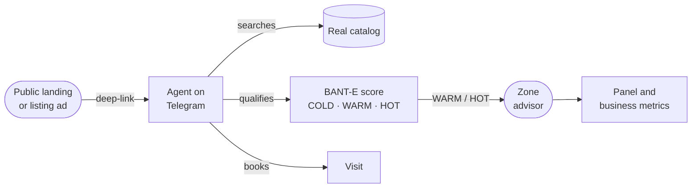
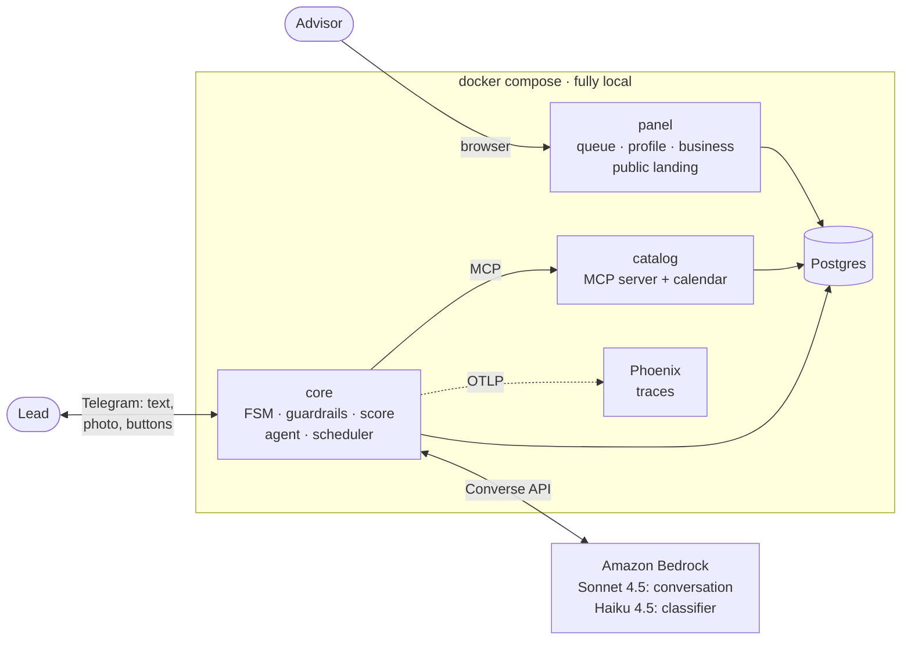

# Real Estate Lead Agent

Project status · October 9, 2026

Team #2 · SoftServe Project Lab 
Santiago Martínez · David Barreto · Miguelangel Vélez

<!--
Introduce the team in one sentence. Mention there is a live demo halfway through.
-->

---
layout: center
---

# Agenda

① Product goal

⑤ Live demo

② Backlog status

⑥ Key points: how much we can trust it

③ A typical story

⑦ What is left

④ Architecture

⑧ Questions

<!--
10 seconds. These are the points of the brief: first where we are, then what is left.
-->

---
layout: statement
---

# Advisors answer good leads **too late** and waste time on the ones who **will never buy**

<!--
The problem in one sentence. Pause before moving on to the solution.
-->

---

# ① Product goal

A <b>Telegram</b> agent that answers prospects at any hour, <b>qualifies</b> them, recommends <b>real</b>
listings, <b>books the visit</b> and hands them to an advisor ready to close.

In English, with inventory in Colombia (Medellín and Bogotá) and prices in US dollars.

<!--
Read the highlighted sentence. Walk the diagram left to right: the lead comes from a listing and ends up as a business metric.
-->

---

# Three non-negotiable rules

🔎

### The LLM never makes things up

It doesn't write listing data: it writes a marker (`{prop_00231.price}`) and the code fills in the
catalog value. What the catalog doesn't say, an advisor confirms.

⚖️

### The LLM never scores

It only extracts signals. Python computes the score, auditable and tested, and it never sees
nationality, marital status or family.

🙋

### A human is one tap away

Anyone can ask for an advisor at any point in the conversation.

<!--
These three rules explain almost every architecture decision. We come back to them in the demo.
-->

---
layout: fact
---

# 74 of 76

stories done · **214 of 220 points** delivered · **0 open**

2 out of scope: B-14 (voice notes) and C-5 (FAQ with embeddings), both future work 
Since October 7: 9 PRs merged and 6 issues closed, including the closing stories Z-1 and Z-2

<!--
② Backlog. The big number first; details on the next slide.
-->

---

# ② Backlog status

| Epic | Done | Out of scope |
| :--- | ---: | :--- |
| **E0** Contracts and environment | 9 / 9 | — |
| **E1** Agent engine | 18 / 18 | — |
| **E2** Channel and panel | 15 / 16 | B-14 voice notes |
| **E3** Data and knowledge | 10 / 11 | C-5 FAQ |
| **E4** Observability and quality | 8 / 8 | — |
| **E5** Closing and demo | 4 / 4 | — |
| **E6** Business intelligence | 10 / 10 | — |

**How we organize it**

- Every story is an issue with epic, track, priority P0-P2 and points (1 point ≈ 2 h).
- The GitHub Projects board is the **only** source of status.
- Parallel tracks: **core** (engine), **edge** (channel and panel), **data** (catalog) and **cross** (CI, docs, demo).
- Whatever live testing finds becomes a `[gap]` or `[bug]` issue, without inflating the stories.
- 71 architecture decisions recorded, each with its context and alternatives.

<!--
Show the board live if there is time (10 s). New this week: B-16, the public landing page.
-->

---

# ③ A typical story: #247, the jury test

<b>Goal:</b> a jury can chat freely with the agent <b>without seeing a mistake</b>.

[gap] · P1 · core track · closing epic

**Exit criteria, fixed before running the held-out set**

- On questions the agent **never saw**: 0 serious errors (made-up data, promises, exact address, fair housing).
- At most one degraded answer every ten turns.
- The held-out set runs **once**, with no tuning before or after.

**Lesson**

Each text-level fix failed on the next phrasing. What moved into **structure** (a classifier field, a
marker written by the code) stopped failing on new phrasings too.

<b>Oct 7 · first jury set</b>19% degraded answers

→

<b>New sets N, M, O</b>~3 serious errors every 35 turns

→

<b>The classifier decides</b>DT-62 to DT-69, no new LLM calls

→

<b>Oct 8 · held-out set P</b>0 serious · 0 degraded

<!--
We picked #247 because it was the whole closing week and it shows how you measure an agent, not just how you build it. The development sets J, N, M and O were used to fix things, so they only measure regression; P measures generalization.
-->

---

# ④ Architecture

- **Only `core` chats with the lead and calls the LLM.** The catalog knows nothing about conversations.
- **The agent only sees what the catalog tools return** (MCP): that makes factuality checkable.

- **All state lives in Postgres**, one transaction per turn. Telegram via long polling: no public URL.
- **Hard limit: 10 LLM calls per minute**, about 4 turns per minute in total.

<!--
Reading order: lead → core → catalog and Bedrock → Postgres → advisor panel. Phoenix keeps one trace per turn with timings, tokens, tools and decisions, but NOT the message text (it shows __REDACTED__ on purpose, DT-18): conversations are personal data and live in Postgres, readable in the lead profile. The 10 RPM quota is why no fix this week added LLM calls.
-->

---

# What happens on every message

<b>Input guardrail</b>PII, protected data, language

→

<b>Haiku classifies</b>signals, intent, property, visit

→

<b>Sonnet + tools</b>only sees MCP tools

→

<b>Code fills markers</b>listing data

→

<b>Output guardrails</b>regenerate or safe answer

→

<b>BANT&#8209;E score + FSM</b>Python, saved with the turn

**Input:** opt-out, PII, jailbreaks and protected mentions ("I'm Colombian") are handled before anything
else sees them. A Spanish message gets a fixed "English only" reply.

**Output:** factuality against the catalog, reserved address until qualified, no unauthorized promises
and availability revalidated. One retry, then a safe answer that offers an advisor.

≈ 2.4

LLM calls per turn

6 s

typical answer time (p95 under 10 s)

1

transaction saves state, score, messages and audit

<!--
The three rules show up here: Python scores, the code writes the data, and nothing goes out without passing the guardrails. The classifier is one call that already existed; this week it got 11 fields instead of new calls.
-->

---
layout: center
class: text-center
---

# ⑤ Live demo

Telegram (lead) · Panel (advisor)

1. Arrives from the listing: photo

2. Writes in Spanish: language filter

3. Availability from the catalog

4. "Parking?": an advisor confirms

5. "I'm Colombian": fair housing

6. "Exact address?": reserved

7. Budget and urgency: HOT

8. Books a visit

9. Panel: queue, summary, deal

<!--
Before: bash scripts/demo/up.sh right before presenting (each seed changes the panel URLs), LLM_PROVIDER=bedrock, two screens, ONE person typing and nothing else running against Bedrock.
Link: t.me/<bot>?start=prop_00231
Messages (docs/DEMO.md): "Hola! ¿Sigue disponible?" → "Oh sorry! Is it still available?" → "Nice. Does it come with a parking spot? I have a car" → "I'm Colombian but I live in Miami, is that a problem?" → "Could you send me the exact address? I'd like to check out the area" → "And what would I need to buy it?" → "I have $40,000 saved, and my total budget is around $200,000" → "It's just me, I make the decision myself" → "I'd like to move in this month, it's kind of urgent" → "Great, can I go see it?" → "1".
Then Valeria Ortiz's panel: queue, profile with summary, close the deal, Business view.
Plan B without Telegram: python scripts/demo/conversar.py. Without Bedrock: docker compose run --rm --build harness, then show panel, funnel, landing and Phoenix.
-->

---

# ⑥ Key points: how much we can trust it

99.6%

turns OK over 285 turns against Bedrock

0

serious errors on questions the agent never saw

0

made-up data in any of the October 8 runs

&lt; 2¢

per turn at Bedrock list prices, about 8¢ per conversation

| Metric | Oct 6 baseline | Oct 8 closing | Threshold |
| :--- | ---: | ---: | ---: |
| Turns OK | 93% | **99.6%** | ≥ 90% |
| Expected tool called | 99% | **100%** | ≥ 90% |
| Regenerated answers | 24% | **6%** | ≤ 30% |
| Degraded (safe) answers | 4% | **0.4%** | ≤ 5% |
| Latency p50 / p95 | 5.9 s / 11.6 s | 6.3 s / 9.8 s | — |

Baseline: 8 scenarios, 180 turns. Closing: 12 scenarios, 285 turns. Same thresholds.

<!--
Honest caveat: P is a single set of 37 turns. "0 serious" is consistent with a low real rate, not a zero rate. One or two answers in a hundred come out as a safe answer.
-->

---

# Quality you can check in CI

1 300+

automated tests, on every PR

54 / 54

fair housing paired profiles with a score difference of 0

6

gold sets that turn CI red: factuality (2), markers, address, fair housing, language

71

architecture decisions recorded

- **CI runs without the LLM:** the gold sets use deterministic inputs (most of them the real demo catalog output), so they are fast and repeatable.
- **The live evaluation runs outside CI**, against the real model, and checks what ended up in Postgres
  (tools, guardrails, route, final state), not exact phrases.
- **Evidence is versioned:** every turn of the closing runs, with its tokens, is in the repository.

<!--
The message: we don't ask you to believe us, you can check it.
-->

---

# Risks and how we cover them

| Risk | Mitigation |
| :--- | :--- |
| The AWS credits show as expired | The live demo costs about $0.20 per run of the script; check the balance before presenting, otherwise plan B without Bedrock |
| 10 LLM calls per minute | One person types at a time; local rate limiter with a queue, and a safe answer if the wait runs out |
| A free conversation may show a quality slip | Known limits are documented: what the agent does and doesn't do by design |
| CI does not block merges (private repo, free plan) | Team agreement: never merge on red |

<!--
Show that we know the risks and that each one has a plan.
-->

---

# ⑦ What is left

The backlog is closed. What remains is <b>confirmation</b>, not scope.

**Before presenting**

- **#259** · re-run the jury sets on the frozen code (~90 min, ~$4). Conditional on AWS credits.
- Human rehearsal of the script on Telegram.
- Restart the stack so the panel shows no evaluation leads.

**Future work, outside the capstone**

- FAQ with embeddings (C-5) and richer listing details.
- Search without a city; compare income against two listings.
- Classifier fields as a schema instead of prose.
- Bedrock prompt caching: 96% of tokens are input.
- WhatsApp as another channel adapter.

<!--
If there are no credits, #259 is closed and the figures are presented as they are, stating which code they were measured on.
-->

---
layout: center
class: text-center
---

# ⑧ Questions

Architecture, one diagram per component: <code>docs/DESIGN/arquitectura-por-piezas.md</code>

<!--
Prepared answers:
- What if the LLM makes up a price? It can't write it: it writes a marker and the code fills in the catalog value (DT-60). A hand-written number that isn't from that listing is blocked: it regenerates once, then sends a safe answer offering an advisor.
- How do you know you didn't tune the agent to your own tests? The held-out set P: questions the agent never saw, run once, nothing touched before or after. 0 serious, 0 degraded. Declared weakness: it was written by the person who made the fixes.
- How do you avoid discrimination? The LLM only extracts signals and Python scores. Whether a protected category matters is decided by the classifier and the answer is fixed (DT-69); 54 paired profiles must keep a difference of 0 for CI to stay green.
- Which model and why? Claude on Amazon Bedrock: Sonnet 4.5 to converse, because Haiku didn't follow several prompt rules; Haiku 4.5 to classify in JSON (DT-6, DT-60).
- Why not a second LLM as a judge? One more call per turn with 10 RPM. The classifier returns fields and the code checks.
- How much does it cost? Under 2 cents per turn, about 8 per conversation, at list prices. 96% is input; prompt caching would lower it.
- What if many people write at once? 10 calls per minute is about 4 turns per minute in total. A local limiter queues the turn; past the maximum wait, it answers with a safe text. Production would need more quota.
- Why Telegram and not WhatsApp? Long polling keeps everything local with no public URL (DT-4). The channel sits behind a canonical event: WhatsApp would be another adapter (DT-20).
- Why do the traces look empty? They aren't: they hold timings, tokens, tools, route and guardrail decisions. Only the message text is redacted, on purpose (DT-18): it's personal data, so it lives in Postgres (messages table, lead profile in the panel), not in the observability tool.
- How do you know the bot sells? DT-41: a deal belongs to the bot if the lead touched that listing with the bot in the previous 60 days. The business view and the weekly report show it.
-->
